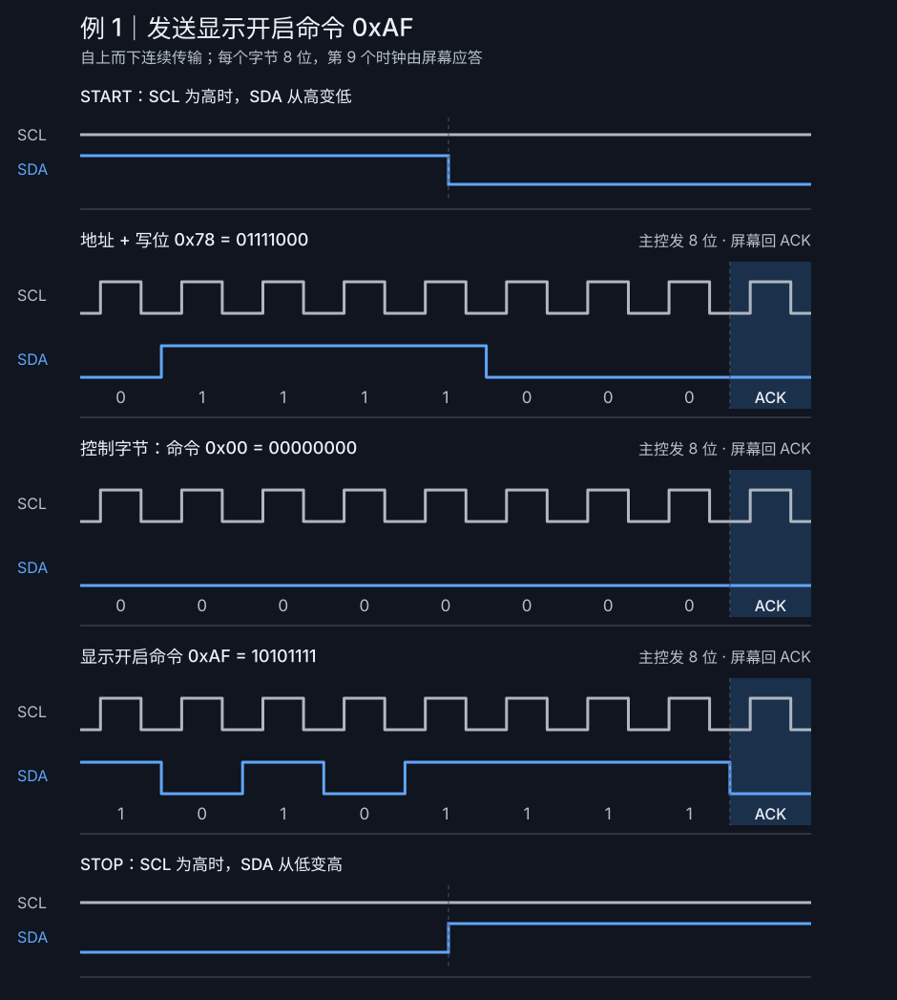
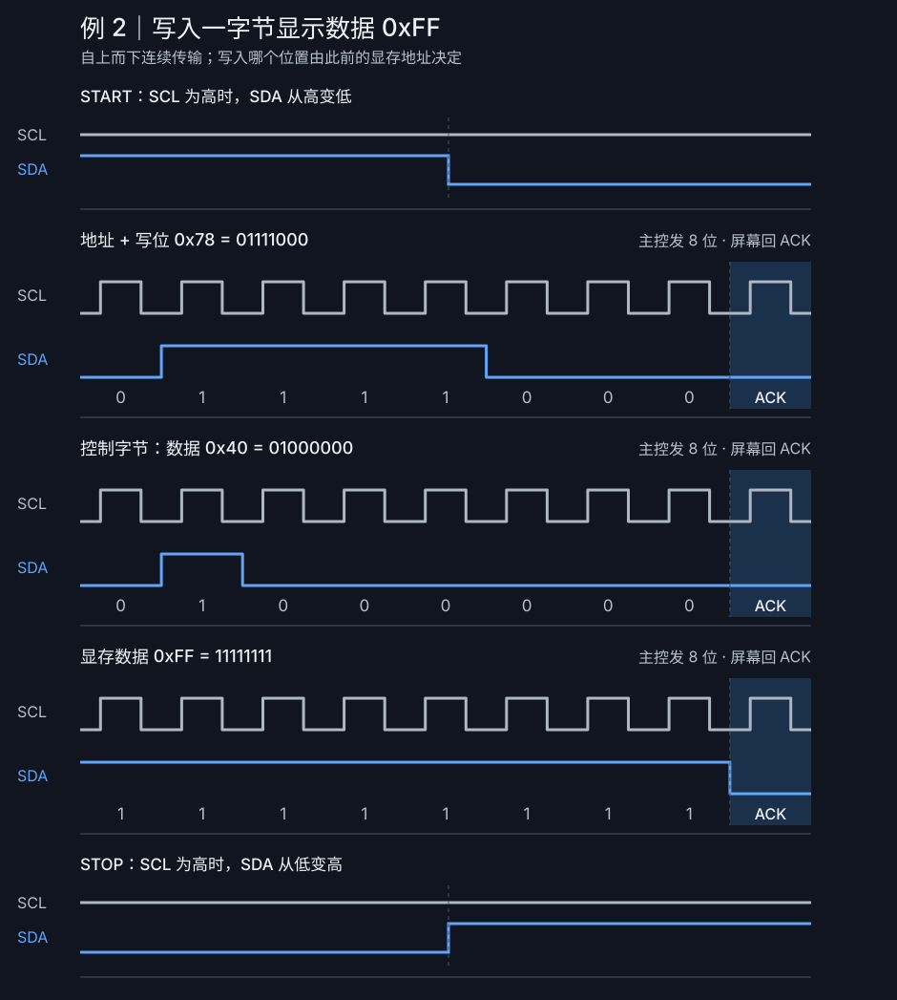
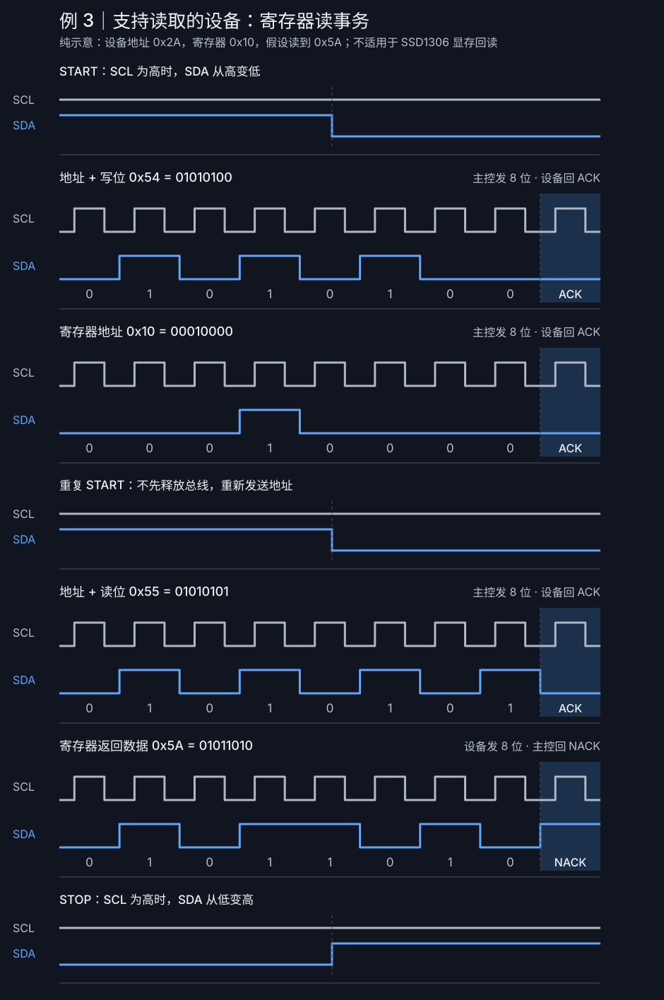
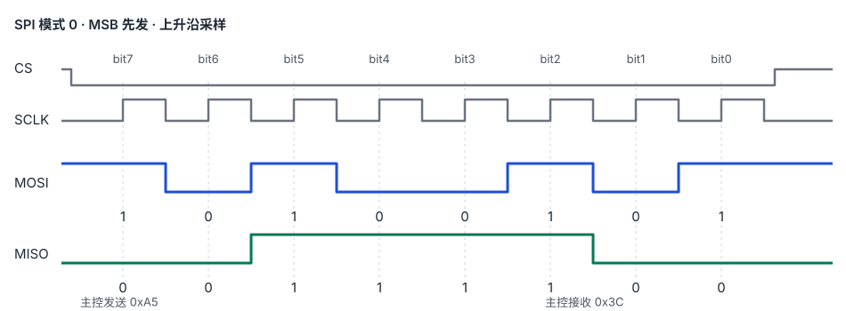
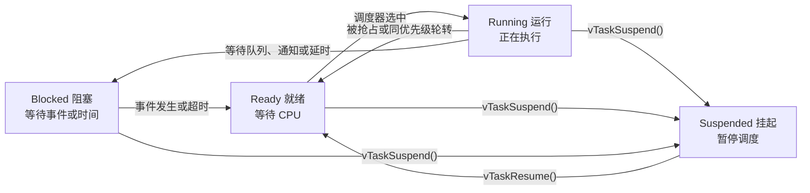
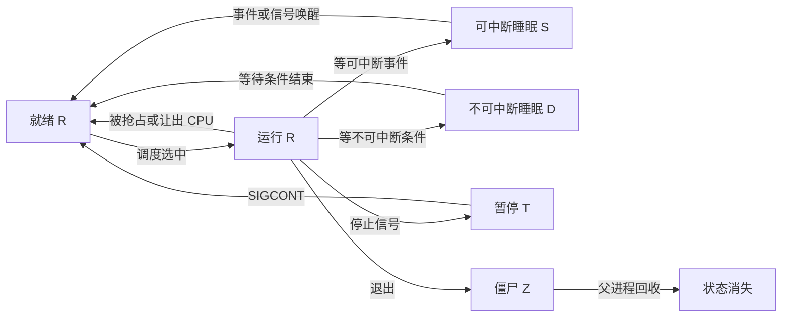

# 嵌入式面试知识点笔记

按主题整理面试经验，涵盖程序内存布局、Cortex-M 寄存器、中断与 HardFault、I2C、SPI、UART、Bootloader 与 OTA、C/C++、FreeRTOS、Linux 进程与线程，以及网络、调试和编程题。建议先掌握 **六大内存分区**，再用 `static`、`malloc`、任务栈等章节把概念串起来；同一知识点的新问题继续补充到对应小节。

[查看实习经历交互页](https://master869.github.io/interview-notes/internship.html) · [查看 SPI 逐拍时序演示](https://master869.github.io/interview-notes/spi-mode0.html)

## 目录

- [六大内存分区](#memory-layout)
  - [一段代码看变量位置](#memory-example) · [各区域的作用](#memory-regions) · [MCU 启动时发生什么](#memory-startup) · [常见追问](#memory-questions)
- [Cortex-M MCU 上电启动流程](#mcu-boot)
  - [复位与启动地址](#mcu-boot-reset) · [向量表与第一条指令](#mcu-boot-vector) · [启动代码和变量初始化](#mcu-boot-runtime)
- [Cortex-M CPU 寄存器](#cortex-m-registers)
  - [R0～R15](#core-registers) · [状态与控制寄存器](#special-registers)
- [中断与中断嵌套](#interrupts)
  - [一次中断的流程](#interrupt-lifecycle) · [中断嵌套](#interrupt-nesting) · [ISR 能做什么](#interrupt-isr-rules) · [ISR 与任务通信](#interrupt-task-communication) · [临界区与屏蔽中断](#interrupt-critical-section) · [面试追问](#interrupt-questions)
- [HardFault 定位](#hardfault)
  - [Keil 排查步骤](#hardfault-steps) · [寄存器现场例子](#hardfault-example) · [容易误判的情况](#hardfault-pitfalls)
- [Cache 与 DMA](#cache-dma)
  - [Cache 基础](#cache-basics) · [DMA 与缓存一致性](#dma-coherency)
- [ADC 模数转换与采样](#adc)
  - [ADC 怎样工作](#adc-basics) · [分辨率与采样率](#adc-resolution-rate) · [典型应用](#adc-applications) · [采样注意点](#adc-practical)
- [I2C 总线与显示屏通信](#i2c)
  - [基础时序](#i2c-signals) · [7 位地址与设备数量](#i2c-address-count) · [显示屏写入与寄存器读取](#i2c-examples) · [挂死、无应答与恢复](#i2c-stuck-bus)
- [SPI 通信](#spi)
  - [信号与通信流程](#spi-basics) · [模式 0 时序](#spi-mode0) · [面试常见问题](#spi-questions) · [I2C 与 SPI 的通信距离](#spi-i2c-distance)
- [UART 串口通信](#uart)
  - [一字节时序与 8N1](#uart-frame) · [接收与业务帧解析](#uart-reception) · [排障要点](#uart-debug) · [面试常见问题](#uart-questions)
- [CAN 总线基础](#can)
  - [控制器与收发器](#can-hardware) · [报文、仲裁与应答](#can-protocol) · [如何回答接口熟悉程度](#communication-experience)
- [CRC 校验](#crc)
  - [CRC8、CRC16、CRC32 的区别](#crc-width) · [一次校验怎么完成](#crc-process) · [外设如何配合](#crc-device) · [C 语言 CRC8 示例](#crc-example)
- [Bootloader 与 OTA 升级](#bootloader-ota)
  - [两者的分工](#bootloader-ota-basics) · [升级时旧应用怎么办](#bootloader-ota-running-app) · [双分区升级流程](#bootloader-ota-flow) · [确认后的主动回滚](#bootloader-ota-manual-rollback) · [单应用分区升级](#bootloader-ota-single-slot) · [断电与恢复](#bootloader-ota-recovery) · [面试常见问题](#bootloader-ota-questions)
- [智能卡读卡器实习技术](#smartcard-internship)
  - [ThreadX 与任务同步](#threadx-smartcard) · [ISO7816 与 APDU](#iso7816-apdu) · [Flash 参数持久化](#flash-parameters) · [USBX 与 CCID](#usbx-ccid)
- [C/C++ 基础](#c-basics)
  - [`volatile`](#volatile) · [`static`](#static) · [同名变量与遮蔽](#variable-shadowing) · [结构体内存对齐](#struct-alignment) · [`malloc` 与 `free`](#malloc-free) · [内存泄漏](#memory-leak)
- [数组](#arrays)
  - [数组的存储与下标](#array-basics) · [数组越界](#array-out-of-bounds)
- [指针](#pointers)
  - [指针与数组名](#pointer-vs-array) · [野指针与悬空指针](#wild-pointers) · [数组指针与指针数组](#array-pointers)
- [裸机、RTOS 与 Linux](#baremetal-rtos-linux)
- [FreeRTOS](#freertos)
  - [任务调度](#freertos-scheduling) · [任务的四种状态](#freertos-task-states) · [任务切换与保存现场](#freertos-context-switch) · [高优先级任务与饥饿](#freertos-starvation) · [优先级反转](#freertos-priority-inversion) · [怎样满足实时要求](#freertos-realtime) · [任务间通信](#freertos-communication) · [创建任务](#freertos-task-creation) · [任务栈大小如何确定](#task-stack-sizing) · [检查任务栈](#freertos-stack-check) · [FreeRTOS 与 Linux 的栈](#freertos-linux-stack)
  - [互斥量](#freertos-mutex) · [二值信号量](#freertos-binary-semaphore) · [队列](#freertos-queue) · [死锁：成因、避免与恢复](#freertos-deadlock)
- [自旋锁、互斥锁与多核临界区](#spinlocks)
  - [区别与应用场景](#spinlock-usage) · [单核为什么不能随意忙等](#spinlock-single-core) · [Zephyr 使用例子](#spinlock-zephyr)
- [抢占、时间片与协作式调度：四套系统对照](#scheduling-comparison)
- [CPU 调度算法：FCFS、SJF、SRTF、优先级、RR、MLFQ](#cpu-scheduling-algorithms)
  - [指标与解题约定](#scheduling-metrics) · [FCFS](#scheduling-fcfs) · [SJF](#scheduling-sjf) · [SRTF](#scheduling-srtf) · [优先级调度](#scheduling-priority) · [RR](#scheduling-rr) · [MLFQ](#scheduling-mlfq)
- [Linux 启动、进程与线程](#linux)
  - [嵌入式 Linux 启动主线](#linux-boot) · [进程与线程的状态](#linux-task-states) · [新线程的默认栈大小](#linux-thread-stack-size) · [创建进程](#linux-process-creation) · [创建线程](#linux-thread-creation) · [线程池与内存池](#linux-thread-pool) · [多线程与多进程](#threads-vs-processes)
- [TCP 服务端建立连接](#tcp-server-connection)
- [驱动开发与调试：SI91x I2C OLED 项目](#driver-experience)
  - [驱动做过哪部分](#driver-work) · [项目代码怎样运行](#driver-oled-flow) · [驱动怎么调试](#driver-debug)
- [嵌入式调试接口排障](#debug-interface)
- [编程题](#coding-problems)
  - [只用 switch case 判断分数](#switch-score) · [按位与判断奇偶](#bitwise-parity) · [合并两个有序链表](#merge-sorted-lists) · [字符串反转](#reverse-string) · [判断大小端](#endianness-code) · [链表区间删除与拼接](#splice-linked-lists) · [判断链表是否有环](#linked-list-cycle) · [简易 malloc/free](#simple-allocator)

<a id="memory-layout"></a>
## 六大内存分区
<!-- TOPIC:memory-layout:START -->

**面试问题：程序的 code、rodata、data、bss、heap、stack 分别存放什么？** 先记住一条主线：**代码和只读常量通常随程序映像保存；有固定生命周期的可写数据在启动时准备好；运行中临时需要的空间由动态分配器或函数调用管理。** 这里说的“六大分区”是常见教学模型，不表示物理内存一定被等分或严格按这个顺序排列；实际布局取决于编译器、链接脚本和平台。

<a id="memory-example"></a>
### 一段代码看变量位置

```c
#include <stdio.h>
#include <stdlib.h>

int global_level = 3;              // 通常在 .data
int global_error;                  // 通常在 .bss
const char screen_name[] = "OLED"; // 通常在 .rodata

void draw_page(void) {             // 函数指令通常在 .text
    static int frames;             // 通常在 .bss，不因函数返回而消失
    int page = 1;                  // 自动局部变量：可能用栈或寄存器
    unsigned char *pixels = malloc(128);
    // pixels 是局部指针；它指向的 128 字节来自动态分配器

    if (pixels == NULL) return;
    pixels[0] = (unsigned char)(global_level + page + frames);
    printf("%s: %u, error=%d\n", screen_name,
           (unsigned)pixels[0], global_error);
    ++frames;
    free(pixels);
}
```

“通常”很重要：C 语言规定对象的行为和生命周期，具体放进哪个节是实现选择；没有被实际使用的对象甚至可能被优化掉。

<a id="memory-regions"></a>
### 六个区域各管什么？

| 区域 | 典型内容 | 生命周期与例子 | 记忆重点 |
| --- | --- | --- | --- |
| **代码区 `.text`** | 函数编译后的机器指令 | 程序运行时可执行；例：`draw_page()` 的指令 | 函数的代码在这里，函数里的变量不因此属于 `.text`。 |
| **只读数据区 `.rodata`** | 常量数据、字符串字面量 | 通常随程序映像存在；例：`screen_name` 的内容 | `const` 不保证对象一定落在 `.rodata`；局部常量也可能被优化为立即数。 |
| **已初始化数据区 `.data`** | 有非零初值、运行时可写的静态存储期对象 | 整个程序运行期间；例：`global_level = 3` | MCU 常在 Flash 保存初值，启动时复制到 RAM。 |
| **零初始化区 `.bss`** | 未显式初始化或初始化为零的静态存储期对象 | 整个程序运行期间；例：`global_error`、`frames` | 程序启动时清零，通常不必在固件映像里逐字节存零。 |
| **堆／动态分配区** | 运行时申请的内存 | 成功申请后至释放前；例：`malloc(128)` 返回的缓冲区 | 申请失败要检查；`free` 后不能继续使用原内存。 |
| **栈** | 调用现场以及通常的局部自动变量 | 随函数调用变化；例：`page`、局部指针 `pixels` | 局部变量可能被放在寄存器；每个 RTOS 任务／Linux 线程有自己的栈。 |

**别把“变量写在函数里”和“变量在栈上”画等号。** `frames` 是函数内的 `static` 变量，却具有静态存储期，函数返回后仍保留值；未初始化时通常在 `.bss`。`pixels` 是局部指针，指针本身通常在栈或寄存器里，所指向的 128 字节才来自动态分配器。Linux 的 `malloc` 实现也可能通过其他内存映射取得空间，不能把“堆”理解为所有动态分配必定落在一块连续区域。[Linux `malloc(3)`](https://man7.org/linux/man-pages/man3/malloc.3.html)

<a id="memory-startup"></a>
### MCU 启动时发生什么？

以**从 Flash 启动的 STM32/Cortex-M 裸机工程**为例，CPU 不会在复位后直接进入 `main()`。它先按向量表找到 `Reset_Handler`；启动代码准备 C 运行环境，将 `.data` 的初值从 Flash 复制到 RAM、将 `.bss` 清零，然后才调用 `main()`。复位地址、汇编启动文件和完整时间线见 [Cortex-M MCU 上电启动流程](#mcu-boot)。

```text
Flash / ROM                           RAM
┌──────────────────────┐             ┌─────────────────────────┐
│ .text：机器指令       │              │ .data：可写的已初始化数据  │
│ .rodata：只读数据     │              │ .bss：清零后的数据        │
│ .data 的初始值 ───────┼──复制──────→ │                         │
└──────────────────────┘             │ 动态分配区、任务栈等       │
                                     └─────────────────────────┘
```

例如 `int count = 10;` 是可写且有非零初值的全局变量，启动代码通常把它的初值从 Flash 复制到 RAM；`int flag;` 是未显式初始化的全局变量，启动代码通常把它清零。上面的 `global_level` 和 `global_error` 也是同一原理。`.data` 的初值通常同时占用固件映像空间和运行时 RAM；`.bss` 主要占用运行时 RAM。具体地址要看链接脚本或 map 文件。[GNU 链接器的 ROM/RAM 示例](https://sourceware.org/binutils/docs/ld.html)

`HAL_Init()` 和项目里的 `SystemClock_Config()` 若写在 `main()` 开头，就是 **进入 `main()` 后** 才执行；不要把它们和启动文件中的 `SystemInit()` 混为一谈。

<a id="memory-questions"></a>
### 面试常见追问

1. **`int x = 0` 一定在 `.data` 吗？** 若它是全局变量或静态变量，通常可放在 `.bss`；若它是普通局部变量，则具有自动存储期，不能只凭初值判断为 `.data`。
2. **`static int n` 写在函数里，为什么不是栈变量？** `static` 让它在整个程序运行期间存在；它只初始化一次、跨调用保留值。参见下方 [`static` 小节](#static)。
3. **`malloc` 得到的内存和指针变量各在哪里？** 分配得到的缓冲区属于动态分配；局部指针本身通常在栈或寄存器。参见 [`malloc` 与 `free`](#malloc-free)。
4. **栈满或堆不够会怎样？** 动态分配失败通常以 `NULL` 表示；栈溢出的表现依平台及保护机制而异，在 MCU 上可能破坏其他内存。FreeRTOS 可通过[任务栈高水位](#freertos-stack-check)估算历史最小余量。
5. **这六块在 Linux 中也按图摆放吗？** 不一定。Linux 进程使用虚拟地址空间，还有共享库、内存映射等区域；可查看 `/proc/<pid>/maps` 观察映射，不能把上面的 MCU 示意图当成通用地址表。[Linux `proc_pid_maps(5)`](https://man7.org/linux/man-pages/man5/proc_pid_maps.5.html)

**一句话复述：** `.text` 放指令，`.rodata` 放通常只读的数据，`.data` 放有初值的可写静态数据，`.bss` 放启动时清零的静态数据，动态分配区按需申请，栈跟随函数调用和任务／线程运行。
<!-- TOPIC:memory-layout:END -->

<a id="mcu-boot"></a>
## Cortex-M MCU 上电启动流程
<!-- TOPIC:mcu-boot:START -->

**适用范围：**这里以 **STM32F103/Cortex-M3 从主 Flash 启动的裸机程序**为例，讲的是 MCU 复位到进入应用 `main()` 的过程。运行 FreeRTOS 的 Cortex-M 工程通常也先经过本段启动代码，再由应用创建任务、启动调度器。其他嵌入式 CPU 的复位入口和引导阶段可能不同；[嵌入式 Linux SoC 的启动主线](#linux-boot)另有 Boot ROM、可选的 SPL、U-Boot、内核和用户空间，不能套用这张 MCU 向量表流程。

```text
上电或其他复位来源 → 复位解除，芯片确定启动存储器
  ↓
CPU 读取初始向量表：第 1 项装入 MSP，第 2 项给出 Reset_Handler 地址
  ↓
CPU 到 Reset_Handler 所指地址执行第一条指令
  ↓
启动代码／C 运行库：复制 .data、清零 .bss，做必要的系统和运行库初始化
  ↓
调用 main() → 初始化业务外设、运行裸机循环或启动 RTOS
```

<a id="mcu-boot-reset"></a>
### 复位来源与启动地址：`0x00000000` 为什么能读到 Flash？

常见复位来源包括**上电复位**（POR/PDR）、`NRST` 被拉低的**外部复位**、IWDG 超时的**看门狗复位**，以及程序请求的**软件复位**（例如 `NVIC_SystemReset()`）。这四种不是全部来源；STM32F103 还有窗口看门狗等。复位后可尽早读取 `RCC_CSR` 的复位标志，记录后清除，以便排查重启原因。[ST STM32F1 参考手册：复位来源与标志](https://www.st.com/resource/en/reference_manual/cd00171190.pdf)

**复位不等于断电。** 若供电保持，普通 SRAM 的电路内容可能保留；但应用重新启动时仍会再次初始化普通 `.data` 和 `.bss`，所以不能依靠普通全局变量跨看门狗／软件复位保存值。要保留信息，需按芯片和链接配置专门设计不初始化区域，并验证数据有效性。[ST STM32CubeIDE 内存段说明](https://www.st.com/content/ccc/resource/technical/document/user_manual/group1/f8/a2/48/77/68/e6/4b/74/DM00629856/files/DM00629856.pdf/jcr%3Acontent/translations/en.DM00629856.pdf)

在这个 **STM32F103 主 Flash 启动**例子里，主 Flash 的常规起始地址是 `0x08000000`；启动配置使它的开头同时映射到 `0x00000000`。CPU 发出对 `0x00000000` 的读取时，芯片内部地址映射硬件把请求导向主 Flash 开头：**两个地址访问同一份内容，并没有把整段 Flash 复制到零地址。** 烧录和链接通常使用 Flash 的常规地址 `0x08000000`；若选系统存储器启动，零地址则映射到另一处启动存储器。[ST STM32F1 参考手册：Boot configuration](https://www.st.com/resource/en/reference_manual/cd00171190.pdf)

<a id="mcu-boot-vector"></a>
### 向量表和第一条指令

向量表通常放在启动映像的开头。对上面的主 Flash 启动例子：

| 启动时读取的地址 | 主 Flash 中的对应位置 | 内容和用途 |
| --- | --- | --- |
| `0x00000000` | `0x08000000` | 初始**栈顶地址**，硬件装入主栈指针 `MSP`；这里放的是地址值，栈本体在 RAM。 |
| `0x00000004` | `0x08000004` | **`Reset_Handler` 的入口地址**，硬件据此设置执行位置。 |
| 后续表项 | Flash 中的后续表项 | NMI、HardFault、外设中断等处理函数入口。 |

**零地址处不是第一条指令，`0x00000004` 处也不是指令。** 它们存的是启动所需的地址值；CPU 跳到 `Reset_Handler` 指向的位置后，才在那里读取并执行第一条汇编指令。ST 的启动文件把初始栈顶和 `Reset_Handler` 放在向量表前两项。[Arm 对 Cortex-M 向量表的解释](https://developer.arm.com/community/arm-community-blogs/b/architectures-and-processors-blog/posts/decoding-the-startup-file-for-arm-cortex-m4) · [ST STM32F103 启动文件](https://github.com/STMicroelectronics/STM32CubeF1/blob/master/Projects/STM32F103RB-Nucleo/Examples/GPIO/GPIO_IOToggle/SW4STM32/startup_stm32f103xb.s)

<a id="mcu-boot-runtime"></a>
### 启动文件里的汇编做什么？谁把变量搬进 RAM？

`startup_stm32xxx.s` 一般定义**向量表、`Reset_Handler`、默认中断处理函数**，并把执行流程交给系统初始化和 C 运行库。链接脚本决定代码、向量表、`.data` 初值在 Flash 的位置，以及 `.data`、`.bss` 在 RAM 的位置；启动代码使用这些地址。真正执行复制的是 **CPU 按启动代码或运行库指令读取 Flash、写入 RAM**，不是向量表在搬运。[ST STM32F103 启动文件](https://github.com/STMicroelectronics/STM32CubeF1/blob/master/Projects/STM32F103RB-Nucleo/Examples/GPIO/GPIO_IOToggle/SW4STM32/startup_stm32f103xb.s)

```c
int count = 10;  // 通常在 .data：Flash 保存初值 10，运行时变量在 RAM
int flag;        // 通常在 .bss：启动时对应的 RAM 区域被清零
```

从用途看，复制循环需要三个地址：**Flash 中 `.data` 初值起点、RAM 中 `.data` 起点、RAM 中 `.data` 终点**。它依次读取、写入，到终点停止；随后把 `.bss` 对应的 RAM 范围写零。启动文件中的 `LDR`、`STR` 等汇编就是在做这些读写。运行库初始化、`SystemInit()` 和 `main()` 也在这条调用链上。**具体顺序以工程和工具链为准**：ST 的一份 GCC 启动文件在 `Reset_Handler` 中直接复制 `.data`、清 `.bss`，再调用 `SystemInit()`、`__libc_init_array()` 和 `main()`；某些 Arm/Keil 工程则由 `__main` 运行库入口完成数据装载，`__main` 不是用户写的 `main()`。[ST 启动文件实例](https://github.com/STMicroelectronics/STM32CubeF1/blob/master/Projects/STM32F103RB-Nucleo/Examples/GPIO/GPIO_IOToggle/SW4STM32/startup_stm32f103xb.s) · [Arm 对 `__main` 的说明](https://developer.arm.com/community/arm-community-blogs/b/tools-software-ides-blog/posts/migrate-to-arm-compiler-6-from-gcc)

`SystemInit()` 也不意味着每个项目都在此时切到 HSE＋PLL、固定运行在 72 MHz；芯片先使用复位后可用的默认时钟，具体时钟方案看工程配置。若 `HAL_Init()` 和 `SystemClock_Config()` 写在用户的 `main()` 中，它们就在**进入 `main()` 后**才执行。若选择片上 ROM Bootloader，或 Flash 中先运行[自定义 Bootloader](#bootloader-ota)，进入应用的 `Reset_Handler` 前还会多一段引导流程。

**面试回答：**“以 STM32F103 从主 Flash 启动为例，复位时 Flash 开头映射到零地址；CPU 从向量表取初始 MSP 和 `Reset_Handler` 地址，跳到复位处理函数执行启动代码。启动代码或 C 运行库按链接结果复制 `.data`、清零 `.bss`，完成必要初始化，最后调用 `main()`。这不是所有嵌入式 CPU 通用的启动链路。”
<!-- TOPIC:mcu-boot:END -->

<a id="cortex-m-registers"></a>
## Cortex-M CPU 寄存器
<!-- TOPIC:cortex-m-registers:START -->

以下以常见的 **Cortex-M3/M4/M7** 为例。寄存器是 CPU 内部暂存数据与状态的地方；不同芯片内核的寄存器集合可能不同。`R0`～`R12` 本质上是通用寄存器，表中的“参数”“局部值”等是 **函数调用约定中的常见分工**，并非硬件规定每个寄存器只能做一件事。[Arm Cortex-M4 核心寄存器说明](https://documentation-service.arm.com/static/5f2ac76d60a93e65927bbdc5)；[Arm 32 位函数调用约定](https://github.com/ARM-software/abi-aa/blob/main/aapcs32/aapcs32.rst)

<a id="core-registers"></a>
### R0～R15：数据、栈、返回位置与执行位置

| 寄存器 | 主要作用 | 怎么记 |
| --- | --- | --- |
| `R0` | 常传第 1 个参数，也常放函数返回值；可作临时值。 | 第 1 个参数／返回值。 |
| `R1` | 常传第 2 个参数；某些结果会与 `R0` 一起返回。 | 第 2 个参数。 |
| `R2` | 常传第 3 个参数；也可作临时值。 | 第 3 个参数。 |
| `R3` | 常传第 4 个参数；也可作临时值。 | 第 4 个参数。 |
| `R4` | 常保存需要跨函数调用保留的值。 | 被调用函数用后通常要恢复。 |
| `R5` | 与 `R4` 类似。 | 同上。 |
| `R6` | 与 `R4` 类似。 | 同上。 |
| `R7` | 与 `R4` 类似；某些编译配置也会用它辅助管理栈帧。 | 没有固定“第 7 个变量”。 |
| `R8` | 与 `R4` 类似。 | 值通常跨调用保留。 |
| `R9` | 用途依平台约定：可能保存变量，也可能有平台专用用途。 | 不能一概当普通临时寄存器。 |
| `R10` | 常保存需要跨函数调用保留的值。 | 与 `R4` 类似。 |
| `R11` | 常保存值；某些编译配置用作帧指针。 | 帧指针并非总会启用。 |
| `R12` / `IP` | 临时寄存器；函数调用或链接器生成的跳转代码也可能使用。 | 中转值。 |
| `R13` / `SP` | 当前栈指针；实际有主栈指针 `MSP` 和进程栈指针 `PSP`。 | 栈顶位置。 |
| `R14` / `LR` | 函数返回信息；进入异常后常保存 `EXC_RETURN`。 | 从哪里返回。 |
| `R15` / `PC` | 程序计数器，决定指令执行位置。 | 执行到哪里。 |

例如 `add(2, 3)` 的两个整数参数通常通过 `R0`、`R1` 传入，整数结果通常通过 `R0` 返回；实际安排还取决于参数类型与调用约定。`R0`～`R3`、`R12` 常被调用过程改写；`R4`～`R11` 通常由被调用函数在使用后恢复，但 **`R9` 的约定依平台而定**。[Arm AAPCS32](https://github.com/ARM-software/abi-aa/blob/main/aapcs32/aapcs32.rst)

**为什么有两个 SP？** 线程模式可选择使用 `MSP` 或 `PSP`，处理异常的 Handler 模式使用 `MSP`。RTOS 常让任务使用 `PSP`，异常处理使用 `MSP`；具体以所用系统实现为准。因此调试 HardFault 时，当前看到的 `SP` 不一定指向 **异常发生前** 保存的现场。[Arm 栈指针与异常模式说明](https://documentation-service.arm.com/static/5f2ac76d60a93e65927bbdc5)

<a id="special-registers"></a>
### 状态与控制寄存器

| 寄存器 | 作用 | 排查时关注什么 |
| --- | --- | --- |
| `xPSR` | 程序状态寄存器，由 `APSR`、`IPSR`、`EPSR` 三部分组成。 | 异常前的状态也会进入基本异常栈帧。 |
| `APSR` | 保存运算标志，如 `N`（负）、`Z`（零）、`C`（进位）、`V`（有符号溢出）。 | 条件判断为何跳转。 |
| `IPSR` | 保存当前异常编号。 | `0` 表示线程模式，`3` 表示 HardFault。 |
| `EPSR` | 保存执行状态，例如 Thumb 状态位 `T`。 | 执行状态损坏可能导致故障。 |
| `CONTROL` | 控制线程模式的权限及使用 `MSP`/`PSP`；带 FPU 时还涉及浮点上下文。 | 当前任务使用哪套栈。 |
| `PRIMASK` | 屏蔽所有可配置优先级异常的激活。 | 中断不响应时核对。 |
| `BASEPRI` | 设置优先级屏蔽门槛；`0` 表示不启用该屏蔽。 | RTOS 临界区或中断屏蔽状态。 |
| `FAULTMASK` | 启用时，除 NMI 外的异常都不能激活。 | 是否被意外设置。 |

`APSR`、`IPSR`、`EPSR` 是 `xPSR` 的不同部分，不要误认为三个互不相关的数据寄存器。Cortex-M 的 **优先级数值越小，实际优先级越高**。部分 Cortex-M4/M7 带 FPU，还存在 `S0`～`S31` 等浮点寄存器；是否存在、异常时是否保存浮点现场，要看具体内核和配置。[Arm 状态寄存器与异常屏蔽说明](https://documentation-service.arm.com/static/5f2ac76d60a93e65927bbdc5)

**面试速记：** `R0`～`R12` 处理数据，`SP` 管栈，`LR` 管返回，`PC` 管执行位置，`xPSR` 记录状态，`CONTROL` 选运行方式，三个 MASK 寄存器影响异常屏蔽。`HFSR`、`CFSR`、`BFAR` 等是故障诊断用的 **系统控制寄存器**，放在下面的排障流程里理解。
<!-- TOPIC:cortex-m-registers:END -->

<a id="interrupts"></a>
## 中断与中断嵌套
<!-- TOPIC:interrupts:START -->

以下以常见 **Cortex-M 单片机** 为例。中断让 CPU 暂停当前执行路径，优先处理外设或系统事件，处理完再恢复；有 FreeRTOS 时，中断退出后也可能先调度另一个就绪任务。**中断优先级和 FreeRTOS 任务优先级是两套不同的编号。**

<a id="interrupt-lifecycle"></a>
### 一次中断从触发到返回


1. **请求与仲裁：** 例如串口收到数据后置位状态标志，并向 NVIC 请求中断。若中断未使能、被屏蔽，或当前执行着更高抢占优先级的中断，请求暂时处于待处理状态；满足响应条件后才进入。
2. **保存现场：** Cortex-M 硬件在异常入口把 `R0～R3`、`R12`、`LR`、`PC`、`xPSR` 的基本现场压到被打断代码当时使用的栈上。硬件并非自动保存所有寄存器；是否还有浮点现场等，依内核与配置而定。[Arm 异常入口说明](https://documentation-service.arm.com/static/64c7832738511951cb7a246e)
3. **进入 ISR：** CPU 从中断向量表取得处理函数入口，进入 Handler 模式执行；Handler 模式使用 `MSP`。任务若原来用 `PSP`，其被打断的基本现场保存在任务栈上，ISR 自身则使用 `MSP`。[Arm 栈与异常说明](https://documentation-service.arm.com/static/5e8e18c2fd977155116a3d48)
4. **处理事件：** 判断中断源，完成必须立即做的工作，按具体外设手册清除或应答中断标志。如果中断源始终有效且未正确处理，退出后可能立即再次进入。
5. **异常返回：** 异常入口写入 `LR` 的 `EXC_RETURN` 指示返回模式和使用哪套栈；返回时硬件恢复现场，从被打断的位置继续。若还有待处理的中断，Cortex-M 可能采用尾链等机制直接转入下一个 ISR；若 FreeRTOS 因 ISR 唤醒了更高优先级任务，也可能先执行任务切换。[Arm 异常返回说明](https://documentation-service.arm.com/static/5f2ac4ab60a93e65927bbdbf)、[Arm 中断尾链说明](https://documentation-service.arm.com/static/5f2286f2f3ce30357bc28b2a)

<a id="interrupt-nesting"></a>
### 什么是中断嵌套？

**中断嵌套：一个 ISR 尚未结束，被更高抢占优先级的中断打断。** 例如普通任务被串口中断 A 打断；A 处理中又来了优先级更高的故障或定时器中断 B：


进入 B 时要保存 A 的现场；B 返回后先接着执行 A，再返回普通任务。**同一抢占优先级的中断不能仅凭子优先级互相抢占**；子优先级主要决定同级请求同时待处理时谁先执行。Cortex-M 的 NVIC 优先级通常是 **数字越小、逻辑优先级越高**，这与 FreeRTOS 任务优先级不要混淆。嵌套层数增加也会增加 `MSP` 的栈使用量。[FreeRTOS 对 Cortex-M 中断优先级分组的说明](https://freertos.org/Documentation/02-Kernel/03-Supported-devices/04-Demos/ARM-Cortex/RTOS-Cortex-M3-M4)、[Arm 嵌套中断栈说明](https://documentation-service.arm.com/static/5e8e18c2fd977155116a3d48)

<a id="interrupt-isr-rules"></a>
### ISR 能不能调用阻塞函数？

**不能在 ISR 中调用会让任务进入 `Blocked` 的 API，也不能在 ISR 里等待另一个任务释放资源。** ISR 不是普通任务，不能像任务那样挂起、等条件满足后再恢复。若 ISR 一直等某任务，而该任务必须等 ISR 退出才能运行，就可能卡死；耗时 ISR 还会拖延其他中断和任务。

但 ISR 可以使用当前 FreeRTOS 移植允许的、**不会阻塞的 `...FromISR` API**。例如串口 DMA 完成中断只清标志、调用 `xSemaphoreGiveFromISR()` 或任务通知，接收任务醒来后再解析数据；详见 [二值信号量示例](#freertos-binary-semaphore)。若唤醒了更高优先级任务，可按移植要求请求中断退出后调度。**在使用 `configMAX_SYSCALL_INTERRUPT_PRIORITY` 的 Cortex-M 移植中，即使是 `...FromISR` API，也只能从符合该优先级门槛的 ISR 调用；超过门槛的高优先级中断不能直接调用这些内核 API。** [FreeRTOS Cortex-M 中断规则](https://freertos.org/Documentation/02-Kernel/03-Supported-devices/04-Demos/ARM-Cortex/RTOS-Cortex-M3-M4)

<a id="interrupt-task-communication"></a>
### ISR 与任务怎么通信？

核心做法是 **ISR 通知或交出数据，任务等待并完成后续处理**；不要让 ISR 自己等待任务。选哪种机制取决于要传的内容：

| 需求 | 常用方式 | 例子 |
| --- | --- | --- |
| 只通知“完成了” | `vTaskNotifyGiveFromISR()`；或二值信号量 | DMA 收完一块数据，唤醒解析任务。 |
| 传一条具体消息 | `xQueueSendFromISR()` | 按键中断把按键编号交给界面任务。 |
| 传连续字节 | 流缓冲区，或 DMA 缓冲区加完成通知 | 串口接收数据，任务解析协议。 |
| 只保留最新状态 | 同步保护的共享状态加通知，或通知值覆盖旧值 | 显示屏只需最新温度，不必处理每次旧读数。 |

**DMA 接收完成例子：** 先创建接收任务、保存 `rxTaskHandle`，再使能 DMA 中断。以下函数名只表示驱动操作，要替换为实际芯片的实现；假设接收完成后 DMA 不会继续改写这块缓冲区。

```c
static TaskHandle_t rxTaskHandle;

void DMA_RX_IRQHandler(void) {
    BaseType_t needSwitch = pdFALSE;

    if (DmaRxComplete()) {
        ClearDmaRxInterrupt();
        vTaskNotifyGiveFromISR(rxTaskHandle, &needSwitch);
    }
    portYIELD_FROM_ISR(needSwitch);
}

void RxTask(void *arg) {
    for (;;) {
        if (ulTaskNotifyTake(pdTRUE, portMAX_DELAY) > 0) {
            ParseRxBuffer();   /* 在任务中解析，不在 ISR 中解析。 */
            StartNextDmaRx();  /* 处理完后才复用这块缓冲区。 */
        }
    }
}
```

接收任务原本阻塞等待；ISR 清中断标志并发通知后尽快退出；接收任务先变成 `Ready`，被调度后才解析。通知本身 **不会复制 DMA 缓冲区**，任务读取期间要防止下一次 DMA 覆盖它。`portYIELD_FROM_ISR()` 的名称和要求依移植而定；只有被唤醒的任务应尽快抢占时才需要请求切换。队列、二值信号量、互斥量各自适用的场景见 [FreeRTOS 任务间通信](#freertos-communication)。[FreeRTOS ISR 任务通知示例](https://freertos.org/Documentation/02-Kernel/04-API-references/05-Direct-to-task-notifications/02-vTaskNotifyGiveFromISR)、[中断中发送队列消息](https://www.freertos.org/media/2018/FreeRTOS_Reference_Manual_V10.0.0.pdf)

<a id="interrupt-critical-section"></a>
### 临界区与屏蔽中断

**临界区**是访问共享数据或设备时，必须作为一个整体完成、不能让其他执行者在中间插入的代码段。它只是需要保护的范围；**屏蔽中断是保护临界区的一种手段**，还可根据访问者选择原子操作、互斥量或消息传递。先弄清“谁会同时访问”，再选保护方式。

**本例范围：单核 Cortex-M4，使用常见的 FreeRTOS GCC ARM_CM4F 移植。** 任务 A、B 都给 `sharedCount` 加一。`sharedCount++` 虽然只有一句 C 代码，却可能分解为读取、加一、写回；即使单次读写是原子的，整个更新也未必原子。假设初始值为 10：

```text
A 读到 10 → 被抢占 → B 读到 10，加一，写回 11
                  → A 恢复，把之前读到的 10 加一，写回 11
预期两次加一得到 12，实际却只有 11。
```

让 A、B 都调用同一个受保护的更新函数，把整个“读取 → 加一 → 写回”放入临界区。下面是放进已有 FreeRTOS 工程的任务代码片段；在初始化时通过 `xTaskCreate()` 创建 `TaskA`、`TaskB`，具体创建方法见[创建任务](#freertos-task-creation)。

```c
#include "FreeRTOS.h"
#include "task.h"
#include <stdint.h>

static uint32_t sharedCount = 0;

void IncrementSharedCount(void) {
    taskENTER_CRITICAL();       // 由 RTOS 设置中断屏蔽

    uint32_t temp = sharedCount;
    temp++;
    sharedCount = temp;          // 整个更新过程都在保护范围内

    taskEXIT_CRITICAL();        // 配对退出，处理临界区嵌套
}

uint32_t ReadSharedCount(void) {
    taskENTER_CRITICAL();
    uint32_t count = sharedCount;
    taskEXIT_CRITICAL();
    return count;
}

void TaskA(void *arg) {
    (void)arg;
    for (;;) {
        IncrementSharedCount();
        vTaskDelay(pdMS_TO_TICKS(10)); // 等待必须在临界区外
    }
}

void TaskB(void *arg) {
    (void)arg;
    for (;;) {
        IncrementSharedCount();
        uint32_t snapshot = ReadSharedCount();
        (void)snapshot;          // 可在此处显示或处理快照，临界区已退出
        vTaskDelay(pdMS_TO_TICKS(20));
    }
}
```

执行时，A 进入临界区后完成整个更新，再退出；B 不能通过正常任务调度在这段更新中途运行。所有修改都采用同样的保护方式；`volatile` 不能替代这套同步，也不能让 `++` 自动变成原子操作。

**具体屏蔽什么？** 本例移植使用 `BASEPRI` 设置门槛，配置来自 `configMAX_SYSCALL_INTERRUPT_PRIORITY`，不是逐个手工关闭外设中断。假设 NVIC 实现 4 位优先级，并按 FreeRTOS 要求全部用于抢占优先级，可用编号 0～15，门槛对应编号 5：

| 中断／异常 | 本例的优先级编号 | 进入临界区后 |
| --- | --- | --- |
| PendSV，执行任务上下文切换 | 15，最低优先级 | 暂缓执行，不能在临界区内切换到 B。 |
| SysTick，推进系统节拍并可能触发调度 | 15，最低优先级 | 暂缓响应。 |
| UART 中断，假设配置为 6 | 6 | 在屏蔽范围内，暂缓响应。 |
| 紧急外设中断，假设配置为 2 | 2 | 不在屏蔽范围内，仍能响应。 |

**编号 0～4 的中断紧急程度更高，保留响应；编号 5～15 暂时被屏蔽。** NVIC 编号越小越紧急，与 FreeRTOS 常见的“任务优先级数值越大越高”方向不同。若工程使用 `configLIBRARY_MAX_SYSCALL_INTERRUPT_PRIORITY` 表示未移位编号，这里为 5；按 4 位实现编码到 8 位寄存器后，`configMAX_SYSCALL_INTERRUPT_PRIORITY` 为 `5 << (8 - 4)`，即 `0x50`。这是假设配置，不能不核对芯片与优先级分组就照抄。

**为什么屏蔽中断能防任务切换？** 本例中切换由 PendSV 完成；它与 SysTick 都位于被屏蔽范围。仅关 SysTick 不足以概括这套保护：其他 ISR 也可能唤醒任务并请求 PendSV，关键是切换处理程序在临界区内不能执行。

**如果中断也访问 `sharedCount`：** 必须确认所有访问者都被正确保护。编号 6 的 ISR 不会在任务临界区中途插入，但 ISR 自己仍要按需要使用相应的 ISR 同步接口；若编号 2 的 ISR 也直接修改变量，上面的任务临界区就不够，应调整访问设计，或采用平台支持且可在该 ISR 上下文使用的原子机制。未被门槛屏蔽的高紧急程度 ISR 不能调用 FreeRTOS 内核 API，包括 `...FromISR` API；任务版 `taskENTER_CRITICAL()` 也不能直接搬进 ISR。

参考：[FreeRTOS ARM_CM4F：临界区、PendSV 和 SysTick 优先级实现](https://github.com/FreeRTOS/FreeRTOS-Kernel/blob/main/portable/GCC/ARM_CM4F/port.c)；[BASEPRI 操作与屏蔽门槛](https://github.com/FreeRTOS/FreeRTOS-Kernel/blob/main/portable/GCC/ARM_CM4F/portmacro.h)。

临界区应尽量短：里面不要等待、打印、主动让出 CPU 或做整笔 I2C 传输，长时间屏蔽会增加中断延迟，某些外设还可能因来不及处理连续事件而丢数据。屏蔽中断不停止 DMA，也不自动阻止另一 CPU 核心访问；其他处理器和 FreeRTOS 移植的实现应单独核对。任务之间共用完整 I2C 事务通常用[互斥量](#freertos-mutex)，多核短临界区可对照[自旋锁](#spinlocks)。

<a id="interrupt-questions"></a>
### 常见面试追问

| 问题 | 回答要点 |
| --- | --- |
| 中断为什么要尽量短？ | 缩短其他中断及任务的等待时间；复杂计算、解析、打印通常放到被通知的任务中。 |
| 进入 ISR 就一定发生任务切换吗？ | 不一定；进入中断先保存被打断的现场，ISR 退出后调度器也可能继续选择原任务。任务上下文切换见 [任务切换与保存现场](#freertos-context-switch)。 |
| 中断与任务共用变量怎么处理？ | 核对访问是否原子、是否会读到一半更新的内容，必要时使用[临界区](#interrupt-critical-section)或消息传递；`volatile` 不能代替同步，见 [`volatile` 章节](#volatile)。 |
| ISR 怎样把工作交给任务？ | 用符合中断优先级要求的 `...FromISR` API 通知或发送消息；任务等待并完成耗时工作，见 [ISR 与任务通信](#interrupt-task-communication)。 |
| 为什么中断退出后又立刻进来？ | 排查外设中断标志是否正确清除、触发条件是否仍然有效，以及是否有新的待处理请求。 |
| 中断优先级设得越高越好吗？ | 不是；高优先级会增加低优先级中断的等待，并影响 FreeRTOS API 能否从该 ISR 调用。 |

**面试速记：** 外设请求 → NVIC 仲裁 → 硬件保存现场 → 向量表进入 ISR → 处理并清中断源 → 异常返回；更高抢占优先级的中断可在 ISR 中间插入，处理完先回原 ISR。ISR 不做任务式阻塞等待，耗时工作交给任务。
<!-- TOPIC:interrupts:END -->

<a id="hardfault"></a>
## HardFault 定位
<!-- TOPIC:hardfault:START -->

**面试问题：程序偶发跑进 HardFault，加 `printf` 后 Bug 不复现，手头只有 Keil IDE，怎么定位？** `printf` 可能改变执行时序、栈占用和内存布局；故障暂时消失不等于已经修复。思路是 **尽量保持原程序运行，故障发生时停住并保存现场，再从症状追到根因**。

<a id="hardfault-steps"></a>
### 在 Keil 中按什么顺序查？

1. **停在现场。** 用原来的固件运行，在 `HardFault_Handler` 入口设断点；故障发生后先记录寄存器和栈，不急着复位，也不加大量打印。Keil 的 **Peripherals → Core Peripherals → Fault Reports** 可以查看故障状态；不支持该窗口时，也可在寄存器或内存窗口读相应寄存器。[Keil 故障调试说明](https://www.keil.com/appnotes/files/apnt209.pdf)
2. **先看故障类型。** `HFSR.FORCED=1` 表示其他故障升级为 HardFault，要继续看 `CFSR`。`CFSR` 汇总内存管理、总线和用法故障；只有 `BFARVALID` 或 `MMARVALID` 置位时，相应的 `BFAR` 或 `MMFAR` 才能当故障地址使用。[Arm 故障寄存器定义](https://documentation-service.arm.com/static/5f2ac76d60a93e65927bbdc5)
3. **选对异常前使用的栈。** 处理函数中的 `LR` 是 `EXC_RETURN`：其 bit2 为 `0`，查看 `MSP`；为 `1`，查看 `PSP`。常见基本返回值 `0xFFFFFFF9` 对应 MSP，`0xFFFFFFFD` 对应 PSP。Keil 的 Registers、Memory 窗口可查看这些值。[Keil 异常栈帧示例](https://www.keil.com/appnotes/files/apnt209.pdf)
4. **找保存的 PC 和操作数。** 若确认是 **有效的基本异常栈帧**，从选中的栈指针指向处依次为 `R0、R1、R2、R3、R12、原 LR、PC、xPSR`；保存的 `PC` 在 `SP + 24` 字节处。将这个 PC 放到 Disassembly 窗口，结合 `.axf` 的源码定位、寄存器值与调用关系分析。处理函数里当前显示的 PC 指向处理函数本身，不能拿它当异常前的执行位置。Keil 的 **Call Stack + Locals → Show Caller Code** 也可辅助定位。[Arm 基本异常栈帧](https://documentation-service.arm.com/static/5f2ac76d60a93e65927bbdc5)；[Keil 窗口操作](https://www.keil.com/appnotes/files/apnt209.pdf)
5. **追查上游并验证。** 若指令只是使用了已损坏的指针，出错位置可能是 **更早写坏指针** 的代码。检查数组越界、任务或中断栈溢出、函数指针、并发访问与初始化时序；对可疑变量设置硬件数据断点，观察是谁改写了它。修复后用 **原来的时序和负载** 复现验证。

```text
有效基本异常栈帧（地址从低到高）
SP+0   R0     SP+4   R1     SP+8   R2     SP+12  R3
SP+16  R12    SP+20  原 LR  SP+24  原 PC  SP+28  xPSR
                                 ↑ 用它找异常前执行的位置
```

<a id="hardfault-example"></a>
### 通俗例子：PC 找到“撞墙处”，再找“谁把方向盘拨歪”

假设 `send_display()` 中有 `*data_ptr = 0x55;`。某次运行时，`data_ptr` 被更早的代码错误改成 `0xDEAD0000`；**假设该地址在这颗 MCU 上不可访问**。程序执行写入时进入 HardFault，现场可能是：

```text
HFSR       = 0x40000000   → FORCED：其他故障升级为 HardFault
CFSR       = 0x00008200   → PRECISERR + BFARVALID：精确总线错误，地址有效
BFAR       = 0xDEAD0000   → 发生错误的访问地址
EXC_RETURN = 0xFFFFFFFD   → 异常前使用 PSP
保存的 PC   = 写入语句对应的 STR 指令地址
```

于是先从 PSP 的 **有效基本栈帧** 取出保存的 PC，确认它对应哪条写指令；再看该指令使用的基址寄存器，发现其中是 `0xDEAD0000`。这能说明“在这里访问坏地址”，却 **还不能说明是谁把指针改坏**。下一步应沿 `data_ptr` 的赋值和生命周期往前查，或对它设置数据断点。若越界写入或任务竞争是根因，加 `printf` 恰好改变了内存布局或时序，就可能让故障暂时消失。以上数值是讲解步骤的 **假设现场**，实际读数随芯片和问题变化。

<a id="hardfault-pitfalls"></a>
### 容易误判的情况

- **保存的 PC 不一定就是肇事指令。** `CFSR` 若显示 `IMPRECISERR`，总线错误可能延后才报告，保存的 PC 与最初引发错误的指令无关；此时应扩大排查范围，必要时用芯片和调试器支持的指令追踪。[Arm 对精确与非精确总线错误的定义](https://documentation-service.arm.com/static/5f2ac76d60a93e65927bbdc5)
- **异常栈帧未必可按固定偏移读。** 带 FPU 的扩展帧、压栈本身出错、栈越界或已经被覆盖时，要先核对现场是否完整；不能机械读取 `SP + 24`。[Arm 异常栈帧说明](https://documentation-service.arm.com/static/5f2ac76d60a93e65927bbdc5)
- **不要只看调用栈最上面。** 它往往只是 `HardFault_Handler`；需要结合异常前的 PC、故障状态、地址和寄存器操作数。若调试器的调用栈不完整，就直接看 Memory 和 Disassembly 窗口。
- **内核型号要先确认。** 上面的 `CFSR/HFSR` 及示例主要针对 Cortex-M3/M4/M7；Cortex-M0/M0+ 可用的故障状态寄存器不同，不能照搬。

**面试简答：** “我会先保持原固件，在 HardFault 入口断住，查看 `HFSR/CFSR`；用 `EXC_RETURN` 判断异常前的现场在 MSP 还是 PSP，从有效栈帧里取出保存的 PC，再结合反汇编、故障地址和操作数定位。找到触发故障的指令后，我会追查指针何时被改坏或栈何时溢出，必要时用硬件数据断点，而不是靠增加 `printf` 碰运气。”
<!-- TOPIC:hardfault:END -->

<a id="cache-dma"></a>
## Cache 与 DMA
<!-- TOPIC:cache-dma:START -->

**面试问题：Cache 是什么？它与 RAM、DMA 和 `volatile` 有什么关系？**

<a id="cache-basics"></a>
### Cache 基础

**Cache（高速缓存）是 CPU 附近保存数据或指令副本的小容量高速存储**，目的是减少访问较慢内存的等待。CPU 要读某地址时，若其内容已经在 Cache 中，就是 **命中**；否则是 **未命中**，需要从更远的内存取入。讨论 DMA 时，主要关心数据 Cache（D-Cache）。Cache 不是 `.text`、`.data`、堆、栈之外的“第七个程序分区”：这些名称描述程序内容及其生命周期，Cache 则是硬件对其中部分内容保存的临时副本。[Arm 对 Cache 与一致性的介绍](https://developer.arm.com/community/arm-community-blogs/b/architectures-and-processors-blog/posts/exploring-how-cache-coherency-accelerates-heterogeneous-compute)

```text
CPU 寄存器：当前参与计算的少量值
      ↕
CPU 数据 Cache：近期访问的数据副本
      ↕
RAM：程序运行时存放的大量数据
```

**Cache 按“缓存行”管理数据，而非只处理一个字节。** 例如某平台一行是 32 字节，读取一个字节时可能把它所在的整行取进 Cache；32 字节只是示例，实际大小看芯片手册。后续对 DMA 缓冲区执行缓存维护时，要考虑行对齐，以及缓冲区是否与其他变量共享同一行，否则可能影响邻近数据。[Linux DMA 指南](https://docs.kernel.org/core-api/dma-api-howto.html)

<a id="dma-coherency"></a>
### DMA 与缓存一致性

DMA 让外设与内存交换数据时无需 CPU 逐字节搬运；CPU 通常负责配置传输、处理完成事件等工作。在使用 **回写式（write-back）** 数据 Cache 的平台上，CPU 修改缓冲区后，新值可能暂时只在 Cache，RAM 仍是旧值。这一行称为 **脏行**。`clean` 将脏数据写回到 DMA 等设备可见的位置；`invalidate` 则使旧副本失效，让 CPU 下次重新取数据。直接丢弃仍含有未写回修改的脏行可能丢数据，因此操作顺序必须遵循芯片或驱动文档。下表只讨论 **CPU Cache 与 DMA 不自动保持一致** 的平台。[Arm 缓存维护说明](https://documentation-service.arm.com/static/684be32a3f793d5d7b223563)

| 传输方向 | 可能发生的旧数据问题 | 交接缓冲区时的典型处理 |
| --- | --- | --- |
| **CPU 写，DMA 读**，如 CPU 准备显示数据后由 I2C DMA 发送 | 新数据还在 CPU Cache，DMA 从 RAM 读到旧数据 | DMA 开始前，按平台要求对发送缓冲区执行 **clean**。 |
| **DMA 写，CPU 读**，如 UART DMA 接收数据 | RAM 已更新，CPU 却命中 Cache 中的旧副本 | DMA 完成、CPU 读取前，按平台要求对接收缓冲区执行 **invalidate**；有些平台还要求在 DMA 开始前处理该缓冲区。 |

```text
发送例子：CPU 把 buffer[0] 改为 0xFF → 新值暂留 Cache
          DMA 若直接从 RAM 读到旧值 0x00 → 屏幕收到错误数据

接收例子：DMA 把 RAM 中 buffer[0] 改为 0x5A
          CPU 若从旧 Cache 读到 0x00 → 误以为没有新数据
```

**不是所有项目都要手工清理 Cache。** 有的 MCU 没有启用 D-Cache；有的平台由硬件保证 CPU 与 DMA 一致；若 [I2C 显示屏](#i2c)由 CPU 直接写外设寄存器、没有使用 DMA 缓冲区，也不会按上述方式出现“DMA 读到旧缓冲区”的问题。在 Linux 驱动中应使用 DMA 映射与同步 API，让平台实现处理缓存一致性；裸机或 RTOS 下则遵循芯片手册和驱动要求。[Arm Cortex-M7 缓存维护操作](https://documentation-service.arm.com/static/61efd6602dd99944d051417b?token=)；[Linux DMA API 指南](https://docs.kernel.org/core-api/dma-api-howto.html)

**与 [`volatile`](#volatile) 区分：** `volatile` 约束编译器对对象访问的优化，不会自动把 Cache 中的脏数据写回，也不会让旧缓存行失效。因此遇到 DMA 旧数据问题，单纯给缓冲区加 `volatile` 不能代替正确的缓存同步。
<!-- TOPIC:cache-dma:END -->

<a id="adc"></a>
## ADC 模数转换与采样
<!-- TOPIC:adc:START -->

<a id="adc-basics"></a>
### ADC 怎样工作？

**ADC（模数转换器）** 把模拟输入电压转换成数字结果：在某一时刻对信号取样，保持并量化，再让程序读取转换值。MCU 的普通单端 ADC 输入直接处理的是**电压**；想测电流、温度、光照等，需要传感器或前端电路先把它们变成符合 ADC 输入范围的电压。具体允许的电压范围、参考电压和引脚限制以芯片手册为准。

```text
物理量／传感器 → 电压信号 → ADC 取样与量化 → 整数结果 → 程序换算
```

<a id="adc-resolution-rate"></a>
### 12 bit 是分辨率，不是采样率

**分辨率** 是一次转换结果有多少位。12 bit 有 `2^12 = 4096` 个编码，通常输出 `0～4095`；MCU 中 12 bit 很常见，但也有其他分辨率，不能说 ADC 一律是 12 bit。假设**理想的单端 0～3.3 V 输入、参考电压为 3.3 V**，相邻编码对应的电压跨度约为 `3.3 V / 4096 ≈ 0.806 mV`；输入约 `1.65 V` 时，读数约为 `2048`。这只是量化刻度，**不代表实际测量精度达到 0.806 mV**：参考电压误差、噪声、偏移、增益误差和传感器误差仍会影响结果。[ST ADC 精度应用笔记](https://www.st.com/resource/en/application_note/an2834-how-to-get-the-best-adc-accuracy-in-stm32-microcontrollers-stmicroelectronics.pdf)

**采样率** 是每秒得到多少次采样结果，单位是 `S/s`，例如 `1 kS/s` 表示每秒 1000 次；扫描多个通道时，还要核对每个通道实际分到的采样次数。它回答“多久测一次”，而位数回答“每次结果能分多少档”。对于快速变化的信号，应依据其最高有效频率选择采样率，并在采样前考虑抗混叠滤波；温度等慢变化信号通常不需要像音频那样频繁采样。

<a id="adc-applications"></a>
### 典型应用：直接测电压，间接测其他量

| 想测的量 | ADC 前面的转换方式 | 程序怎样理解结果 |
| --- | --- | --- |
| 电池电压 | 先用电阻分压，让输入不超过 ADC 允许范围。 | 按分压比例还原电池电压，再结合电池特性估算电量。 |
| 电流 | 用采样电阻产生压差，必要时放大。 | 根据 `I = V / R` 换算电流；例如 `0.1 Ω` 流过 `2 A`，压差为 `0.2 V`。 |
| 温度 | 热敏电阻与固定电阻组成分压，或使用模拟温度传感器。 | 先求电阻或传感器电压，再按标定关系求温度。 |
| 光照 | 光敏电阻分压，或使用模拟光照传感器。 | 根据电压和标定关系估算光强。 |
| 旋钮／摇杆位置 | 电位器位置改变输出电压。 | 将电压映射成角度、方向或控制量。 |
| 声音、振动、压力／重量 | 模拟传感器输出经偏置、放大或滤波后采样。 | 连续样本还原波形，或根据标定关系求物理量。 |

**不是所有传感器都要占用 MCU 的 ADC。** 若传感器已通过 I2C、SPI 等接口输出数字结果，就直接按协议读取；若麦克风经过外部音频 ADC／编解码器并通过 I2S 输出数字样本，模数转换发生在外部器件中。

<a id="adc-practical"></a>
### 采样时还要检查什么？

1. **参考电压与输入范围：** 换算要用实际参考电压；分压、保护电路和模拟前端要保证输入满足芯片限制。
2. **采样时间：** ADC 内部采样电容需要时间跟随输入电压；信号源阻抗较高、采样时间过短时，结果可能偏差较大。采样时间是一次转换中的取样阶段，不等于“每秒采样次数”。[ST ADC 精度应用笔记](https://www.st.com/resource/en/application_note/an2834-how-to-optimize-the-adc-accuracy-in-the-stm32-mcus-stmicroelectronics.pdf)
3. **触发与搬运：** 偶尔测一次可由软件触发；周期采样可用定时器触发，连续数据常用 DMA 搬入缓冲区，再让任务处理。若平台的 D-Cache 与 DMA 不自动一致，还要遵守 [DMA 与缓存一致性](#dma-coherency) 的缓冲区交接规则。[ST ADC 入门示例](https://wiki.st.com/stm32mcu/wiki/Getting_started_with_ADC)

**面试简答：** “ADC 输入的是模拟电压；12 bit 是分辨率，表示一次转换有 4096 个编码，不是采样率。采样率按每秒采样次数计算。测电流、温度、光照等通常先转换为电压，再用 ADC 采样并标定换算；还要关注参考电压、采样时间、噪声和输入范围。”
<!-- TOPIC:adc:END -->

<a id="i2c"></a>
## I2C 总线与显示屏通信
<!-- TOPIC:i2c:START -->

下面用 **SSD1306 I2C OLED** 做写入示例。假设屏幕的 **7 位地址是 `0x3C`**，那么“地址 + 写位 `0`”组成的总线地址字节就是 **`0x78`**（`0x3C << 1`）。屏幕的实际地址可能不同；调用 I2C 驱动时，也要确认 API 要求传入 7 位地址还是已左移的地址字节。

I2C 的 ACK 与设备协议中的 [CRC 校验](#crc)是不同的概念；是否带 CRC 字节由具体器件手册决定。

<a id="i2c-signals"></a>
### 基础时序：先记住四个信号

- **START（起始）**：SCL 为高时，主控让 SDA 从高变低。
- **数据位**：每个字节按最高位到最低位发送；SCL 为高时，SDA 保持稳定，通常在 SCL 为低时改变。
- **ACK/NACK（应答）**：8 位数据之后还有第 **9 个 SCL 脉冲**。接收方拉低 SDA 是 ACK，保持高电平是 NACK。
- **STOP（停止）**：SCL 为高时，主控让 SDA 从低变高。

<a id="i2c-address-count"></a>
### 7 位地址为什么不是 8 位？一条总线能接多少设备？

**面试问题：为什么是 `2^7` 而不是 `2^8`？“127 个设备”怎么算？**

常见的 7 位寻址格式中，START 后发送的第一个字节由 **7 位设备地址 + 1 位 R/W 方向位** 组成。方向位不能算作设备地址，所以 7 位地址共有 `2^7 = 128` 种组合；`0x3C` 这个屏幕地址加写位 `0` 后形成总线字节 `0x78`。按地址格式计算，读位 `1` 会形成 `0x79`，并不代表另一台设备；这只是在解释地址格式，实际设备能否读要看手册。

“127 个设备”不是 I2C 的通用上限：它通常只扣除了 `0x00`，却忽略其他保留地址。按标准普通 7 位设备地址范围 `0x08`～`0x77` 计算，常规可分配地址有 **112 个**（128 减去首尾各 8 个保留地址）。这仍只是地址数量；实际可挂设备数还受地址冲突、总线电容、上拉电阻与速率等条件限制。某些保留地址有特定用途，不能简单当作普通设备地址使用。

参考：[NXP I2C 总线规范 UM10204，保留地址表](https://www.nxp.com/docs/en/user-guide/UM10204.pdf)。

<a id="i2c-examples"></a>
### 显示屏写入与寄存器读取示例

下面的图按 **从上到下** 的顺序画出同一次事务。每一行字节波形都包含 8 位数据和第 9 拍应答；蓝色是 SDA，灰色是 SCL。

#### 例 1：向 SSD1306 发送“打开显示”命令

```text
START → 0x78 → ACK → 0x00 → ACK → 0xAF → ACK → STOP
         地址+写位       控制字节       显示开启命令
```

`0x00` 是 **控制字节**，告诉 SSD1306 后面的内容按“命令”解释；`0xAF` 才是“打开显示”的命令。三个 ACK 都由 **屏幕** 在各自的第 9 个时钟拉低 SDA 发出。



#### 例 2：向 SSD1306 写入一个显示数据字节

```text
START → 0x78 → ACK → 0x40 → ACK → 0xFF → ACK → STOP
         地址+写位       控制字节       显示数据
```

`0x40` 也是 **控制字节**，这次表示后续内容是写入显存的数据。`0xFF` 的 8 位都是 `1`，对应当前显存列中一页的 8 个垂直像素位。它落在屏幕上的具体位置，取决于此前设置的寻址模式、页地址和列地址；发送多个数据字节时，可以在同一次事务中继续写。



**容易混淆：** 例 1 的 `0x00` 与例 2 的 `0x40` 都是控制字节；同一个十六进制值在不同位置可能有不同含义，必须结合前面的控制字节解释。

#### 例 3：设备支持读取时，怎样读寄存器？

这是 **通用读流程示意，不是 SSD1306 显存回读**。为方便看每一位，假设另一台可读设备的 7 位地址为 `0x2A`、寄存器地址为 `0x10`，且读出的值为 `0x5A`：

```text
START → 0x54(地址+写) → ACK → 0x10(寄存器地址) → ACK
      → 重复 START → 0x55(地址+读) → ACK → 0x5A(设备发数据) → NACK → STOP
```

前半段的“写”只是告诉设备 **想读哪个寄存器**，没有发 STOP，而是用重复 START 切换到读。读出最后一个字节后，**主控** 在第 9 拍保持 SDA 为高，回 NACK 表示“读完了”，然后发 STOP。



**SSD1306 的 I2C 串行接口不提供显存数据回读。** 如果你的显示屏项目确实会从屏幕读取数据，请先确认控制器型号及手册中可读的寄存器；读命令、地址和应答方式要以实际控制器为准。

#### 读图时抓住这三点

1. **SCL 高电平期间 SDA 发生下降或上升**，分别表示 START 或 STOP；普通数据位此时应保持不变。
2. **每发完 8 位就看第 9 拍**：写事务中通常由屏幕回 ACK；读事务中数据由设备发，最后一个字节通常由主控回 NACK。
3. **地址和负载要分开看**：`0x3C` 是 7 位设备地址，`0x78` 是加上写位后的总线字节；`0x00`/`0x40` 决定 SSD1306 怎样解释后面的字节。

参考：[SSD1306 数据手册，第 8.1.5 节（I2C 接口）及命令表](https://files.waveshare.com/upload/a/af/SSD1306-Revision_1.1.pdf)。

<a id="i2c-stuck-bus"></a>
### I2C 挂死、无应答与恢复

**面试问题：I2C 因走线、干扰等原因没有响应，甚至总线挂死，如何排查？** 下面是假设案例，用来说明排查方法，不代表自己的项目已经遇到过。

本节追问：[SCL 卡低怎样定位](#i2c-scl-low) · [九时钟为什么有效](#i2c-nine-clocks) · [运行时由谁执行恢复](#i2c-recovery-runtime) · [断电重启能否恢复](#i2c-power-cycle) · [面试回答](#i2c-recovery-interview)。

**假设现象与原因：** 一条 I2C 总线原本通信正常，受 SCL 附近快速切换信号串扰后偶发传输超时，后续访问同一总线的其他设备也失败。示波器发现 SDA 持续为低；触发捕获故障前的波形，发现 SCL 毛刺。主控与从设备的滤波差异可能使一方识别了额外时钟、另一方没有，双方位计数失步；从设备仍在 ACK 阶段拉低 SDA 等待后续时钟，主控却认为这一字节已结束。SDA 无法正常变化，便不能正常产生 START／STOP。原因必须靠波形等证据确认，不能只凭一次超时认定是串扰。

参考：[TI：I2C Stuck Bus，错误时钟边沿、串扰及恢复](https://www.ti.com/lit/an/scpa069/scpa069.pdf)。

**先区分三个现象：**

| 观察到的现象 | 排查方向 |
| --- | --- |
| 有完整地址和第 9 拍，但 SDA 未被拉低，即地址 NACK | 先查 7 位／已移位地址的 API 约定、设备供电和复位、接线、启动等待时间。NACK 不等于总线卡死；读事务最后一字节由主控发送的 NACK 还是正常结束信号。 |
| 空闲预期下 SCL 能回高、SDA 持续低 | 查主控是否主动占线、从设备状态机失步、线路短路等。确认恢复条件后，可尝试总线清除。 |
| SCL 持续低 | 查主控外设状态、短路和从设备时钟拉伸；合法拉伸不能立即当作故障。超过器件预期或系统设计允许的等待后再处理。若实际 SCL 无法拉高，就无法产生有效恢复时钟。 |

<a id="i2c-scl-low"></a>
#### SCL 为什么会一直低？怎样定位是谁在拉低？

普通开漏 I2C 的高电平来自上拉，设备通过“拉低／释放”控制线路。因此主控释放 SCL 后，如果另一端仍拉低，线路也不能回高。**支持时钟拉伸的从设备可以主动保持 SCL 为低，表示暂未准备好继续传输**，例如需要准备下一个发送字节；准备好后释放，传输继续。这是合法的 clock stretching，并非所有从设备都支持。普通 I2C 没有适用于所有器件的统一拉伸超时，应结合器件手册与系统等待期限判断。

持续低电平也可能来自主控外设或引脚配置、从设备异常、线路短路、未供电器件钳位或上拉失效。不能仅凭 SCL 低就断言“传感器正在转换”或“从设备已经死机”。

定位时先保存驱动错误码、外设状态和引脚实际电平，用示波器同时观察 SCL/SDA 以及故障前后的波形；“软件在等待”与“物理线路卡低”要区分。确认停止所有访问后，按芯片手册停用控制器并确保主控引脚释放 SCL：

- **SCL 回高：** 说明此前低电平与主控驱动有关，继续检查引脚配置、传输状态以及中断／DMA 等处理路径，不能立即归因于从设备。
- **SCL 仍低：** 在可控测试板上逐个隔离外部支路，或使用设备支持的硬件复位，观察线路是否恢复；隔离后保证剩余总线仍有正确上拉。某支路隔离后恢复，只能把范围缩小到该器件及周边电路，还要查供电、复位与线路。

参考：[NXP UM10204 第 3.1.9 节：Clock stretching](https://www.nxp.com/docs/en/user-guide/UM10204.pdf)；[TI：I2C 时钟拉伸与等待](https://www.ti.com/video/6243124608001)。

<a id="i2c-nine-clocks"></a>
#### 九时钟恢复的适用条件和原理

**这里的“SCL 能正常拉高拉低”，表示它在电气上可由主控控制，不表示故障发生后它还在不停地产生时钟。** I2C 的 SCL 通常只在事务中输出脉冲，并非持续运行的晶振时钟。控制器可能因总线忙或传输超时停止推进，而从设备仍拉着 SDA 等待剩余时钟。

**九时钟是 Bus clear 操作，不是某个特殊复位命令。** 它主要适用于 SDA 被通信状态机持续拉低、SCL 仍可有效切换的情况，可由通信中断、主控单独复位或干扰导致的失步触发；不局限于前述串扰案例。它不保证能解决短路、损坏器件或无法响应时钟的异常状态，也不是对整个传感器执行芯片复位。

I2C 每个字节的交接包含 **8 位数据＋1 位 ACK/NACK**。补时钟的目的是让从设备继续推进数据／应答状态，完成剩余阶段，有机会释放 SDA，然后由主控产生 STOP。

以**从设备向主控发送 `0x00` 的读事务**为例：前 3 位已传完，主控意外复位，但从设备仍供电，已将下一位 `0` 放到 SDA 上并等待后续时钟。主控重启后若只等总线空闲，双方可能一直等。恢复时主控自身保持释放 SDA：

| 补出的时钟 | 从设备的动作 |
| --- | --- |
| 第 1～5 拍 | 继续发送剩下的 5 位。 |
| 第 6 拍，即该字节的应答阶段 | 从设备释放 SDA；主控也保持释放，线路上拉为高，表达 NACK，表示不再继续接收。 |

本例用六拍就能推进到应答；恢复前通常不知道设备停在哪一位，因此规范提出尝试九拍，覆盖一个字节的数据与应答阶段。“为什么不只发八拍”可用**设备还可能需要第九个应答时钟完成交接**来解释。读事务的 NACK 原理不能机械套用到所有停滞状态；若卡在从设备 ACK 拉低阶段，后续时钟也可能使它结束应答、释放 SDA。

实现时，**释放 SDA 只是让主控停止拉低，不是强行输出高电平**；实际电平还由其他器件决定。某个数据位为 1 时 SDA 短暂升高，也不能仅凭这一点认定总线已经回到空闲，应按器件及驱动要求完成恢复与 STOP，并验证状态。若已经有多组有效 SCL 脉冲而 SDA 始终低，再发九拍并无特殊魔力，应继续定位占线或硬件异常。

参考：[NXP UM10204 第 3.1.5、3.1.6、3.1.16 节：字节、应答与 Bus clear](https://www.nxp.com/docs/en/user-guide/UM10204.pdf)；[NXP UM10301 第 19.3 节：九时钟加 STOP 的恢复说明](https://www.nxp.com/docs/en/user-guide/UM10301.pdf)。

<a id="i2c-recovery-runtime"></a>
#### 设备正在运行时，由谁产生这九个时钟？

**示波器只能观察，不能自动执行恢复。** 工程上通常提前把恢复函数写入底层驱动，由有限超时和故障判断触发；不需要每次故障都重新烧录程序。可实现为带超时和返回值的顺序函数，也可用状态机分阶段执行，重点是有退出条件、失败处理和总线互斥。

```text
正常传输
  ├─ 成功 → 返回结果
  └─ 超时 → 保存现场，停止其他访问，中止传输并确保主控释放线路
                 ├─ SDA 低、SCL 可有效切换 → 尝试九时钟 + STOP
                 ├─ SCL 持续低 → 定位占线原因，必要时硬件复位
                 └─ 两线均高 → 继续检查控制器、驱动及超时原因
```

**不是任一步超时都无条件发九拍。** RTOS 下应由拥有总线控制权的任务执行恢复；中断中发现异常可以记录并通知任务。恢复成功后重新发起完整事务，丢弃半截数据，按协议确认设备配置；是否自动重发要考虑命令是否有重复执行的副作用，不能只清掉 BUSY 就当作原操作成功。

**以单主控系统、SDA 卡低但 SCL 能释放为高为前提，恢复可按以下顺序：**

1. 给传输设置有限超时并保存错误码、SCL/SDA 电平和外设状态，避免无限等待。RTOS 中先串行化总线访问，停止其他任务发起事务，并按驱动要求中止相关中断／DMA 传输。
2. 若芯片有硬件总线恢复功能，按手册使用；否则先停用 I2C 外设，再把引脚切成开漏方式由软件控制。释放 SDA，SCL 拉低后再释放为高；每次确认引脚实际回到高电平，并设置超时，不能用推挽输出强行顶高。
3. 按 I2C 规范尝试 9 个 SCL 脉冲，使卡在字节中的设备有机会完成剩余阶段并释放 SDA。“8 位数据＋1 位应答”有助于理解这一步，但不保证任何器件、任何故障都能恢复。
4. 线路释放后，按器件与控制器要求产生 STOP（SCL 为高期间 SDA 从低变高），恢复引脚复用并重新初始化 I2C 外设，再按设备协议确认通信和必要的配置。只重初始化 MCU 的 I2C 外设，不一定能让外部设备释放 SDA。
5. 若 SDA 仍低，或 SCL 根本无法回高，检查硬件；必要时复位或受控断电重启故障设备，避免无休止重试。多主控系统恢复前还必须协调其他主控，不能抢占正常事务。

参考：[NXP UM10204 第 3.1.16 节 Bus clear：SDA 卡低时的九时钟与失败后的硬件复位／断电恢复](https://www.nxp.com/docs/en/user-guide/UM10204.pdf)。

如果现有固件没有恢复入口，不能仅靠接上示波器让 MCU 自动发脉冲。能连接调试器时，可在受控调试中按芯片手册操作外设与引脚，是否可行取决于调试权限和环境；有合适的外部恢复工具时，应先确保原主控释放总线再接管。若既不能改固件、又没有这些控制入口，现场通常采用设备硬件复位或真正断电重启，再在下一版固件补上自动恢复。

<a id="i2c-power-cycle"></a>
#### 整板断电再上电，能否让 SDA 恢复？

对于临时通信状态异常，**真正断电并触发上电复位通常可以恢复**，也是规范给出的失败后恢复手段。只复位 MCU 则可能使仍供电的外部设备保留卡住的状态；仅重初始化主控外设也不保证外部设备释放线路。

断电恢复的前提是故障设备确实掉电，供电下降与断电时间满足其复位要求；备用电源、USB、调试器或其他接口反向供电，都可能使“拔掉主电源”不等于真正掉电。若是线路短路、器件损坏等持续故障，断电不能修复。重新上电后要按器件要求等待启动并检查空闲电平、通信和配置；走线干扰、供电或初始化时序等根因仍在时，故障可能再次发生。

**恢复后还要处理根因：** 核对上拉阻值与总线电容、上升时间、SCL/SDA 的走线和参考地，减少干扰耦合；必要时调整 SCL 频率或按芯片手册配置滤波。复测应覆盖实际线长、速率、器件负载和干扰源工作状态，并检查反复访问及恢复后的数据，而不只是看到 BUSY 清除。

<a id="i2c-recovery-interview"></a>
#### 面试回答：没有亲历案例也能说明排查原理

**没有亲历案例时的回答：** “我目前没有亲自遇到过 I2C 总线挂死。如果遇到，我会先区分地址 NACK、软件等待和线路被持续拉低，再查供电、复位、地址、外设状态及波形。如果确认 SDA 被设备拉低且 SCL 能正常释放，我会在停止其他访问后，按器件要求尝试九时钟恢复和 STOP，再初始化验证；如果 SCL 卡低或恢复失败，则定位占线设备并考虑硬件复位。之后还会检查走线、上拉、干扰和时序，解决根因。”

**追问：调研过为什么用九个时钟去 reset 吗？** “这个方法对应 I2C 规范中的 Bus clear，主要恢复通信状态，不是复位整个芯片。I2C 每字节有八位数据和一位应答，异常中断后设备可能仍拉着 SDA 等剩余时钟；补九拍是让状态机有机会完成剩余阶段、释放 SDA，再用 STOP 结束异常事务。这里要求 SCL 能有效切换，九拍后仍不释放就继续排查，并考虑硬件复位或断电恢复。”

回答“查过规范”之前应实际查看上面的来源，能区分协议规定、器件要求与假设案例；不把这里的学习示例说成自己的项目故障。
<!-- TOPIC:i2c:END -->

<a id="spi"></a>
## SPI 通信
<!-- TOPIC:spi:START -->

SPI 是 **由主控提供时钟的同步串行通信**。以常见的四线连接为例，一次时钟传输中，主控经 MOSI 发出一位，同时从 MISO 收到一位；具体设备也可能只接一根数据线、只写或只读。SPI 没有像 I2C 那样统一的设备地址字节、START/STOP 和每字节第 9 拍 ACK；**命令格式、读写位、寄存器地址和片选时序由设备手册规定**。

<a id="spi-basics"></a>
### 四根常见信号与一次通信流程

| 信号 | 方向 | 作用 |
| --- | --- | --- |
| `SCLK` / `SCK` | 主控 → 从设备 | 主控产生时钟；双方按约定的边沿改变、采样数据。 |
| `MOSI` | 主控 → 从设备 | 主控发送的数据。 |
| `MISO` | 从设备 → 主控 | 从设备返回的数据；具体设备可能没有这根线。 |
| `CS` / `SS` | 主控 → 从设备 | 选择从设备；常见为低有效，但要以设备手册为准。 |

常见流程是：**配置模式、位序和时钟频率 → 选中设备（CS 有效）→ 产生时钟并逐位交换数据 → 等最后一位传完 → 释放 CS**。CS 有效前后的建立时间、保持时间，以及命令和数据之间是否允许释放 CS，都要看器件手册。多个设备可以共享时钟和数据线，但通常各有片选；未被选中的设备一般不应驱动共享的 MISO。

**CPOL 决定时钟空闲电平，CPHA 决定在前沿还是后沿采样。** “前沿”是从空闲电平离开的第一个边沿，可能是上升沿，也可能是下降沿。

| 模式 | CPOL | CPHA | SCLK 空闲 | 采样边沿 | 改变下一位的边沿 |
| --- | ---: | ---: | --- | --- | --- |
| 0 | 0 | 0 | 低 | 上升沿 | 下降沿 |
| 1 | 0 | 1 | 低 | 下降沿 | 上升沿 |
| 2 | 1 | 0 | 高 | 下降沿 | 上升沿 |
| 3 | 1 | 1 | 高 | 上升沿 | 下降沿 |

主控与设备的模式、位序和可接受的时钟频率必须匹配。表中的“改变”是便于读时序图的典型表述；尤其在 **CPHA=0** 时，**第 1 位必须在第一个采样边沿之前就准备好**，不能等第一个下降沿才放上去。[Analog Devices：SPI 接口与四种模式](https://www.analog.com/en/resources/analog-dialogue/articles/introduction-to-spi-interface.html)

<a id="spi-mode0"></a>
### 模式 0：一边发 `0xA5`，一边收 `0x3C`

下面假设 **CS 低有效、MSB 先发、CPOL=0、CPHA=0**，且从设备恰好返回 `0x3C`。主控发送 `0xA5 = 1010 0101`，从设备发送 `0x3C = 0011 1100`。这是演示收发时序的 **假设数据**，实际返回什么由设备协议及当前状态决定。



**[打开可逐拍查看的交互时序图](https://master869.github.io/interview-notes/spi-mode0.html)**（网页启用后可直接使用；[页面源码](docs/spi-mode0.html)也可下载后在浏览器中打开）。

1. **CS 拉低。** 主控选中目标设备，SCLK 此时保持低电平。主控先把 MOSI 的最高位 `1` 放好；从设备也应按其协议准备 MISO 的首位 `0`。
2. **第 1 个上升沿。** 主控采样 MISO 的 bit7=`0`，从设备采样 MOSI 的 bit7=`1`。随后下降沿到来，双方准备 bit6。
3. **重复到第 8 拍。** 每个上升沿双方各采一位，因此一字节需要 **8 个 SCLK 周期**；发送与接收是在同一组时钟内同时发生的。
4. **收尾。** 第 8 位传完且满足器件时序要求后，主控释放 CS。此时主控发送了 `0xA5`，接收移位寄存器得到 `0x3C`。

这张图中的 MISO 数据只是举例。**SPI “发送时也在接收”，不等于每次接收的字节都有用。** 很多设备在收到读命令和地址后，主控还需要发送占位字节（常见为 `0x00` 或 `0xFF`，按器件要求），继续产生 SCLK，设备才会在 MISO 上送出目标数据。也有设备需要等待周期；具体看数据手册。

<a id="spi-questions"></a>
### 面试常见问题

1. **SPI 为什么说是全双工？** 典型四线 SPI 有独立的 MOSI、MISO；每个时钟周期双方可以各传一位。某些设备或工作模式只有单向数据线，不能把“全双工”套到所有 SPI 器件上。
2. **模式 0 在哪个边沿采样？** SCLK 空闲低；上升沿采样，下降沿为下一位做准备。第一位须在 **第一个上升沿之前** 稳定。
3. **CPOL 与 CPHA 配错会怎样？** 一方可能在另一方改变数据的边沿采样，造成读值错位或不稳定。排查时同时核对模式、位序、CS 时序和最高 SCLK 频率。
4. **SPI 读寄存器为什么还要“发送”数据？** 时钟由主控产生；为了让从设备继续输出，主控需要继续触发传输。占位字节的值及有效返回数据从第几字节开始，都按具体设备协议判断。
5. **SPI 有地址和 ACK 吗？** 常见 SPI 没有 I2C 式总线地址与每字节 ACK。CS 选择设备；器件自己的命令中可以包含地址或状态响应，但那属于该器件协议。
6. **传完一个字节就拉高 CS 吗？** 不一定。一条命令可能包含命令字、地址、等待字节和数据，可能要求整段期间 CS 一直有效；还要等待最后一位真正移出，不能只看发送缓冲区已写入。
7. **SPI 比 I2C 快就一定更合适吗？** 不一定。SPI 通常布线和片选更多，缺少统一的寻址和 ACK；I2C 只需共享两根信号线，适合多个低速设备。选择取决于带宽、引脚、布线、设备协议等要求。

参考：[Analog Devices：SPI 基础、全双工与模式表](https://www.analog.com/en/resources/analog-dialogue/articles/introduction-to-spi-interface.html)；[Microchip：SPI 时钟模式说明](https://onlinedocs.microchip.com/oxy/GUID-76938A18-C47D-4351-9D02-463E8A957829-en-US-8/GUID-D8B41778-0B24-41AB-AB85-5F5130FB7D87.html)。

<a id="spi-i2c-distance"></a>
### I2C 与 SPI 的通信距离怎么比较？

**面试问题：SPI 通常更快，是否也能传得更远？两者分别能传多少米？** 常规 MCU 引脚直接连接的 I2C、SPI 多用于板内或短距离互连；两者都不能只凭协议名称给出固定的可靠距离，也不能从 SPI 时钟通常更高就推导出它传得更远。

| 接口 | 线变长后主要要检查什么？ |
| --- | --- |
| I2C | 线缆和更多节点增加总线电容，上拉电阻与电容影响上升时间；若在采样前仍未达到有效高电平，就可能通信失败。上拉阻值还受器件拉低电流能力约束，不能无限减小。 |
| SPI | 线缆、负载和支线影响波形，反射、串扰以及传播延迟可能破坏建立／保持时间。读数据还要考虑 SCLK 到设备、设备输出 MISO、MISO 返回主控的整段延迟。 |

例如 SPI 时钟为 10 MHz，一个周期只有 100 ns；线缆、器件响应和采样要求都要放进这个时间预算。降低时钟有时可以增加时序余量，但不能自动消除反射、干扰、地电位差等电气问题。I2C 的上升时间问题也不能单靠“降低软件读写频率”解决，要区分总线 SCL 频率与应用访问频率。

需要跨较长线缆时，应评估专用缓冲／扩展器或差分传输方案，并明确条件：时钟、线缆及拓扑、器件负载、电平和环境。使用专用扩展器实现的距离，不能直接当作普通 I2C／SPI 引脚直连能力。验证时在接收端观察波形与时序，检查 I2C 上升时间及应答、SPI 返回数据采样余量，并在目标速率和实际负载下持续收发、检查数据错误；SPI 没有统一的每字节 ACK，可按设备协议读回或校验。

参考：[TI：I2C 距离、总线电容与扩展方法](https://www.ti.com/lit/an/sdaa306/sdaa306.pdf)；[Analog Devices AN-1478：SPI 往返传播延迟与时钟约束](https://www.analog.com/en/resources/app-notes/an-1478.html)。
<!-- TOPIC:spi:END -->

<a id="uart"></a>
## UART 串口通信
<!-- TOPIC:uart:START -->

UART 是常见的**异步串行收发** 方式。典型连接是设备 A 的 TX 接设备 B 的 RX、A 的 RX 接 B 的 TX，并共地；双方预先约定波特率、数据位、校验位和停止位。与 [I2C](#i2c) 的共享总线寻址、[SPI](#spi) 的主控时钟和片选不同，常见 UART 链路没有共享时钟线，也没有统一的设备地址或每字节 ACK。它只负责逐字节收发，**业务命令的边界和格式由上层协议规定**。

<a id="uart-frame"></a>
### 一字节时序与 8N1

线路空闲通常为高电平；起始位拉低线路，接收方据此确定采样时机；随后传数据位（常见为低位先发），可选奇偶校验位，最后是高电平停止位。常见的 **115200 8N1** 表示波特率 115200、8 位数据、无奇偶校验、1 位停止位。[Microchip UART 参考手册](https://ww1.microchip.com/downloads/aemDocuments/documents/OTH/ProductDocuments/ReferenceManuals/60001107H.pdf)

```text
空闲  起始位       8 个数据位（低位先发）         停止位
  1  │  0  │ d0 d1 d2 d3 d4 d5 d6 d7 │    1
```

8N1 每传 1 字节有效数据，线路上要发 **1+8+1=10 位**。因此 115200 波特率下，理论上最多约 `115200 / 10 = 11520` 字节/秒；再扣除上层协议字段、设备处理等，实际有效载荷速率会更低。一字节的线路时间约 `10 / 115200 ≈ 86.8 μs`。波特率相同并不意味着实际采样时刻绝对相同，两端时钟误差过大仍可能造成接收错误。[Microchip 串口调试指南](https://ww1.microchip.com/downloads/aemDocuments/documents/MCU08/ApplicationNotes/ApplicationNotes/TB3331-Debug-SerialInterf-EmbeddedSystems-DS90003331.pdf)

<a id="uart-reception"></a>
### 接收与业务帧解析

| 接收方式 | 适用情况 | 需要注意 |
| --- | --- | --- |
| 轮询 | 数据很少、流程简单 | 等待期间占用 CPU，容易影响别的工作。 |
| 接收中断 | 字节到来就及时处理 | 中断中尽量只取数据、放入缓冲区并通知任务，不做耗时解析。 |
| DMA | 持续或较大量的数据 | 管理缓冲区写入位置、回绕及覆盖；核对半满、满和空闲事件。 |

**UART 硬件的起始位/停止位只界定一个字符，不界定一条多字节业务消息。** 例如设备协议可定义 `[帧头][长度][命令/数据][CRC]`；接收方逐字节状态机依次找帧头、读长度、收够数据、校验后交给业务任务。长度必须限幅；半帧要保留状态，超时或错误时要重新同步。帧头若也允许出现在负载中，使用长度字段后不应把负载里的同值字节误认成新帧头；若协议用结束符定界，则要考虑转义。[Microchip UART 命令帧示例](https://onlinedocs.microchip.com/oxy/GUID-58904FDA-338A-488F-A88D-766D29B27E37-en-US-1/GUID-EF0E0992-17AA-46DD-85CB-826FA2545D10.html)

STM32 等平台有“接收到空闲”相关中断/DMA API，可用来通知软件处理**当前已收到的字节**；空闲只表示出现了时间间隔，**不能脱离协议就认定是一帧结束**。DMA 回调给出的长度还要按所用 HAL 版本和接收模式解释。[ST UART Receive-to-Idle 文档](https://dev.st.com/stm32cube-docs/stm32c5xx-hal-drivers/2.0.0/en/docs/drivers/hal_drivers/uart/api/hal_uart_exported_functions.html)

<a id="uart-debug"></a>
### 收不到、乱码、丢字节怎么排查？

1. **先查电气连接：** TX/RX 是否交叉、是否共地、收发器与电平是否匹配。MCU 的 UART 引脚、RS-232 和 RS-485 不是可直接互接的同一种电气接口；后两者通常需要相应收发器。
2. **再查配置：** 波特率、数据位、校验位、停止位是否一致；检查实际时钟和示波器/逻辑分析仪上的位时间。
3. **看错误状态：** 帧错误、奇偶校验错误、噪声错误或接收溢出（overrun）有不同含义。接收处理不及时、FIFO/软件缓冲区满时可能丢字节；必要时调整缓冲区、DMA 和流控。错误标志的清除方式按芯片手册处理。[Microchip 接收错误标志](https://onlinedocs.microchip.com/oxy/GUID-173AD72D-41FE-4760-A93C-7078A02BD908-en-US-7.1.1/GUID-7B4385C0-7B06-44CC-B8BC-07E8CDDB8721.html)
4. **最后查协议：** 是否取错 DMA 缓冲区位置、漏了数据、长度字段解释错、校验不一致，或把一次接收回调误认为一整帧。数据完整性可按设备协议使用 [CRC](#crc)。

<a id="uart-questions"></a>
### 面试常见问题

1. **UART 为什么不需要时钟线？** 双方约定波特率，接收方利用起始位定位后续数据位的采样时机；因此时钟误差不能过大。
2. **UART 是全双工吗？** 典型 TX/RX 独立的连接可同时收发；具体能力仍取决于芯片、引脚和外部线路模式。
3. **UART 与 USART 有什么区别？** USART 常表示外设还能支持同步工作方式；具体支持哪些模式，以目标芯片手册为准。
4. **奇偶校验能替代 CRC 吗？** 不能。奇偶校验只增加一个字符级校验位，可检测某些位错误，但不能保证发现所有错误；多字节业务帧按协议另做 CRC 或其他校验。
5. **为什么发送缓冲区空了还不能立刻关闭发送器？** “可以再写下一字节”和“最后一位已从引脚移出”是两个不同状态。控制 RS-485 方向脚时，应等发送完成标志，而不是只看缓冲区空。[Microchip 发送标志说明](https://onlinedocs.microchip.com/oxy/GUID-0EC909F9-8FB7-46B2-BF4B-05290662B5C3-en-US-12.1.1/GUID-8B7DDFC1-10E0-447C-9276-A5BEE9BABDD3.html)
6. **RTS/CTS 用来做什么？** 硬件流控让接收方在缓冲区接近满时提示发送方暂缓，避免处理速度跟不上而丢数据；是否可用取决于双方硬件和配置。[Microchip 硬件流控说明](https://onlinedocs.microchip.com/oxy/GUID-167CA20A-2C0F-4CBC-A693-9FD032B9B193-en-US-1/GUID-C8B83E54-0F62-4205-98DD-B1560AACDBB4.html)
7. **UART 传输距离能给一个固定数字吗？** 不能。UART 规定收发格式；可用距离取决于电气接口、线缆、波特率、干扰、接地等条件，不能把 MCU 引脚直连和 RS-485 收发器的距离混为一谈。

**面试概括：** 先讲 8N1 的字节时序，再讲轮询/中断/DMA 如何接收，随后说明业务帧必须由上层协议定义，最后按电气、配置、错误标志、协议四层排查故障。
<!-- TOPIC:uart:END -->

<a id="can"></a>
## CAN 总线基础
<!-- TOPIC:can:START -->

CAN 是面向报文的多主通信总线，常用于车辆、机器人等多节点系统。多个节点共享总线，按报文标识符和仲裁规则竞争发送；同一条共享总线上通常一次只传一帧。这里以经典 CAN 和常见高速 CAN 物理层为例。

<a id="can-hardware"></a>
### 控制器与收发器分别做什么？

```text
软件 → CAN 控制器 → CAN 收发器 → CAN_H / CAN_L 总线
```

控制器负责组帧、仲裁、校验与错误管理，可集成在 MCU 内，也可外接；收发器负责把逻辑信号转换为总线差分信号。MCU 的 CAN TX/RX 引脚不能直接当作 CAN_H/CAN_L 接到总线上。常见高速 CAN 线性总线在两个物理末端各配置约 120 Ω 的终端匹配，并按硬件设计处理参考地、电气兼容与隔离；不是每个节点都加一个终端电阻。

参考：[TI：CAN 原理、控制器／收发器和总线终端](https://www.ti.com/lit/an/sloa101d/sloa101d.pdf)。

<a id="can-protocol"></a>
### 报文、仲裁与应答

- **报文：** 经典 CAN 使用 11 位标准标识符或 29 位扩展标识符，数据帧负载最多 8 字节。标识符主要表示报文含义及仲裁优先级，不等同于 I2C 的设备地址；软件根据应用协议配置接收过滤。CAN FD 的负载规则不同，不能把 8 字节上限套用到所有 CAN 版本。
- **仲裁：** 显性位 0 覆盖隐性位 1。节点发送隐性位却读到显性位时，若处于仲裁阶段就退出竞争，让获胜报文继续发送。相同帧格式下，较小标识符通常有更高仲裁优先级；这种优先级属于报文，不是 RTOS 任务优先级。
- **可靠性：** CAN 有 CRC、ACK、错误检测和故障隔离机制；它们不能代替应用层确认。“有节点应答”不代表目标应用已经执行命令，也不保证所有节点都收到。发送方自己不会给自己的报文产生接收 ACK。
- **基础排查：** 从接线、收发器供电及工作模式、终端匹配开始，再查双方位时序、接收过滤、ACK 和错误计数；只有一个节点正常发送而没有其他正常接收节点应答时，会遇到 ACK 错误。不能仅凭 MCU 发送接口返回成功就认定对端业务已完成。

参考：[TI：CAN 帧格式、非破坏性仲裁、ACK 与错误管理](https://www.ti.com/lit/an/sloa101d/sloa101d.pdf)。

<a id="communication-experience"></a>
### 如何回答“CAN、UART、I2C 哪个比较熟？”

先说明自己真正做过项目的接口，再选最熟悉的一种展开：**连接的器件与用途 → 自己负责的代码 → 收发方式与数据格式 → 实际遇到的问题、定位证据和处理结果**。用过 SDK/HAL 不等于从零实现过底层驱动；轮询、中断、DMA 等只讲自己实际采用的方式。

如果实际只做过 UART、SPI，CAN 尚无项目经历，可以回答：“我实际使用过 UART 和 SPI，其中更熟悉的是【按真实经历选择一种】。在【实际项目】中，我负责【具体工作】。CAN 目前没有实际项目经验。”只有已经掌握基础原理时，再补充自己能解释哪些 CAN 知识；不要把刚复习的原理包装成开发经验。

后续追问可从已有章节复习：[UART 的 8N1、接收缓冲与帧解析、乱码和丢字节排查](#uart)；[SPI 的四根信号线、CPOL/CPHA、片选时序与读寄存器流程](#spi)；[I2C 的地址、ACK/NACK 与重复起始](#i2c)。现有项目记录是否能作为亲历案例，应按自己实际完成和调试的部分判断。
<!-- TOPIC:can:END -->

<a id="crc"></a>
## CRC 校验
<!-- TOPIC:crc:START -->

**CRC（循环冗余校验）用来发现数据在传输或存储时是否发生变化。** 发送方按约定算法计算校验值，把它与数据一起发送；接收方对收到的数据重新计算，再与收到的校验值比较。不相同就判为校验失败；相同表示**通过这次检错**，并不保证数据绝对正确。CRC 本身不能修复数据，也不能代替加密或身份认证。

<a id="crc-width"></a>
### CRC8、CRC16、CRC32 有什么区别？

| 名称 | 校验值宽度 | 附加开销 | 常见例子 |
| --- | --- | --- | --- |
| CRC8 | 8 位 | 1 字节 | SMBus 的 PEC、部分传感器报文 |
| CRC16 | 16 位 | 2 字节 | Modbus 串行通信等 |
| CRC32 | 32 位 | 4 字节 | 较大数据块、文件或固件数据的检错 |

**数字表示校验值长度，不表示原始数据长度。** 1 字节的数据也能按协议使用 CRC16；多个字节的数据也能使用 CRC8。校验值越长，附加开销越大；实际检错能力还取决于**多项式、报文长度和错误模式**，不能只看 8、16、32。[SMBus 规范](https://smbus.org/specs/SMBus_3_3_1_20241020.pdf)；[Modbus 串行规范](https://www.modbus.org/modbus-specifications)；[CRC 多项式研究](https://users.ece.cmu.edu/~koopman/roses/dsn04/koopman04_crc_poly_embedded.pdf)

**只说“使用 CRC16”还不足以让双方算出相同结果。** 通信双方至少要核对校验宽度、生成多项式、初始值、输入/输出是否按位反射、最终异或值、参与计算的字节范围；多字节 CRC 还要核对发送时的字节顺序。例如 CRC32 与 CRC32C 都是 32 位，但使用不同多项式，不能直接互换。[Linux 内核 CRC 接口文档](https://www.kernel.org/doc/html/next/core-api/kernel-api.html)

<a id="crc-process"></a>
### 一次校验怎么完成？

```text
发送方：原始数据 ──按约定参数计算──→ CRC
                     │                  │
                     └────发送 数据 + CRC──→ 接收方
                                             │
                                             └──重新计算并比较
                                                 相同：通过；不同：丢弃或重试
```

假设双方约定采用多项式 `0x07`、初始值 `0x00`、不反射、最终异或 `0x00` 的 CRC8，对单独的 `0x01` 计算会得到 `0x07`。发送 `[0x01, 0x07]`；接收方对 `0x01` 重算也得到 `0x07`，便通过校验。若数据误变成 `0x00`、附带的 CRC 仍是 `0x07`，重算得到 `0x00`，就会失败。这只是**单字节演示**；真正的 SMBus PEC 要按规范把规定的地址及数据字节都纳入计算。[SMBus 规范：PEC](https://smbus.org/specs/SMBus_3_3_1_20241020.pdf)

<a id="crc-device"></a>
### MCU 写了 CRC，外设怎么知道？

**外设不会因为 MCU 写了一个 CRC 函数就自动配合。** 先看器件数据手册或通信协议：若外设支持 CRC，厂商已经在外设硬件或固件中实现了规则，MCU 按相同规则收发；若外设是另一块可编程 MCU，两端程序需要约定一致；若外设根本不发送或检查 CRC，MCU 单方面附加一个 CRC 字节也无法实现双方的通信校验。I2C 的 ACK 只表示该字节被应答，不等于整条业务数据通过 CRC 检查。

**传感器例子：** SHT3x 温湿度传感器在每两个测量数据字节后发送一个 CRC8 字节，其说明书规定多项式 `0x31`、初始值 `0xFF`。MCU 取前两个数据字节按该参数计算，与第三个字节比较；温度和湿度各自的两字节数据分别校验。不能擅自改用前面演示的 `0x07` 参数。[Sensirion SHT3x 数据手册](https://sensirion.com/media/documents/213E6A3B/63A5A569/Datasheet_SHT3x_DIS.pdf)

**本地存储例子：** 把参数及其 CRC 一起写入 MCU 的 Flash，下次读取时由同一台 MCU 重算并比较，不需要外设参与。但 CRC 只能帮助发现数据损坏；要处理断电期间写入不完整，还需另外设计有效标记、版本或备份等更新策略。参见 [Flash 参数持久化](#flash-parameters)。

<a id="crc-example"></a>
### C 语言 CRC8 示例

下面是**高位优先、不反射、最终不异或** 的逐位实现。`poly`、`init` 由具体协议提供；它不代表所有名为“CRC8”的算法。

```c
#include <stddef.h>
#include <stdint.h>

uint8_t crc8_msb(const uint8_t *data, size_t len,
                 uint8_t poly, uint8_t init) {
    uint8_t crc = init;
    for (size_t i = 0; i < len; ++i) {
        crc ^= data[i];
        for (unsigned bit = 0; bit < 8; ++bit) {
            crc = (crc & 0x80u)
                ? (uint8_t)((crc << 1) ^ poly)
                : (uint8_t)(crc << 1);
        }
    }
    return crc;
}

/* 单字节演示：data=0x01、poly=0x07、init=0x00，结果为 0x07。 */
/* SHT3x：crc8_msb(response, 2, 0x31, 0xFF) == response[2]。 */
```

调用时保证 `data` 指向至少 `len` 个有效字节。实际项目还要核对参与校验的字段、CRC 字节位置、是否使用硬件 CRC 单元，以及驱动与外设的参数是否完全一致。
<!-- TOPIC:crc:END -->

<a id="bootloader-ota"></a>
## Bootloader 与 OTA 升级
<!-- TOPIC:bootloader-ota:START -->

<a id="bootloader-ota-basics"></a>
### Bootloader 和 OTA 各负责什么？

**Bootloader** 是应用程序运行前的引导程序，负责按设备的启动设计检查固件、选择要运行的镜像，并把控制权交给应用。部分 MCU 自带用于下载或恢复的 ROM Bootloader；产品也可在 Flash 中放自己的 Bootloader，二者的位置和功能不能混为一谈。对于 Cortex-M 自定义引导程序，跳转应用时还要处理应用的初始栈指针、复位入口、中断向量表及先前外设/中断状态；细节以具体芯片和工程布局为准。[ST 双 Bank 升级应用笔记](https://www.st.com/resource/en/application_note/an4767-onthefly-firmware-update-for-dual-bank-stm32-microcontrollers-stmicroelectronics.pdf)

**OTA（Over-the-Air）** 指通过无线或网络通道获取新固件并升级的方式。在双分区等方案中，通常是正在运行的应用负责下载、分块写入和请求升级；Bootloader 在重启时检查升级状态、选择或搬运镜像，再启动应用。单应用分区也可让 Bootloader 承担接收和擦写工作。串口或 USB 升级能复用类似的 Bootloader 与分区设计，但传输方式本身不叫 OTA。

<a id="bootloader-ota-running-app"></a>
### 升级时，正在运行的应用怎么办？

**准备升级不等于立即停止旧应用。** 双分区方案中，旧应用通常继续运行，利用网络下载新固件到非运行分区并完成校验；升级期间仍需保留下载、日志和进度处理等必要功能。准备切换时，再停止新的业务请求，让录音、播放等正在进行的操作安全结束，保存必要状态，并按平台要求协调 Flash 访问、通信和看门狗。确认候选镜像可用后，可靠地记录待启动状态并重启；重启后旧应用不再运行，由 Bootloader 决定启动哪个镜像。具体何时暂停任务取决于硬件是否允许应用执行和目标分区写入同时进行。

```text
旧应用运行并准备新固件 → 业务进入安全状态 → 记录升级状态 → 重启
                                                       ↓
                                           Bootloader 选择并启动应用
```

<a id="bootloader-ota-flow"></a>
### 双分区升级：从下载到确认

下面用**示意布局** 说明 A/B 两份应用固件的升级；实际地址、分区数量，以及“直接从 B 运行”还是“将 B 交换/复制到运行区”，由硬件和 Bootloader 方案决定。[MCUboot 升级策略](https://docs.mcuboot.com/design.html)

```text
Flash：│ Bootloader │ 应用 A：当前可用 │ 应用 B：下载候选 │ 升级状态 │

运行 A ──下载并写入 B──→ 检查 B ──标记“试运行”──→ 重启
  ↑                                              │
  └────────── 若新版本未确认，按方案回滚 ── Bootloader 启动新版本
                                                 │
                                  新版本自检通过后标记“确认可用”
```

1. **下载：** 运行中的 A 把新固件分块写入 B，记录写入进度，避免越过分区边界；下载未完成时不要将 B 标记为可启动。
2. **验证：** 核对镜像格式、长度、目标型号/硬件版本、版本策略及完整性。CRC 或哈希可发现数据变化；若要确认固件确由可信发布者签发，还需使用受信任密钥验证**数字签名**，单靠 CRC 不具备身份认证能力。[MCUboot 镜像校验与签名](https://docs.mcuboot.com/design.html)
3. **试启动：** 确认 B 满足启动条件后，可靠地写入“待试运行”状态并重启。Bootloader 再次验证候选镜像，按方案切换或搬运镜像并启动新版本。
4. **确认或回滚：** 新版本完成关键自检后将自己标记为“确认可用”；若它崩溃、反复重启或一直未确认，下一次启动回到旧版本。这里的回滚必须在设计与配置中实现，不能假设所有 Bootloader 都自动支持。[MCUboot 测试升级与回滚](https://docs.mcuboot.com/design.html)；[ESP-IDF 回滚流程](https://docs.espressif.com/projects/esp-idf/en/stable/esp32/api-reference/system/ota.html)

例如显示设备从 A 版升级到 B 版，B 虽能进入 `main()`，但显示任务一直报错。只检查“程序启动了”就确认升级，会让故障固化；把显示初始化、关键配置读取和必要的通信自检纳入确认条件，才有机会在下一次重启时回到 A。

<a id="bootloader-ota-manual-rollback"></a>
### B 已确认运行，后来发现严重 Bug，怎样主动回滚到 A？

**试运行失败的自动回滚**与**确认后发现业务 Bug 的主动回滚**不同。B 已确认可用后，Bootloader 通常不会判断“功能不好用”；需要有维护入口发起回滚，而且旧版 A 必须仍完整、可启动。典型流程如下：

```text
运行 B → 收到回滚请求 → 可靠地记录“下次启动 A” → 重启
       → Bootloader 读取启动状态并验证 A → 选择 A 并启动
```

Bootloader 不一定要把 A 重新烧录一遍：若设计为两分区直接启动，它选择 A 的入口，完成必要的中断/外设清理、初始栈指针和向量表设置，再跳转到 A 的复位入口。若方案采用 Bank Swap 或镜像交换/复制，则按该方案完成映射或搬运后启动 A。镜像须适配实际运行地址，不能假定把按固定地址链接的程序放进另一个分区就能直接运行。启动选择状态应能承受写入中断电，且回滚前还要检查 A 的有效性、版本安全策略和配置数据兼容性。

**是否需要改 Bootloader 或 B？** 若 Bootloader 原本支持选择 A，且 B 已有接收回滚请求、写启动状态的能力，只需触发该流程，无需重新烧录程序。若 B 没有回滚指令，但 Bootloader 留有独立入口（例如开机按键、维护接口），或可通过调试接口修改启动状态，仍可选择 A。若唯一远程入口在 B、而 B 未实现设置回滚状态的能力，则无法凭空发送回滚命令；需要通过现有升级通道更新 B，或到现场使用恢复入口。若 Bootloader 根本不支持选择 A，仅修改 B 也不够，需先补齐引导方案；修改 Bootloader 本身应特别注意失效后的恢复路径。

<a id="bootloader-ota-single-slot"></a>
### Flash 只够放一个应用版本怎么办？

若内部 Flash 只有一个应用分区，而且没有外部存储等位置保存旧镜像，就不能照搬完整的 A/B 方案。常见做法是保留**独立且受保护的 Bootloader**：旧应用收到升级请求后进入安全状态并重启；Bootloader 从网络或其他升级接口取得新镜像，擦写唯一的应用分区，写完后校验并启动。若候选镜像先暂存于外部 Flash，也可以先完整验证，再由 Bootloader 搬运到应用区。不能默认让正在从应用 Flash 执行的代码直接擦掉自身后继续运行；芯片能否边读边写、能否从 RAM 执行更新代码，都依具体硬件而定。

```text
内部 Flash：│受保护的 Bootloader│唯一的应用分区│
旧应用请求升级 → 重启进入 Bootloader → 接收／取得新固件
                                      → 擦写应用区 → 校验 → 启动新应用
```

**回滚与恢复要分清：** 如果旧镜像已被覆盖，设备本地没有完整旧版本，就无法像 A/B 那样直接切回旧固件；即使新固件校验通过，也可能在运行后暴露业务故障。升级中断或新应用无法启动时，只要 Bootloader 和恢复入口仍可用，就能再次通过网络、串口或 USB 写入可用固件，这是**重新刷入恢复**，不是本地自动回滚。若连 Bootloader 都损坏且没有 ROM 恢复途径，设备可能需要线下重新烧录。外部存储、额外暂存空间或精心设计的差分升级可以提供其他选择，但必须单独设计断电保护与镜像验证。

<a id="bootloader-ota-recovery"></a>
### 断电、空间不足与恢复

| 故障点 | 设计时要保证什么？ |
| --- | --- |
| 下载或写入 B 中途断电 | A 仍完整可启动；B 没有通过校验前不可选为正式应用。 |
| 更新“启动哪个版本”的状态时断电 | 状态写入要可恢复，例如冗余记录、序号和校验；重启后应能选出明确的有效版本。ESP-IDF 的 OTA 状态区使用两个可独立擦写的扇区处理这一问题。[ESP-IDF OTA 状态区](https://docs.espressif.com/projects/esp-idf/en/latest/esp32/api-reference/system/ota.html) |
| 新版本能启动但运行不稳定 | 试运行期间不立即确认；故障后按回滚规则重新启动旧版本。 |
| Flash 只够放一份应用 | 无法照搬完整 A/B 双镜像回滚；需按容量设计暂存空间和恢复入口，具体见[单应用分区升级](#bootloader-ota-single-slot)。 |

Bootloader 本身也要考虑更新风险：若它损坏且没有 ROM 恢复路径或其他保护，应用分区再完整也可能无法启动。对带签名和防降级要求的产品，回滚旧固件还需与版本安全策略协调。

<a id="bootloader-ota-questions"></a>
### 面试常见问题

1. **OTA 和 Bootloader 是一回事吗？** 不是。OTA 描述获取与安装新固件的升级方式；Bootloader 是启动阶段执行的程序，负责按设计选择和启动镜像。
2. **为什么不能直接覆盖正在运行的固件？** 写入中断电会使唯一镜像不完整；执行 Flash 与写 Flash 还可能受芯片限制。A/B 或暂存方案用于保留恢复路径，但有额外 Flash 成本。
3. **CRC 校验通过就说明固件可信吗？** 不能。CRC 主要检查数据是否意外损坏；防止别人伪造镜像需要验证数字签名及可信公钥。
4. **新固件能启动，为什么还要应用确认？** 能跳到入口不等于业务正常。确认前进行关键自检；未确认时让下一次启动回滚。
5. **升级到一半断电怎么办？** 先区分断在镜像写入、状态写入还是首次试启动。双分区方案应保留可启动的旧镜像；单应用分区若已擦掉旧镜像，则需靠仍可运行的 Bootloader 继续升级或重新刷入。
6. **升级准备期间，旧应用要立刻停掉吗？** 不一定。双分区时它通常还要负责下载和校验；切换前再让业务安全停下、保存状态并重启。重启后交由 Bootloader 选择镜像。
7. **单应用分区能做 OTA 和回滚吗？** 可以由受保护的 Bootloader 进行 OTA 擦写，但若没有保存旧镜像，就不能本地自动回滚；应保留升级失败后重新下载或串口等恢复路径。
8. **B 已确认，但几天后发现 Bug；B 也没有回滚指令，怎么办？** 先看 Bootloader 是否有独立维护入口能选择仍有效的 A；有则设置下次启动 A 并重启。若只有 B 能远程设置启动状态，而它没有这个功能，就得先通过现有升级通道更新 B，或现场恢复；Bootloader 若不支持选 A，还须补齐引导能力。详见[确认后的主动回滚](#bootloader-ota-manual-rollback)。

**面试简答：** “应用下载新固件到备用区，校验格式、版本、完整性及需要的签名；Bootloader 在重启后试启动新版本。新版本自检成功才确认，否则按回滚规则启动旧版本。重点是断电后仍能确定有效镜像，且不能把 CRC 当作固件来源认证。”
<!-- TOPIC:bootloader-ota:END -->

<a id="smartcard-internship"></a>
## 智能卡读卡器实习技术

这部分对应[实习经历交互页](https://master869.github.io/interview-notes/internship.html)，先把经历中的技术入口归到一起。以下是知识点解释；具体工作内容以实习经历页为准。

<a id="threadx-smartcard"></a>
### ThreadX 与任务同步

ThreadX 是一种嵌入式 RTOS，提供线程、优先级调度、互斥量、事件标志组、消息队列和内存池。任务划分时，先区分“谁执行业务”“谁等待事件”“谁独占外设”；多个任务共用 I2C 总线时要保护访问顺序，等待事件时尽量避免无意义轮询。通用调度、互斥和队列概念也可对照本笔记的 [FreeRTOS 章节](#freertos)及[四套系统调度对照](#scheduling-comparison)，但**ThreadX 和 FreeRTOS 的 API、状态名称及具体机制不能直接画等号**。[Eclipse ThreadX 官方文档](https://github.com/eclipse-threadx/rtos-docs/blob/main/rtos-docs/threadx/chapter3.md)

<a id="iso7816-apdu"></a>
### ISO7816 与 APDU

ISO7816 是接触式智能卡通信相关标准；T=0、T=1 是卡与读卡器间不同的传输协议，APDU 则是上层命令和响应的数据单元。排查一条卡命令时，要分清“上层 APDU 是否正确”“底层传输是否完成”和“返回状态是否表示成功”。PPS 用于协商相关通信参数，不能把它当作普通业务 APDU。[ST 智能卡接口应用笔记](https://www.st.com/resource/en/application_note/an4100-designing-a-smartcard-interface-using-an-stm32f05xx-microcontroller-stmicroelectronics.pdf)

<a id="flash-parameters"></a>
### Flash 参数持久化

参数写入 Flash 前，先做有效性和范围校验；更新时按目标芯片规定的擦除单位、写入粒度及对齐要求操作，并检查返回状态。还要考虑掉电或中断写入时如何识别旧数据与新数据；若另存 [CRC](#crc)，它可帮助发现数据损坏，但不能单独保证断电时写入的完整性。简历中的 **QuadWord 写入** 是项目采用的具体写入方式，实际粒度以所用 STM32H563 的参考手册和工程配置为准；“软件变量在 RAM 还是 Flash”可对照 [六大内存分区](#memory-layout)。

<a id="usbx-ccid"></a>
### USBX 与 CCID

USBX 是嵌入式 USB 协议栈，CCID 是智能卡读卡器使用的 USB 设备类。主机侧请求进入设备后，需要由设备类处理并映射到读卡器的卡命令逻辑；实习中涉及 `XfrBlock`、`Escape` 等回调。排查端点接收阻塞时，应沿“主机请求 → USB 传输 → 类回调 → 业务处理 → 响应”逐层确认，区分协议字段错误、缓冲区处理和任务调度问题。[Eclipse USBX 官方文档](https://github.com/eclipse-threadx/rtos-docs/blob/main/rtos-docs/usbx/overview-usbx.md)

<a id="c-basics"></a>
## C/C++ 基础

<a id="volatile"></a>
### `volatile`
<!-- TOPIC:volatile:START -->

**面试问题：`volatile` 有什么作用？什么时候用？**

`volatile` 告诉编译器：这个对象的值可能在当前代码看不到的地方发生变化，因此对它的访问不能像普通对象那样被省略或长期保存在寄存器中。典型场景是内存映射的硬件寄存器，以及在满足平台约束时由中断例程和主程序共同访问的标志。

```c
volatile int event_ready = 0;

void interrupt_handler(void) {
    event_ready = 1;
}

int main(void) {
    while (!event_ready) {
        /* 等待中断设置标志 */
    }
    return 0;
}
```

**追问：不加 `volatile` 会怎样？加锁后变量为什么仍可能在寄存器里？** 对硬件寄存器轮询而言，不加 `volatile` 可能使编译器省略重复读取，看不到硬件更新。锁并非“禁止使用寄存器”：CPU 仍会把值读入寄存器运算；互斥锁负责控制并发访问和建立线程间的内存同步。所有线程都正确使用同一把锁保护普通共享变量时，通常无须再加 `volatile`。

**边界：** `volatile` 不保证原子性或线程同步，不能让 `count++` 自动安全。多线程共享数据应使用原子类型或同步机制；中断与主程序之间还要核对目标平台的访问宽度、原子性与必要的临界区。[GCC 对 `volatile` 的说明](https://gcc.gnu.org/onlinedocs/gcc/Volatiles.html)；[POSIX 对互斥锁内存同步的规定](https://pubs.opengroup.org/onlinepubs/9799919799/basedefs/V1_chap04.html)。

来源：[海康 BSP 嵌入式开发实习面试经验](https://chrisy0618.github.io/2025/04/15/hello-world/)。
<!-- TOPIC:volatile:END -->

<a id="static"></a>
### `static`
<!-- TOPIC:static:START -->

**面试问题：`static` 放在不同位置分别是什么意思？**

| 用法 | 效果 |
| --- | --- |
| 函数内的局部变量 | 仍只在所在作用域可见，但具有静态存储期；只初始化一次，跨调用保留值。 |
| 文件作用域的变量或函数 | 具有内部链接，只能由当前翻译单元按名称访问。 |
| C++ 类的静态数据成员 | 属于类，所有实例共享同一成员；一般需要按相应 C++ 规则提供定义或使用 `inline`。 |
| C++ 类的静态成员函数 | 不依赖某个对象调用，没有 `this` 指针。 |
| C99 数组形参中的 `static N` | 声明调用者传入的数组至少有 `N` 个元素；这是接口约定，不能代替运行时检查。 |

```c
int next_count(void) {
    static int count = 0;
    return ++count;  /* 连续调用得到 1、2、3…… */
}

/* 此处的 helper 只在当前 .c 文件内具有链接可见性。 */
static void helper(void) {}

/* C99：要求调用者传入至少 10 个 int。 */
void process_data(int data[static 10]) {
    /* 使用 data[0] 到 data[9] */
}
```

**区分两个概念**：局部 `static` 主要改变存储期；文件作用域 `static` 主要改变链接属性。C++ 静态类成员属于 C++ 用法，和 C 语言本身无关。

**追问：与不加 `static` 的局部变量有什么区别？** 例如 `int a = 0; static int b = 0;` 写在同一函数里，每次调用都会重新执行 `a` 的初始化，而 `b` 只初始化一次并保留上次的值。`b` 的生命周期和典型内存位置见[六大内存分区](#memory-layout)；未初始化的普通自动局部变量不能默认当作 0 使用。

**追问：`static` 函数能跨文件使用吗？** 另一个 `.c` 文件不能直接按名字调用本文件的 `static` 函数，因为它只有内部链接。如果确实要作为跨文件接口，应去掉函数定义上的 `static`，在头文件中放 **声明**，并只在一个 `.c` 文件里放 **定义**。不同 `.c` 文件可以各自定义同名 `static` 辅助函数而不冲突；把普通外部函数定义写进被多个 `.c` 文件包含的头文件，通常会造成重复定义。参见 [C 标准草案中的存储期与链接属性](https://www.open-std.org/jtc1/sc22/wg14/www/docs/n1570.pdf)。

来源：[海康 BSP 嵌入式开发实习面试经验](https://chrisy0618.github.io/2025/04/15/hello-world/)。
<!-- TOPIC:static:END -->

<a id="variable-shadowing"></a>
### 同名变量与遮蔽
<!-- TOPIC:variable-shadowing:START -->

**面试问题：函数内和函数外定义同名变量，访问的是谁？** 内层作用域的变量会遮蔽外层同名变量；两者是不同对象，修改局部变量不会改动全局变量。

```c
#include <stdio.h>

int count = 10;

void show(void) {
    int count = 3;
    printf("%d\n", count);  /* 输出 3 */
}
```

函数结束后，全局 `count` 仍为 10。嵌套代码块的同名局部变量也遵循这一规则。C++ 可用 `::count` 指明全局变量；C 语言没有 `::` 语法。这里讨论的是作用域，与 `static` 决定的存储期和链接属性是不同问题，见 [`static`](#static)。
<!-- TOPIC:variable-shadowing:END -->

<a id="struct-alignment"></a>
### 结构体内存对齐
<!-- TOPIC:struct-alignment:START -->

**面试问题：下列两个结构体各占多少字节？**

```c
struct student {
    int no;
    char name;
    short sex;
};

struct teach {
    char no;
    int name;
    short sex;
};
```

在常见的 `int` 为 4 字节且按 4 字节对齐、`short` 为 2 字节且按 2 字节对齐的 ABI 下：

| 结构体 | 成员布局 | 尾部填充 | `sizeof` |
| --- | --- | --- | --- |
| `student` | `no`：0–3；`name`：4；填充：5；`sex`：6–7 | 0 字节 | **8 字节** |
| `teach` | `no`：0；填充：1–3；`name`：4–7；`sex`：8–9 | 2 字节 | **12 字节** |

**如果再加一个 `double` 呢？** 假设把它放在两个结构体的末尾，且当前 ABI 中 `sizeof(double) == 8`、`_Alignof(double) == 8`：

```c
struct student_double {
    int no;
    char name;
    short sex;
    double score;
};

struct teach_double {
    char no;
    int name;
    short sex;
    double score;
};
```

| 结构体 | 前三个成员之后 | `score` 前的填充 | `score` 位置 | 最终 `sizeof` |
| --- | --- | --- | --- | --- |
| `student_double` | `sex` 占 6–7；下一个空位是 8 | 0 字节 | 8–15 | **16 字节** |
| `teach_double` | `sex` 占 8–9；下一个空位是 10 | 6 字节（10–15） | 16–23 | **24 字节** |

计算方法是：**每个成员的起始偏移向上取整到该成员要求的对齐倍数；最后把结构体总大小补齐到结构体的对齐倍数。** 在这个例子中，最大成员对齐要求是 8 字节，因此结构体本身也按 8 字节对齐，数组中的下一个结构体才能让其 `double` 继续正确对齐。[Arm AAPCS32 数据类型与复合类型布局](https://github.com/ARM-software/abi-aa/blob/main/aapcs32/aapcs32.rst)

**不要只凭 `double` 占 8 字节就认定它一定按 8 字节对齐。** 如果另一个 ABI 规定 `double` 大小为 8 字节、对齐要求却只有 4 字节，那么 `teach_double.score` 可以从偏移 12 开始，占 12–19，整个结构体是 **20 字节**；`student_double` 在这两种假设下都是 16 字节。成员顺序、目标 ABI、编译器选项和打包设置都会影响布局。实际项目可用下面的代码测量：

```c
#include <stddef.h>
#include <stdio.h>

/* 接在上面的两个结构体定义之后 */
int main(void) {
    printf("double: size=%zu, align=%zu\n", sizeof(double), _Alignof(double));
    printf("teach_double: score offset=%zu, size=%zu\n",
           offsetof(struct teach_double, score), sizeof(struct teach_double));
    return 0;
}
```

`_Alignof` 是 C11 写法；C++ 可用 `alignof`。`offsetof` 可以核对成员偏移，`sizeof` 可以核对尾部填充；这些结果以实际编译目标为准。

来源：[海康 BSP 嵌入式开发实习面试经验](https://chrisy0618.github.io/2025/04/15/hello-world/)。
<!-- TOPIC:struct-alignment:END -->

<a id="malloc-free"></a>
### `malloc` 与 `free`
<!-- TOPIC:malloc-free:START -->

**面试问题：动态分配一个整数、赋值、打印并释放，会输出什么？**

```c
#include <stdio.h>
#include <stdlib.h>

int main(void) {
    int *p = malloc(sizeof *p);
    if (p == NULL) {
        fprintf(stderr, "Memory allocation failed\n");
        return 1;
    }

    *p = 12345;
    printf("result = %d\n", *p);
    free(p);
    return 0;
}
```

分配成功时输出 `result = 12345`；分配失败时输出错误信息并返回非零值。`malloc` 得到的内存未初始化，必须先赋值再读取；`free(p)` 之后不能继续解引用 `p`。在 C 语言中通常不需要强制转换 `malloc` 的返回值。

来源：[海康 BSP 嵌入式开发实习面试经验](https://chrisy0618.github.io/2025/04/15/hello-world/)。
<!-- TOPIC:malloc-free:END -->

<a id="memory-leak"></a>
### 内存泄漏
<!-- TOPIC:memory-leak:START -->

**面试问题：未释放的内存存在哪里，会怎样？** 动态申请的内存不会因为保存地址的局部指针离开作用域就自动释放。如果最后一个有效地址丢失，这块内存就无法再通过程序正常释放，形成内存泄漏。

```c
#include <stdlib.h>

void process(void) {
    char *buf = malloc(100);
    if (buf == NULL) return;
    /* 使用 buf */
}  /* buf 消失了，申请的 100 字节仍未释放 */
```

在长时间运行的服务或 MCU 程序中，反复调用可能逐渐耗尽可用内存。Linux 进程退出后，操作系统会回收该进程的资源，但不能因此忽略运行期间的泄漏。应在所有退出路径配对释放资源，并明确“谁申请、谁负责释放”；排查时可在主机上用内存检查工具，嵌入式系统则可记录分配与释放次数、剩余内存和失败路径。动态分配与[六大内存分区](#memory-layout)中所说的“堆”相关，但具体分配实现由平台决定。
<!-- TOPIC:memory-leak:END -->

<a id="arrays"></a>
## 数组
<!-- TOPIC:arrays:START -->

<a id="array-basics"></a>
### 数组的存储与下标

数组由**相同类型的元素连续组成**。`int a[3] = {10, 20, 30};` 有 3 个元素，有效下标是 `0、1、2`；`a[i]` 访问第 `i` 个元素。数组对象的大小是 `3 * sizeof(int)`，并不等于一个指针的大小。数组名在多数表达式中会转换为指向首元素的指针，具体区别见[指针与数组名](#pointer-vs-array)。

<a id="array-out-of-bounds"></a>
### 数组越界会怎样？

```c
#include <stddef.h>

void array_example(void) {
    int a[3] = {10, 20, 30};
    // int x = a[3];  // 错误：越界读
    // a[3] = 40;     // 错误：越界写

    for (size_t i = 0; i < 3; ++i) {  // 正确：最后一次访问 a[2]
        /* 使用 a[i] */
    }
}
```

在 C 语言中，**越界访问是未定义行为**：越界读可能得到无关数据或触发异常；越界写可能破坏相邻对象、指针或栈上的调用现场。程序也可能暂时看起来正常，直到稍后才发生 HardFault。此时异常现场显示的是“在哪里撞墙”，还应追查更早的越界写入；参见 [HardFault 定位](#hardfault)。编译器也可以基于“合法程序不会越界”的假设优化代码，不能依赖某次运行的表现。

**字符串容易差一个字节：** `char buf[8]` 若用作 C 字符串，最多容纳 7 个普通字符和末尾的 `\0`；8 个普通字符加终止符至少需要 9 字节。处理外部输入时同时检查**目标缓冲区容量和实际写入长度**，循环条件用 `i < 元素个数`。把数组传给函数时通常还需另传长度，因为形参 `int a[]` 会调整为 `int *a`，函数内无法用 `sizeof a` 求原数组的元素个数。
<!-- TOPIC:arrays:END -->

<a id="pointers"></a>
## 指针
<!-- TOPIC:pointers:START -->

<a id="pointer-vs-array"></a>
### 指针与数组名有什么区别？

**数组是一组元素；指针变量保存地址。** 数组名在多数表达式中会转换为首元素地址，因此两者都能写 `a[1]`、`p[1]`，但本体和类型不同。

```c
void pointer_and_array_example(void) {
    int a[3] = {10, 20, 30};
    int *p = a;             // 这里 a 转换为 &a[0]
    int second = p[1];     // 20，与 a[1] 相同
    p = &a[2];             // 可以给指针变量重新赋地址
    // a = &a[2];          // 错误：数组不能被赋值
    (void)second;
    (void)p;
}
```

| 比较 | 数组 `a` | 指针变量 `p` |
| --- | --- | --- |
| 本体 | 3 个连续的 `int` | 一个存放地址的变量 |
| `sizeof` | 整个数组的大小：`3 * sizeof(int)` | 指针变量本身的大小 |
| 能否改指向 | 不能给数组名赋新地址 | 可以给 `p` 赋新地址 |
| 类型 | `int [3]` | `int *` |

`sizeof a` 和 `&a` 是数组名**不转换** 为首元素指针的常见情况：`&a` 的类型是 `int (*)[3]`，即指向整个数组；而 `a` 在 `a + 1` 中转换为 `int *`。因此 `a + 1` 前进一个 `int`，`&a + 1` 前进整个 `int[3]`。两者的起始地址数值相同，类型和步长不同。允许形成指向数组末尾之后一个位置的指针，但**不能解引用** 它。函数形参 `void show(int a[3])` 实际调整为 `void show(int *a)`，函数内 `sizeof a` 得到指针大小，长度需要另传。

<a id="wild-pointers"></a>
### 野指针与悬空指针：怎么避免？

野指针通常泛指**没有指向有效对象却被拿来访问的指针**。常见来源是未初始化的指针、对象释放后仍保留的地址、返回局部自动变量的地址，或越界计算后继续解引用。其中对象已释放、局部变量生命周期已结束等情况也常称为**悬空指针**。

```c
#include <stdlib.h>

void pointer_lifetime_example(void) {
    // int *bad;           // 未初始化的指针不能解引用
    int *p = malloc(sizeof *p);
    if (p != NULL) {
        *p = 10;
        free(p);            // p 原来指向的对象生命周期结束
        p = NULL;           // 防止再通过 p 使用旧地址
    }
}
```

**`p = NULL` 只清除了 `p`。** 如果释放前还有 `int *q = p;`，那么释放后 `q` 仍保留失效地址。避免此类错误要明确对象由谁释放、其他使用者何时停止访问；声明指针时就初始化，没有有效对象时置 `NULL`，使用前检查对象生命周期和边界。`NULL` 本身也不能解引用。调试时结合 [HardFault 定位](#hardfault) 检查指针来源与更早的内存破坏。

<a id="array-pointers"></a>
### 数组指针与指针数组
<!-- TOPIC:array-pointers:START -->

**面试问题：`int *p[3]` 和 `int (*q)[3]` 有什么区别？** 先找到变量名，再看它紧挨着什么：`p[3]` 说明 **`p` 是数组**，其中每个元素是 `int *`；`(*q)` 先把 `q` 与 `*` 结合，说明 **`q` 是指针**，它指向一个含 3 个 `int` 的数组。括号不能省，省掉就变成另一种类型。

```c
void pointer_examples(void) {
    int a[3] = {10, 20, 30};  // a 本身是“含 3 个 int 的数组”
    int x = 10, y = 20, z = 30;

    int *p[3] = {&x, &y, &z}; // 指针数组：3 个 int * 元素
    int (*q)[3] = &a;          // 数组指针：指向整个 int[3] 数组

    *p[1] = 99;               // p[1] 指向 y，因此 y 变成 99
    (*q)[1] = 88;             // q 指向 a，因此 a[1] 变成 88
}
```

```text
指针数组 p：本体是数组                数组指针 q：本体是指针
p[0] ──→ x:10                      q ──→ a: [10][88][30]
p[1] ──→ y:99
p[2] ──→ z:30
```

| 比较项 | `int *p[3]`：指针数组 | `int (*q)[3]`：数组指针 |
| --- | --- | --- |
| 变量本身 | 一个有 3 个元素的数组。 | 一个指针变量。 |
| 保存什么 | 每个元素各保存一个 `int` 的地址。 | 保存一个 `int[3]` 数组的地址。 |
| 取值 | `*p[1]`：取第 2 个指针所指的整数。 | `(*q)[1]` 或 `q[0][1]`：取所指数组的第 2 个整数。 |
| `sizeof` | `sizeof p` 是 **3 个指针元素** 占的总字节数。 | `sizeof q` 是 **一个指针** 的字节数；`sizeof *q` 才是整个 `int[3]` 的字节数。 |
| `+1` 的含义 | `p + 1` 指向下一个 `int *` 元素。 | `q + 1` 跨过整个 `int[3]` 数组。 |

上例中 `&a` 是 `int (*)[3]`，可以赋给 `q`；`sizeof *q` 则是整个 `int[3]` 的大小。数组名的转换、`sizeof` 和函数形参的规则见[指针与数组名](#pointer-vs-array)。[C 标准草案：数组转换、`sizeof` 与数组形参](https://www.open-std.org/jtc1/sc22/wg14/www/docs/n1570.pdf)

#### 二维数组为什么常用数组指针？

```c
#include <stddef.h>

void print_rows(int rows[][3], size_t count); // 形参调整后是 int (*rows)[3]

void matrix_example(void) {
    int matrix[2][3] = {{1, 2, 3}, {4, 5, 6}};
    int (*row)[3] = matrix; // matrix 在这里转换成指向第 1 行的指针

    int first = row[0][0]; // 1
    int last  = row[1][2]; // 6；row + 1 指向下一整行

    print_rows(matrix, 2);
    (void)first;
    (void)last;
}
```

`matrix` 的每一行都是一个 `int[3]`，各行连续存放，所以转换后的类型是 `int (*)[3]`，**不是 `int **`**。`int **` 表示“指向 `int *` 的指针”，适用于另有一个指针数组等情形；若把连续的二维数组强制当成 `int **` 使用，程序会把整数数据误当作地址读取，属于错误用法。上例函数声明需要包含 `<stddef.h>` 才能使用 `size_t`。[C 标准草案：多维数组与形参调整](https://www.open-std.org/jtc1/sc22/wg14/www/docs/n1570.pdf)

**一句话回答：** “指针数组首先是 **数组**，里面装多个指针；数组指针首先是 **指针**，指向一整组连续元素。看声明时以变量名为中心，`p[3]` 是数组，`(*q)` 是指针；再用 `sizeof`、`+1` 和二维数组传参验证理解。”
<!-- TOPIC:array-pointers:END -->

<!-- TOPIC:pointers:END -->

<a id="baremetal-rtos-linux"></a>
## 裸机、RTOS 与 Linux
<!-- TOPIC:baremetal-rtos-linux:START -->

**面试问题：裸机、RTOS 和 Linux 有什么区别？怎么选？**

| 方面 | 裸机 | RTOS（以 FreeRTOS 为例） | Linux |
| --- | --- | --- | --- |
| 组织工作 | 主循环、中断、状态机；工作何时执行主要由程序员安排。 | 内核调度多个任务，提供队列、信号量等同步与通信机制。 | 内核调度进程和线程，提供文件系统、网络、驱动等功能。 |
| 内存与隔离 | 通常直接访问硬件和内存。 | 常见 MCU 移植中的任务共享地址空间；部分平台可借助 MPU 做访问限制。 | 通常有虚拟内存和用户态／内核态隔离；不同进程拥有各自的虚拟地址空间。 |
| 资源需求 | 最小，适合功能较简单、资源紧张的设备。 | 较小，适合多个任务并发且有明确响应期限的控制系统。 | 较大，适合界面、网络、存储等功能复杂的设备。 |
| 响应时间 | 执行路径可控，但耗时操作或关中断过久仍会耽误响应。 | 优先级调度有利于安排紧急任务；仍需分析最坏执行时间、阻塞和中断延迟。 | 普通 Linux 功能丰富，但不能直接保证严格的最坏响应时间。 |

**以 I2C 显示屏为例：** 裸机程序可以在 `while (1)` 中采集数据、更新屏幕，并用中断处理紧急事件；如果显示函数一直等待传输完成，主循环中的其他工作也会等。使用 FreeRTOS 时，可以让采集任务把数据送进队列，由显示任务取出并刷新屏幕；显示任务等待队列时，其他就绪任务可以运行。使用 Linux 时，应用程序可通过 I2C 驱动访问显示屏，同时运行界面、网络和存储程序。具体是否需要操作系统，取决于整个设备的功能与硬件资源，不由“用了 I2C”这一点决定。

**回答时抓住两点：** 第一，裸机并非没有并发，中断和主循环也能配合处理多件事，只是没有现成的任务调度器。第二，**实时指在规定期限内完成，不等于平均运行速度快**；用了 RTOS 也不会自动满足所有期限，普通 Linux 也不能直接承诺硬实时。若被追问任务调度、任务通信和任务栈，继续看下方 [FreeRTOS](#freertos)；若被追问进程与线程，继续看 [Linux 进程与线程](#linux)。
<!-- TOPIC:baremetal-rtos-linux:END -->

<a id="freertos"></a>
## FreeRTOS

<a id="freertos-scheduling"></a>
### 任务调度
<!-- TOPIC:freertos-scheduling:START -->

**面试问题：FreeRTOS 如何选择下一个运行的任务？**

调度器从 **就绪态** 任务中选择优先级最高的任务运行；阻塞或挂起的任务即使优先级很高，也不能占用 CPU。FreeRTOS 的**任务**优先级数字越大越高（0 是空闲任务的优先级）；这与常见 Cortex-M NVIC 中断优先级的数字方向不同。[FreeRTOS 任务优先级](https://github.com/FreeRTOS/FreeRTOS-Website-Content/blob/main/content/en-us/Documentation/02-Kernel/02-Kernel-features/01-Tasks-and-co-routines/03-Task-priorities.md)

**抢占式调度**：当 `configUSE_PREEMPTION=1`，更高优先级任务由 `Blocked` 变为 `Ready` 后，不必等当前任务主动 `yield` 或用完时间片，就可以切换过去。例如低优先级显示任务 A 正在运行，接收任务 B 阻塞等待 DMA 完成；DMA 中断通知 B，B 变为就绪。ISR 结束并允许调度后，若 B 优先级更高，内核保存 A 的现场并运行 B；B 再次等待数据时，A 从暂停处继续。**硬件中断打断 A** 与 **ISR 结束后 B 抢占 A** 是两个不同层次；具体何时请求切换还取决于移植、中断优先级和临界区。[FreeRTOS 调度规则](https://github.com/FreeRTOS/FreeRTOS-Website-Content/blob/main/content/en-us/Documentation/02-Kernel/02-Kernel-features/01-Tasks-and-co-routines/04-Task-scheduling.md)

**时间片轮转**主要处理**同一最高就绪优先级**上有多个任务的情况。设单核系统中 A、B 同优先级且一直就绪，演示用时间片 10 ms；假设两者从节拍边界开始运行：

| 时间 | 运行任务 | 队列变化 |
| --- | --- | --- |
| 0–10 ms | A | A 用完时间片，排到同优先级就绪队列尾部。 |
| 10–20 ms | B | B 用完时间片，轮到 A。 |
| 20–30 ms | A | A 从原来暂停的位置继续，不是重新执行任务函数。 |
| 30–40 ms | B | 继续轮转。 |

若 A 在第 6 ms 等待队列而阻塞，B 可以立即运行，无须等到 10 ms。若第 6 ms 有更高优先级任务 C 就绪，在抢占式配置下 C 也不必等 A 的时间片结束。FreeRTOS 用 `configUSE_TIME_SLICING` 控制是否仅因 tick 到来就轮转同优先级任务；**关闭时间片不等于关闭高优先级抢占**。时间片、抢占和主动阻塞是三种不同原因。[FreeRTOS 配置说明](https://github.com/FreeRTOS/FreeRTOS-Kernel/blob/main/examples/template_configuration/FreeRTOSConfig.h)

**协作式调度**：当 `configUSE_PREEMPTION=0`，任务通常要通过 `taskYIELD()`、阻塞、挂起等方式交出 CPU；更高优先级任务变为就绪，并不按普通抢占规则立刻替换当前任务。**协作式不等于关闭硬件中断**：ISR 仍可打断任务；官方文档还列出 ISR 显式请求上下文切换这一例外。长时间计算而不让出的任务，可能拖住整个任务层的进度。[FreeRTOS 调度规则](https://github.com/FreeRTOS/FreeRTOS-Website-Content/blob/main/content/en-us/Documentation/02-Kernel/02-Kernel-features/01-Tasks-and-co-routines/04-Task-scheduling.md)

**面试易错点：**`taskYIELD()` 不保证低优先级任务运行；若当前任务仍是最高优先级的就绪任务，调度器可以再次选中它。时间片也不能解决这种低优先级饥饿。抢占式系统未必启用同优先级时间片；没有时间片也未必就是协作式系统。四套系统的具体差异见[下方对照](#scheduling-comparison)。
<!-- TOPIC:freertos-scheduling:END -->

<a id="freertos-task-states"></a>
### 任务的四种状态
<!-- TOPIC:freertos-task-states:START -->

**面试问题：Ready、Running、Blocked、Suspended 分别是什么意思？任务怎样切换状态？**

| 状态 | 含义 | 显示任务例子 |
| --- | --- | --- |
| `Running` 运行 | 正在 CPU 上执行任务代码；单核系统同一时刻只有一个任务在运行。 | 正在准备画面或调用 I2C 驱动刷新屏幕。 |
| `Ready` 就绪 | 已具备运行条件，等待调度器分配 CPU。 | 绘制请求已到达，但别的任务正在运行。 |
| `Blocked` 阻塞 | 正在等时间到或等队列、通知、信号量等事件，暂时不能被选中运行。 | 调用 `xQueueReceive()` 等待绘制请求，或调用 `vTaskDelay()` 等待。 |
| `Suspended` 挂起 | 被显式暂停，不参与正常调度；显式挂起不会仅因时间流逝而恢复。 | 调用 `vTaskSuspend()` 停止显示任务。 |



**区分 `Ready` 和 `Blocked`：** 前者现在就能运行，只差 CPU；后者还缺等待的条件，CPU 空闲也不能运行。队列收到消息或等待超时后，阻塞任务先变成 `Ready`，调度器选中它才变成 `Running`。显式挂起的任务通过 `vTaskResume()` 回到 `Ready`，也不是立刻占用 CPU。

**注意调试工具里的 `S`：** FreeRTOS 内部也可能把无限期等待某事件的任务放在挂起列表中；`vTaskList()` 的 `S` 既可能表示显式挂起，也可能表示无超时阻塞。判断时要看任务调用了哪个 API，不要只凭一个字母断定它调用过 `vTaskSuspend()`。

参考：[FreeRTOS 任务状态](https://www.freertos.org/Documentation/02-Kernel/02-Kernel-features/01-Tasks-and-co-routines/02-Task-states)、[任务状态查询与 `vTaskList()`](https://www.freertos.org/Documentation/02-Kernel/04-API-references/03-Task-utilities/00-Task-utilities)。
<!-- TOPIC:freertos-task-states:END -->

<a id="freertos-context-switch"></a>
### 任务切换与保存现场
<!-- TOPIC:freertos-context-switch:START -->

**面试问题：什么情况下会触发上下文切换？切换是怎么完成的？**

先区分 **触发一次调度** 和 **真的换了任务**：调度器重新选择后，若选中的仍是当前任务，就没有切换到另一个任务。常见触发情况如下；是否立即抢占还取决于 FreeRTOS 的调度配置。

| 触发情况 | 例子 | 结果 |
| --- | --- | --- |
| 当前任务不能继续运行 | `vTaskDelay()`；在空队列上等待；挂起或删除自身 | 当前任务离开 `Running`，调度器选择其他 `Ready` 任务。 |
| 更高优先级任务变为 `Ready` | 中断通知了等待中的任务；等待超时；其他任务恢复了它 | 在抢占式配置下，高优先级任务可抢占当前任务。 |
| 同优先级任务轮流运行 | 系统节拍到来，且启用了时间片轮转 | 可能切换到另一个同优先级任务。 |
| 主动请求调度或调整优先级 | `taskYIELD()`；`vTaskPrioritySet()` | 重新选择任务；`taskYIELD()` 不保证低优先级任务能运行。 |

**以常见单核 Cortex-M 移植为例，真正切换时的顺序：**

1. 某个任务阻塞，或中断使更高优先级任务就绪，请求调度；在该移植中通常通过 `PendSV` 完成上下文切换。
2. 保存当前任务的 CPU 执行现场，并将保存后的任务栈顶指针记入该任务的控制块（TCB）。
3. 调度器选择下一个就绪任务，从它的 TCB 找到栈顶，恢复现场；该任务从上次暂停的位置继续执行。

**面试问题：上下文切换保存哪些内容？**

| 保存者 | 典型内容 | 为什么要保存 |
| --- | --- | --- |
| Cortex-M 硬件在异常入口 | `R0～R3`、`R12`、`LR`、`PC`、`xPSR` | 保留运算中的值、返回信息、下一步执行位置和处理器状态。 |
| FreeRTOS 的 Cortex-M 切换代码 | 通常补存 `R4～R11` 和异常返回信息；使用浮点单元时还可能涉及浮点寄存器 | 补齐恢复任务所需的现场；细节依处理器和移植版本而异。 |
| FreeRTOS 的任务控制块 | 指向该任务已保存现场的栈顶指针 | 切回任务时找到它自己的栈。 |

**不会复制整个任务内存。** 局部变量和调用链原本就在各任务自己的栈中，保留栈与栈顶位置即可；全局变量和堆内存也不会在每次切换时整体复制。比如显示任务等待队列而切出，收到绘制请求后先进入 `Ready`，被选中时恢复自己的现场，继续执行等待调用后面的代码。

参考：[FreeRTOS 调度规则](https://www.freertos.org/Documentation/02-Kernel/02-Kernel-features/01-Tasks-and-co-routines/04-Task-scheduling)、[Arm Cortex-M 异常入口压栈](https://documentation-service.arm.com/static/6036810d5319e554d4ba108e)、[FreeRTOS Cortex-M4F 移植代码](https://github.com/FreeRTOS/FreeRTOS-Kernel/blob/main/portable/GCC/ARM_CM4F/port.c)。
<!-- TOPIC:freertos-context-switch:END -->

<a id="freertos-starvation"></a>
### 高优先级任务与饥饿
<!-- TOPIC:freertos-starvation:START -->

**面试问题：高优先级任务一直运行，会不会占满 CPU？**

会。在可抢占的优先级调度中，如果高优先级任务始终处于就绪态、持续运行且不阻塞，低优先级任务可能长期得不到 CPU，出现 **任务饥饿**。这可能影响低优先级的通信、采样或维护任务。

常见处理方式：

- 让周期性任务通过 `vTaskDelay()` 或 `vTaskDelayUntil()` 进入阻塞态，而不是忙等。例如 `vTaskDelay(pdMS_TO_TICKS(10));`。
- 按实时要求设置优先级，缩短高优先级任务的连续执行时间。
- 共享资源使用合适的互斥与同步机制，并缩短持锁时间。

**注意**：`taskYIELD()` 只是让出一次调度机会；若当前任务仍是最高优先级的就绪任务，它并不能保证低优先级任务运行。若希望低优先级任务获得 CPU，高优先级任务通常需要阻塞或挂起。

来源：[海康 BSP 嵌入式开发实习面试经验](https://chrisy0618.github.io/2025/04/15/hello-world/)；任务饥饿说明参考 [FreeRTOS 官方文档](https://www.freertos.org/Documentation/02-Kernel/02-Kernel-features/01-Tasks-and-co-routines/04-Task-scheduling)。
<!-- TOPIC:freertos-starvation:END -->

<a id="freertos-priority-inversion"></a>
### 优先级反转
<!-- TOPIC:freertos-priority-inversion:START -->

**面试问题：什么是优先级反转？如何处理？**

以单核、抢占式调度下共享一把锁的高（H）、中（M）、低（L）三个任务为例：

| 顺序 | 发生的事 | 谁能运行 |
| --- | --- | --- |
| 1 | L 正在运行，先拿到锁。 | L |
| 2 | H 变为 `Ready` 并抢占 L；H 申请同一把锁，拿不到，进入 `Blocked`。 | L 原本可以继续运行 |
| 3 | M 变为 `Ready`，抢占 L。 | M；L 无法运行、无法及时释放锁 |
| 4 | H 一直等 L 释放锁；若 M 长时间运行，等待会继续延长。 | M 间接拖延了比自己优先级更高的 H |

**反转的关键：H 的优先级高于 M，却因为 L 持锁而间接受 M 的运行影响。** 这里 M 抢占的是 L；H 已经因等锁而阻塞，并非 M 直接抢占了 H。它也不同于上节的 [任务饥饿](#freertos-starvation)：问题的核心是高优先级任务依赖低优先级持锁者释放资源。

**解决思路：正确使用 FreeRTOS Mutex。** H 等待 L 持有的 Mutex 时，内核会自动让 L 暂时继承 H 的优先级，使 M 不能按原优先级抢占 L；L 释放锁后，H 才能继续。**不需要自己调用 `vTaskPrioritySet()` 手工升降 L 的优先级**，但需要创建 Mutex，并让所有访问同一共享资源的任务都按约定拿锁、释放锁。

例如多个任务共用 I2C 总线时，在启动调度器前创建一把锁，访问总线的任务使用同一把锁。以下假设 I2C 写入函数在传输完成后才返回：

```c
SemaphoreHandle_t i2cMutex;

void InitI2CLock(void) {
    i2cMutex = xSemaphoreCreateMutex();
    configASSERT(i2cMutex != NULL);
}

void DisplayTask(void *arg) {
    for (;;) {
        /* 先等待一次绘制请求；此处省略队列接收代码。 */
        if (xSemaphoreTake(i2cMutex, pdMS_TO_TICKS(20)) == pdTRUE) {
            DisplayI2CWrite();  /* 示例函数：替换成项目中的 I2C 写入函数。 */
            xSemaphoreGive(i2cMutex);
        } else {
            /* 取得锁超时：按项目要求处理，不要直接访问总线。 */
        }
    }
}
```

**使用边界：** 拿到锁的任务应尽快释放它，避免持锁做漫长等待；同一任务负责拿锁和还锁。若使用异步 I2C/DMA，不能在传输尚未结束时释放总线锁。普通二值信号量没有 Mutex 的优先级继承机制。中断处理函数不能使用 Mutex；中断通知任务应使用合适的 `...FromISR` API。优先级继承只能减轻部分反转延迟，不能让 H 跳过等锁，也不能替代对最坏等待时间的分析。[FreeRTOS Mutex 与优先级继承说明](https://freertos.org/Real-time-embedded-RTOS-mutexes.html)

**与死锁区分：** 优先级继承可以帮助持锁任务获得 CPU，但不能消除资源之间的循环等待；详见[死锁及其避免方法](#freertos-deadlock)。
<!-- TOPIC:freertos-priority-inversion:END -->

<a id="freertos-realtime"></a>
### 怎样满足实时要求
<!-- TOPIC:freertos-realtime:START -->

**面试问题：FreeRTOS 怎么保证实时性？用了 RTOS 是不是程序会跑得更快？**

**实时性看关键工作能否在截止时间前完成，不等于平均运行速度快。** 例如传感器数据到来后要求 2 ms 内处理完：等待调度 0.2 ms、执行代码 0.3 ms，总响应时间为 0.5 ms，满足期限；若处理代码仍只需 0.3 ms，但等互斥锁耗费 3 ms，就错过期限。

FreeRTOS 提供可预测的优先级调度、任务通知与队列等机制，让高优先级关键任务就绪后及时获得 CPU；周期任务可用 `vTaskDelayUntil()` 按固定节拍解除阻塞。**解除阻塞只是变成 `Ready`，不等于这一刻已经开始执行。** 共享资源造成的等待与 [优先级反转](#freertos-priority-inversion) 也要计入响应时间。[FreeRTOS 实时性说明](https://freertos.org/Why-FreeRTOS/What-is-FreeRTOS)、[周期任务说明](https://www.freertos.org/media/2018/FreeRTOS_Reference_Manual_V10.0.0.pdf)

**能否满足期限还要由项目验证：** 估算并测量任务的最坏执行时间、较高优先级任务和中断造成的延迟、关中断或临界区持续时间、共享资源的最长等待时间，并在最忙工况下检查是否错过截止时间。仅仅提高任务优先级，不能让它的算法本身运行得更快，也不能保证所有任务都准时完成。
<!-- TOPIC:freertos-realtime:END -->

<a id="freertos-communication"></a>
### 任务间通信
<!-- TOPIC:freertos-communication:START -->

**面试问题：FreeRTOS 任务间通信有哪些方式？**

可以先按用途回答：**传递数据用队列，通知事件用任务通知或信号量，保护共享资源用互斥锁**。

| 机制 | 适合的场景 | 关键点 |
| --- | --- | --- |
| 队列 `Queue` | 任务间传递固定大小的消息 | 队列会复制消息内容；若传指针，只复制指针，需管理所指数据的生命周期。 |
| 直接任务通知 `Task Notification` | 向确定的单个任务发事件或较小的值 | 不必单独创建队列或信号量，开销较小；接收方只能是指定任务。 |
| 二值信号量 | 完成通知、一次事件已发生 | 只有“有／无”两种状态；不承载业务数据，也不累计多次事件。 |
| 互斥锁 `Mutex` | 多任务访问共享设备或共享变量 | 用于互斥，支持优先级继承；与普通二值信号量的用途不同。 |
| 事件组 `Event Group` | 等待一个或多个条件同时满足 | 每一位可代表一个事件或状态。 |
| 流／消息缓冲区 | 传连续字节流或变长消息 | 默认按单写入者、单读取者设计；多写或多读要另外同步。 |

<a id="freertos-mutex"></a>
#### 互斥量：保护共用的东西

**互斥量就是互斥锁（Mutex）。** 它有“持有者”：拿到锁的任务使用完资源后，应由同一个任务释放。FreeRTOS Mutex 带有基础的优先级继承；普通二值信号量没有。比如显示任务要往 OLED 写画面，传感器任务也要通过同一条 I2C 总线读数据：两个任务每次操作总线前都拿同一把 Mutex，操作完再释放，避免一次总线事务被另一个任务插入。优先级继承如何减轻等待，见 [优先级反转](#freertos-priority-inversion) 中的代码例子。中断不能拿或还 Mutex。[FreeRTOS Mutex 说明](https://freertos.org/Real-time-embedded-RTOS-mutexes.html)

需要同时获取多把锁时，还要防止[死锁](#freertos-deadlock)：规定一致的获取顺序，并为失败路径设计释放和退出处理。

<a id="freertos-binary-semaphore"></a>
#### 二值信号量：通知一件事发生了

二值信号量只有 **0／1** 两种状态，适合说“完成了”，不负责传递温度值或一整包数据，也没有锁的所有者和优先级继承。比如串口 DMA 收完一块数据：接收任务调用 `xSemaphoreTake()` 阻塞等待；DMA 完成中断只清除硬件标志、调用 `xSemaphoreGiveFromISR()` 发信号，然后尽快退出；接收任务醒来后再解析数据。这样耗时处理发生在任务中，而非中断中。若有更高优先级任务被唤醒，可按所用移植的方式请求中断退出后调度。[FreeRTOS 二值信号量说明](https://freertos.org/Embedded-RTOS-Binary-Semaphores.html)

**注意：** 二值信号量不能累计多次事件；如果每次事件都必须计数，考虑计数信号量或其他能保留事件信息的机制。只通知一个确定任务时，直接任务通知通常更轻量。[FreeRTOS 任务通知说明](https://www.freertos.org/Documentation/02-Kernel/04-API-references/05-Direct-to-task-notifications/04-xTaskNotify)

<a id="freertos-queue"></a>
#### 队列：把具体消息交给另一个任务

队列像有固定容量的“收件箱”：创建时指定最多存几条、每条占多少字节；发送时把消息内容复制进队列，接收方按顺序取出。队列为空时，接收任务可以阻塞等待；队列满时，发送任务可以按设定时间等待或处理发送失败。若队列里放的是指针，被复制的只是指针，指向的数据仍需由程序管理。[FreeRTOS 队列 API](https://www.freertos.org/media/2018/FreeRTOS_Reference_Manual_V10.0.0.pdf)

**例子：** 传感器任务依次测得 `26℃ → 27℃ → 28℃`，要把每条记录交给日志任务保存，就把每个温度值送进队列，日志任务逐条取出。若显示屏只需要显示 **最新温度**，没有必要排队重画已经过时的读数：可以用共享“最新值”加任务通知，或直接用任务通知携带一个值并允许新值覆盖旧值。共享变量的读写仍须按数据类型和平台做好同步；`volatile` 不能代替同步。[FreeRTOS 队列复制数据的说明](https://www.freertos.org/media/2018/161204_Mastering_the_FreeRTOS_Real_Time_Kernel-A_Hands-On_Tutorial_Guide.pdf)、[任务通知覆盖值](https://www.freertos.org/Documentation/02-Kernel/04-API-references/05-Direct-to-task-notifications/04-xTaskNotify)

**一眼区分：** 保护共用 I2C 总线用 Mutex；中断说“DMA 完成了”用二值信号量或任务通知；传递每条具体数据用队列。中断操作队列或信号量要使用对应的 `...FromISR` API，不能在中断中阻塞等待。
<!-- TOPIC:freertos-communication:END -->

<a id="freertos-deadlock"></a>
### 死锁：成因、避免与恢复
<!-- TOPIC:freertos-deadlock:START -->

**面试问题：什么是死锁？什么会造成死锁？如何避免或解决？** 死锁是相关任务互相等待，谁都无法继续推进，也就不能释放别人需要的资源。不一定整个 RTOS 都停止：死锁任务可能都处于 `Blocked`，其他无关任务仍正常运行；自旋形式的死锁也可能表现为 CPU 持续忙等。一次正常的短暂等锁或一次超时，不足以证明已经死锁。

#### 例子：A、B 以相反顺序获取两把锁

假设一项业务确实需要同时保护 I2C、SPI 两个资源。A 先拿 I2C 锁，B 却先拿 SPI 锁，并且双方无限等待第二把锁：

| 顺序 | 任务 A | 任务 B |
| --- | --- | --- |
| 1 | 成功取得 I2C 锁。 | |
| 2 | 被 B 抢占。 | 成功取得 SPI 锁。 |
| 3 | | 申请 I2C 锁，因 A 持有而阻塞。 |
| 4 | 恢复运行，申请 SPI 锁，因 B 持有而阻塞。 | |

```text
A 持有 I2C 锁 → 等待 B 释放 SPI 锁
B 持有 SPI 锁 → 等待 A 释放 I2C 锁
```

此时即使 CPU 空闲，二者也不能前进；提高其中一个任务的优先级仍不能使它拿到锁。

#### 四个必要条件和常见诱因

对于经典互斥资源死锁，可用四个必要条件理解：

| 条件 | 例子中的含义 |
| --- | --- |
| 互斥 | 一把 Mutex 同时只由一个任务持有。 |
| 持有并等待 | 已经拿着一把锁，还等待另一把。 |
| 不可强行剥夺 | 不能随意抢走持锁者的资源；通常由持锁任务完成操作后释放。 |
| 循环等待 | A 等 B，B 又等 A；也可能涉及更多任务形成等待环。 |

“不可剥夺”说的是资源，不是 CPU：调度器可以抢占 A 的执行，但不会因此自动把 A 持有的 Mutex 交给 B。设计中打破其中一个必要条件，可以避免对应的经典资源死锁；不能仅凭系统存在这些机制就断定当前已经发生死锁。

常见诱因包括：多把锁的获取顺序不一致；任务持锁等待另一个任务的完成通知，而对方必须先获得同一把锁才能完成；外层函数持有普通非递归 Mutex，内部调用又申请同一把锁，造成自己等自己。FreeRTOS 的递归 Mutex 可用于确有递归持锁需求的场景，但每次获取都要对应释放，且它不能解除 A、B 的循环等待。单核上不当自旋导致持锁者无法运行的情况，见[自旋锁死锁例子](#spinlock-single-core)。

漏释放锁也会导致永久等锁，诊断时同样要检查，但不应把所有长时间等待都一概称作两任务循环死锁。

#### 如何避免：统一顺序，减少嵌套，失败时清理

1. **统一获取顺序。** 所有代码都先拿 I2C 锁、再拿 SPI 锁，通常按相反顺序释放；包括内部函数、错误处理和回调路径，也应遵循同一规则。
2. **减少同时持有的资源。** 可以分开完成的操作尽量分开；也可由专门任务管理外设，其他任务通过队列请求。采用消息传递后仍要检查同步回复是否引入新的循环等待。
3. **为获取锁设置合理期限并检查结果。** 获取失败就走明确的退出／回滚路径，释放本次操作已经持有的锁；不要拿着第一把锁无限重试第二把。
4. **缩短持锁时间。** 避免持锁等待一个依赖该资源才能产生的事件，所有退出路径都要正确释放资源。使用自旋锁时还必须遵守不能阻塞／睡眠等限制。

下面是 **FreeRTOS 任务上下文中的加锁与退出路径示意**。两把 Mutex 必须已成功创建，且不同；所有调用方都采用相同顺序，每次调用开始时不持有它们。每次等待 100 ms 仅为例子，应按实时预算调整：

```c
#include "FreeRTOS.h"
#include "semphr.h"

BaseType_t UseBothResources(SemaphoreHandle_t i2cMutex,
                           SemaphoreHandle_t spiMutex) {
    if (xSemaphoreTake(i2cMutex, pdMS_TO_TICKS(100)) != pdTRUE) {
        return pdFAIL;           // 第一把锁未取得，不访问资源
    }

    if (xSemaphoreTake(spiMutex, pdMS_TO_TICKS(100)) != pdTRUE) {
        xSemaphoreGive(i2cMutex); // 第二把失败，归还自己已持有的第一把
        return pdFAIL;
    }

    // 两把锁都取得后，执行需要同时保护的操作。
    // 若业务失败，也应先恢复一致状态并走相同的释放路径。

    xSemaphoreGive(spiMutex);
    xSemaphoreGive(i2cMutex);
    return pdPASS;
}
```

此函数只演示锁协议，未实现硬件操作。不要在中间新增一个跳过释放的 `return`。两次等待各有期限，不等于整个操作共用一个 100 ms 截止时间。**超时不是自动解除死锁的机制**：超时后仍占有资源或无休止重试，问题可能继续；超时应触发清理、限次重试或上报，而不是把失败当作成功。

#### 已经疑似死锁时怎样定位和恢复？

先保存任务状态、调用栈、锁持有者和等待对象，再沿着“这个任务等谁 → 对方又等谁”追踪，确认是否存在等待环；调试记录可包含每次获取／释放的锁、任务及时间。随后使用预先设计的超时退出、回滚和模块恢复流程。

不能随便强制释放别人持有的 Mutex，也不能假设删除任务就能安全解锁：共享数据或外设事务可能只完成了一半。若无法安全恢复，可按系统要求使用模块重启或看门狗复位兜底，并保留诊断信息、修复根因；不是每种死锁都能在运行中无损解除。

| 概念 | 主要问题 | 提高持锁任务优先级是否能解决？ |
| --- | --- | --- |
| 死锁 | 相关任务互相等资源，无法继续推进。 | 不能消除循环等待。 |
| 优先级反转 | 高优先级任务等低优先级持锁者，后者又可能被中优先级任务拖延。 | 优先级继承可以减轻相应延迟，但不保证所有实时期限。 |
| 饥饿 | 一个任务长期得不到 CPU 或所需资源，不要求存在等待环。 | 需要分析调度、公平性和负载，不能只套用继承。 |

参考：[FreeRTOS 官方教程第 8.3.2～8.3.5 节：优先级反转、继承、死锁及递归 Mutex](https://github.com/FreeRTOS/FreeRTOS-Kernel-Book/blob/main/ch08.md)；[Zephyr 自旋锁的递归、锁顺序与持锁限制](https://docs.zephyrproject.org/latest/kernel/services/synchronization/spinlocks.html)。

**面试回答：** “死锁是任务之间形成相互等待，谁都无法继续释放资源，例如 A 持有 X 等 Y，B 持有 Y 等 X。我会通过统一拿锁顺序、减少嵌套、合理超时以及失败后的释放与回滚来预防。定位时查看任务栈、锁持有者和等待关系；已经发生时按设计恢复，无法安全恢复再考虑复位。优先级继承缓解反转，不能解除资源循环等待。”
<!-- TOPIC:freertos-deadlock:END -->

<a id="freertos-task-creation"></a>
### 创建任务
<!-- TOPIC:freertos-task-creation:START -->

**面试问题：怎么创建一个 RTOS 任务？**

1. 写一个任务入口函数，形如 `void DisplayTask(void *arg)`；任务通常在循环中处理工作，没事时阻塞等待事件，而不是空转。
2. 调用 `xTaskCreate(DisplayTask, "display", stackDepth, arg, priority, &handle)`，传入任务函数、名称、栈深度、参数、优先级和句柄地址，并检查是否返回 `pdPASS`。
3. 创建好需要的任务和通信对象后，调用 `vTaskStartScheduler()` 启动调度器。

`xTaskCreate()` 为任务控制块和栈动态分配内存；`xTaskCreateStatic()` 则由调用者提供这两块内存。**标准 FreeRTOS 的栈深度按 `StackType_t` 元素数计，通常称为“字”，不是字节数**；使用厂商改造版时应核对该平台的 API 文档。

参考：[FreeRTOS 任务创建说明](https://github.com/FreeRTOS/FreeRTOS-Kernel-Book/blob/main/ch04.md)。
<!-- TOPIC:freertos-task-creation:END -->

<a id="task-stack-sizing"></a>
### 任务栈大小如何确定？
<!-- TOPIC:task-stack-sizing:START -->

**面试问题：任务栈大小能人为设定吗，设多少合适？** 创建 FreeRTOS 任务或 Zephyr 线程时由开发者指定栈大小。只看任务入口函数通常不能精确得出最大用量：要估算最深调用路径上**同时存活**的局部变量、返回地址、保存的寄存器和任务切换现场；还要确认当前移植中断时使用任务栈还是独立中断栈。不用把互不重叠的调用路径简单相加。

例如显示任务里有 `uint8_t line[128]`，它**可能**占用任务栈；还要考虑 `prepare_text()`、`send_i2c()` 及其下层函数在最深调用时的用量：

```c
void DisplayTask(void *arg) {
    uint8_t line[128];
    for (;;) {
        prepare_text(line);
        send_i2c(line);
        vTaskDelay(pdMS_TO_TICKS(100));
    }
}
```

大局部数组、`printf` 一类库函数、递归和错误处理路径尤其值得检查。编译器也可能优化局部变量，实际用量应结合测量。把缓冲区改成静态或全局对象可移出任务栈，但仍占 RAM，还须处理多任务共享时的并发访问。

1. 根据调用链、局部变量和平台上下文保存开销给出初始栈大小。
2. 运行最吃栈的场景，例如最长显示内容、日志和异常处理。
3. 测历史最低剩余量：FreeRTOS 用 [`uxTaskGetStackHighWaterMark()`](#freertos-stack-check)；Zephyr 可用 [Thread Analyzer](https://docs.zephyrproject.org/latest/services/debugging/thread-analyzer.html)。
4. 按实测峰值和未覆盖的路径留余量，开启平台支持的栈溢出检测。测过的场景只能说明那些路径的用量，不能证明其他路径安全。

**注意单位：** 标准 FreeRTOS 的 `xTaskCreate()` 栈深度按 `StackType_t` 元素数指定；如果该类型是 4 字节，传入 `512` 对应 2048 字节。Zephyr 的线程栈大小参数按字节表示；ESP-IDF 改造过 FreeRTOS 接口，其 `xTaskCreate()` 栈大小也按字节计算。最终以项目所用版本及平台文档为准。

面试可概括为：**先估算最坏调用链，再用栈水位测量，最后留安全余量。** 参考：[FreeRTOS 任务创建](https://github.com/FreeRTOS/FreeRTOS-Kernel-Book/blob/main/ch04.md)、[FreeRTOS 栈检查](https://github.com/FreeRTOS/FreeRTOS-Kernel-Book/blob/main/ch13.md)、[Zephyr 线程 API](https://docs.zephyrproject.org/latest/doxygen/html/group__thread__apis.html)、[ESP-IDF FreeRTOS 差异](https://docs.espressif.com/projects/esp-idf/en/stable/esp32/api-reference/system/freertos_idf.html)。
<!-- TOPIC:task-stack-sizing:END -->

<a id="freertos-stack-check"></a>
### 检查任务栈
<!-- TOPIC:freertos-stack-check:START -->

**面试问题：怎么知道任务堆栈使用情况？**

保存任务句柄，调用 `uxTaskGetStackHighWaterMark(handle)`；传 `NULL` 可查询当前任务。返回值是任务运行以来 **最少剩余过的栈空间**，并非当前瞬间的剩余量；越接近 0，距离栈溢出越近。

例如创建任务时分配 256 个栈元素，测得高水位余量为 40 个元素，则曾经至少用到约 216 个元素；若每个 `StackType_t` 占 4 字节，最低余量约为 160 字节。这个值需在最深函数调用、异常处理等路径都跑过后才有参考意义，调试时还可开启 `configCHECK_FOR_STACK_OVERFLOW` 并实现 `vApplicationStackOverflowHook()`。

参考：[FreeRTOS 栈检查说明](https://github.com/FreeRTOS/FreeRTOS-Kernel-Book/blob/main/ch13.md)。
<!-- TOPIC:freertos-stack-check:END -->

<a id="freertos-linux-stack"></a>
### FreeRTOS 与 Linux 的栈
<!-- TOPIC:freertos-linux-stack:START -->

**面试问题：FreeRTOS 和 Linux 的栈区有什么区别？**

两者的每个任务／线程都有自己的执行栈，主要区别在 **地址空间和分配方式**：

| 方面 | 常见 MCU 上的 FreeRTOS | Linux 用户线程 |
| --- | --- | --- |
| 所在位置 | 通常是创建任务时分配或提供的一块固定 RAM。 | 位于所属进程的虚拟地址空间；新线程有自己的用户栈。 |
| 与其他任务／线程的关系 | 普通移植通常没有进程级地址空间隔离；部分 MPU 移植可限制内存访问。 | 同一进程的线程共享堆和全局数据，但不共用各自的用户栈。 |
| 大小与保护 | 创建时确定大小，需结合高水位和溢出检测评估。 | 可通过线程属性指定大小，通常有保护页；Linux 线程运行内核代码时还使用独立的内核栈。 |

**不要把“向上增长还是向下增长”当作二者的固定区别**：栈增长方向取决于处理器架构和 ABI。

参考：[FreeRTOS 任务创建说明](https://github.com/FreeRTOS/FreeRTOS-Kernel-Book/blob/main/ch04.md)、[FreeRTOS MPU 支持](https://www.freertos.org/Security/04-FreeRTOS-MPU-memory-protection-unit)、[Linux pthreads 手册](https://man7.org/linux/man-pages/man7/pthreads.7.html)。
<!-- TOPIC:freertos-linux-stack:END -->

<a id="spinlocks"></a>
## 自旋锁、互斥锁与多核临界区
<!-- TOPIC:spinlocks:START -->

**面试问题：互斥锁和自旋锁有什么区别？RTOS 中什么时候使用自旋锁？** 临界区是需要保护的代码范围；互斥锁、自旋锁和中断屏蔽是保护它的不同手段。选择取决于执行上下文、持锁时间、是否允许阻塞以及是否多核。

<a id="spinlock-usage"></a>
### 区别与应用场景

| 对比项 | 互斥锁 Mutex | 自旋锁 Spinlock |
| --- | --- | --- |
| 获取不到时 | 若允许等待，任务阻塞，让出 CPU；非阻塞尝试也可以立即失败。 | 常规加锁操作会在当前 CPU 反复尝试，忙等到锁可用。 |
| 适合保护 | 任务之间共享的资源或数据；应控制持锁时间。 | 极短、执行时间有界的共享数据操作。 |
| 中断上下文 | FreeRTOS、Zephyr 的 Mutex 不用于 ISR。 | 仅按具体 RTOS 的接口和中断限制使用。 |
| 优先级继承 | 可支持，例如 FreeRTOS Mutex 的基础继承机制。 | 通常没有，不能靠它自动解决优先级反转。 |
| 持锁期间睡眠／阻塞 | 机制上可能允许，但长时间占锁会拖延其他任务。 | 不允许；会阻碍等锁者推进，并可能造成死锁。 |

**典型场景是多核 RTOS：** CPU 0 拿锁修改共享链表的几个指针，CPU 1 短暂自旋；CPU 0 仍能并行执行并很快释放锁。临界区足够短时，这可能比阻塞、切换任务再唤醒更合适，但等待时间还取决于竞争，不能保证自旋一定更快。

可考虑自旋锁的操作包括：跨核更新就绪队列／共享链表、缓冲区管理信息，以及任务与允许使用该接口的 ISR 共同更新极短的共享状态。若只是一个支持原子更新的字段，可先考虑合适的原子操作。不能在自旋锁内延时、等待 DMA 完成、调用可能阻塞的队列接收或进行耗时打印；等待完整 I2C 事务通常优先用 Mutex。

多核只关闭本核中断，不能阻止另一个核心访问，因此还需要跨核同步。自旋锁实现通常同时处理原子竞争、内存顺序和本核执行约束；不能用 `volatile` 标志加普通 `while` 循环自行代替。

<a id="spinlock-single-core"></a>
### 单核为什么不能随意忙等？

假设自行实现的锁只忙等，未防止持锁任务被抢占：

```text
低优先级 A 拿到锁 → 高优先级 B 抢占 A → B 一直等 A 释放锁
                                          ↓
                        B 持续运行，A 没机会运行并解锁，可能死锁
```

因此“真正自旋等待”的典型场景是多核，但不能断言自旋锁接口只存在于多核。RTOS 的正规接口会按其规则处理本核中断／抢占等问题。以 Zephyr 为例，`k_spin_lock()` 屏蔽本核普通中断；多核下还通过共享锁排斥其他核心。**单核、未启用 SMP 时，它退化为本核中断保护，不会真的空转等另一个任务。** 特殊中断上下文的使用限制仍以平台文档为准。

<a id="spinlock-zephyr"></a>
### Zephyr 接口例子：一起更新两个共享字段

下面是 **Zephyr** 代码片段，不是 FreeRTOS API。假设两个字段必须一致地更新，所有并发读写者都要遵循同一套锁协议：

```c
#include <zephyr/kernel.h>
#include <stdint.h>

static struct k_spinlock stateLock;
static struct {
    uint32_t status;
    uint32_t sequence;
} sharedState;

void UpdateSharedState(uint32_t status) {
    k_spinlock_key_t key = k_spin_lock(&stateLock);

    sharedState.status = status;
    sharedState.sequence++;

    k_spin_unlock(&stateLock, key); // 用对应 key 恢复本核中断状态
}
```

锁内只有短小的内存更新；外设通信和日志应放在锁外。Zephyr 自旋锁不可递归获取同一把锁；多把锁嵌套要保持一致顺序。应用层通常优先采用合适的高层同步机制，自旋锁更多用于内核／驱动和跨核短临界区，不能把这种使用规则直接套到所有 RTOS 的同名接口。

参考：[Zephyr 自旋锁规则、单核优化与场景](https://docs.zephyrproject.org/latest/kernel/services/synchronization/spinlocks.html)；[Zephyr Spinlock API 与 key](https://docs.zephyrproject.org/latest/doxygen/html/group__spinlock__apis.html)；[Zephyr SMP 同步](https://docs.zephyrproject.org/latest/kernel/services/smp/smp.html)；[FreeRTOS Mutex](https://freertos.org/Real-time-embedded-RTOS-mutexes.html)。

**面试回答：** “Mutex 在竞争时可以阻塞任务，让出 CPU；自旋锁在当前 CPU 上忙等，适合多核系统中的极短临界区或不能睡眠的内核路径。自旋锁要遵守本核中断、抢占及持锁限制，不能把外设等待放在锁内。单核 RTOS 也可能保留自旋锁接口，但实现可能退化为中断保护。共享 I2C 事务我优先用 Mutex，跨核更新少量共享数据才考虑平台的自旋锁。”
<!-- TOPIC:spinlocks:END -->

<a id="scheduling-comparison"></a>
## 抢占、时间片与协作式调度：FreeRTOS、ThreadX、Zephyr、Linux 对照

**面试问题：用过的 FreeRTOS、Azure RTOS ThreadX 和 Zephyr 都是抢占式系统吗？Linux 中有对应概念吗？**

先统一三个词。**抢占**是当前任务还没有主动结束或让出 CPU，更合适的就绪任务便使调度器切走当前任务；**时间片轮转**通常是在同优先级的多个就绪任务间分配 CPU；**协作式**则主要依靠运行任务主动让出、阻塞或结束，普通高优先级任务就绪本身不会立刻夺走 CPU。是否进入 ISR 与是否发生**任务级**抢占是两件事：协作式任务仍可被硬件中断打断，ISR 返回后未必切到另一个任务。

以单核为例：低优先级任务 A 在运行，高优先级任务 B 等待的数据到达并变成 `Ready`。抢占式模式通常在允许调度时保存 A 的上下文并运行 B；协作式模式通常让 A 继续，直到 A `yield`、等待或结束。若另有与 A **同优先级**的任务 C，时间片到期才可能让 A 和 C 轮转。多核机器上，B 也可能直接在另一空闲核运行，不一定要切走 A。

| 系统 | 抢占与协作 | 同优先级怎样轮转 | 优先级数字 |
| --- | --- | --- | --- |
| **FreeRTOS** | 常见配置为固定优先级抢占；`configUSE_PREEMPTION=1` 开启，`0` 可用协作式。 | `configUSE_TIME_SLICING=1` 时可随 tick 在同优先级任务间轮转；关闭后仍可因阻塞、主动 `yield` 等原因切换。 | **越大越高**；任务优先级与 NVIC 中断优先级不是一套编号。 |
| **Azure RTOS ThreadX（现 Eclipse ThreadX）** | 按固定优先级抢占；可设置 **preemption threshold**，限制哪些较高优先级线程能抢占当前线程。 | 同优先级线程按 FIFO 安排；可用 `tx_thread_relinquish()` 主动让出，或按线程设置时间片。使用抢占阈值的线程不启用时间片。 | **越小越高**，0 为最高。 |
| **Zephyr** | 同一内核里同时有两类线程：**负数优先级为协作式**，**非负数为可抢占式**。运行中的普通协作式线程通常须自己阻塞或让出；ISR 仍能打断它。 | 可抢占线程可 `k_yield()`；也可配置 `CONFIG_TIMESLICING` 等选项轮转同优先级线程。 | **越小越高**；负数区间对应协作式线程。 |
| **Linux** | 支持线程抢占，并有不同调度策略。`SCHED_FIFO`、`SCHED_RR` 属实时固定优先级策略；普通程序常用 `SCHED_OTHER` 公平调度；另有 `SCHED_DEADLINE`。 | `SCHED_FIFO` 的同实时优先级线程**无自动时间片**；`SCHED_RR` 才按时间片轮转。`SCHED_OTHER` 不能直接套用固定优先级的简单轮盘模型。 | 实时策略 `SCHED_FIFO/RR` 的静态优先级数字**越大越高**；普通策略不使用这个实时优先级字段。 |

**ThreadX 的抢占阈值例子：**线程优先级为 20（数字小者更高），运行期间把 threshold 设为 15，则优先级 15–19 的线程不能抢占它，0–14 的线程仍可以。它不是把该线程永久改成优先级 15；该机制也会禁用该线程的时间片。[ThreadX 调度与阈值](https://github.com/eclipse-threadx/rtos-docs/blob/main/rtos-docs/threadx/chapter3.md)

**Linux 中最像 RTOS 的部分：**`SCHED_FIFO` 的高实时优先级线程就绪时可抢占低优先级线程；同优先级不因时间片到期自动切换，直到当前线程阻塞、主动让出或被更高优先级线程抢占。这里的 FIFO 指同一实时优先级就绪队列内的次序，不代表整个 Linux 都采用课本中的 FCFS。`SCHED_RR` 保留优先级规则，增加同优先级的时间片轮转。因此“**没有时间片就是协作式**”是错的，`SCHED_FIFO` 正是反例。普通 `SCHED_OTHER` 则以公平共享 CPU、响应性为目标，并非 FreeRTOS 式的固定优先级支配；Linux 普通调度的内核实现也在从 CFS 向 EEVDF 演进。[Linux `sched(7)`](https://man7.org/linux/man-pages/man7/sched.7.html)、[Linux EEVDF 文档](https://docs.kernel.org/scheduler/sched-eevdf.html)

**再区分 Linux 内核抢占：**用户线程之间能否被调度器换走，与“线程正在执行内核代码时，内核有哪些位置允许抢占”不是同一个问题。`PREEMPT_RT` 通过减少不可抢占区间、线程化大量中断处理等方式降低最坏调度延迟；它不等于给每个普通进程都加上实时保证。任何系统的响应时间还受关中断区间、临界区、锁竞争和上下文切换影响，**支持抢占不等于保证硬实时**。[Linux PREEMPT_RT 原理](https://docs.kernel.org/core-api/real-time/theory.html)

**面试快问快答：**

1. **两任务优先级相同，一定自动轮流执行吗？** 不一定，要看同优先级时间片配置，以及任务是否主动阻塞或让出。
2. **协作式任务能被 ISR 打断吗？** 能；中断抢占任务代码，不代表 ISR 返回后必然进行任务级切换。
3. **`SCHED_FIFO` 没有时间片，它是协作式吗？** 不是，更高优先级线程仍能抢占它。
4. **最高优先级任务一直计算，低优先级任务能靠时间片运行吗？** 在典型固定优先级模型下不能；时间片主要分给同优先级任务。

参考：[FreeRTOS 调度配置](https://github.com/FreeRTOS/FreeRTOS-Website-Content/blob/main/content/en-us/Documentation/02-Kernel/02-Kernel-features/01-Tasks-and-co-routines/04-Task-scheduling.md)、[ThreadX 调度](https://github.com/eclipse-threadx/rtos-docs/blob/main/rtos-docs/threadx/chapter3.md)、[Zephyr 调度](https://docs.zephyrproject.org/latest/kernel/services/scheduling/index.html)与[线程优先级](https://docs.zephyrproject.org/latest/kernel/services/threads/index.html)、[Linux 调度策略](https://man7.org/linux/man-pages/man7/sched.7.html)。

<a id="cpu-scheduling-algorithms"></a>
## CPU 调度算法：FCFS、SJF、SRTF、优先级、RR、MLFQ

这六张截图讲的是**单核 CPU 调度的教材模型**，不是某个操作系统的完整实现。以下保留截图中的到达时间和运行时间，重新推演执行顺序；截图里有几处顺序与数据矛盾，不能直接背结论。题目虽常写“进程”，现代系统也会调度线程。[OSTEP《Scheduling: Introduction》](https://pages.cs.wisc.edu/~remzi/OSTEP/cpu-sched.pdf)

<a id="scheduling-metrics"></a>
### 先统一指标与解题约定

假设只有一颗 CPU、每个任务只有一段 CPU 执行、没有 I/O、上下文切换耗时忽略，时间从 0 开始。记到达时间为 `A`，所需 CPU 时间为 `B`，首次开始运行时间为 `S`，完成时间为 `C`：

| 指标 | 计算 | 含义 |
| --- | --- | --- |
| 周转时间 | `C − A` | 从到达到完成的总历时。 |
| 等待时间 | `C − A − B` | 在就绪队列中等待 CPU 的累计时间；仅在这里的单段 CPU、无 I/O 模型下可直接这样算。 |
| 响应时间 | `S − A` | 到达后等多久才**第一次**运行。 |

非抢占、无 I/O 时，等待时间也等于 `S − A`；若执行中途被抢占，后续排队时间还要算进去，所以不能总用“首次开始−到达”求等待。平均值就是把各任务指标求和后除以任务数。**画时间线时只在决策点从已到达、已就绪的任务中选**；未来才会到达的任务不能预先占用队列。本页 SRTF 遇到相等剩余时间时继续运行原任务；RR 在“到达恰好等于时间片结束”的时刻，先把新任务加入队列，再把用完时间片的任务放到队尾。未写明这些并列约定的题，可能有不止一种合法时间线。

| 算法 | 选择依据 | 经典模型是否抢占 | 核心取舍 |
| --- | --- | --- | --- |
| FCFS | 就绪队列到达顺序 | 否 | 简单，但长任务可能挡住短任务。 |
| SJF | 已就绪任务的预计 CPU 执行时间 | 否 | 减少平均等待需事先知道或估计时长。 |
| SRTF | 已就绪任务的**剩余** CPU 时间 | 是 | 短任务响应快，长任务可能久等。 |
| 优先级 | 题设给定的优先级 | 可抢占或非抢占，必须说明 | 高优先级及时执行，低优先级可能饥饿。 |
| RR | 同一就绪队列依次取得固定时间片 | 是 | 改善首次响应，但切换会有开销。 |
| MLFQ | 多队列优先级、时间片与反馈规则 | 通常是 | 依据运行行为动态调整，规则更复杂。 |

<a id="scheduling-fcfs"></a>
### FCFS：先来先服务

CPU 空闲时选**最先进入就绪队列**的任务。经典 FCFS 不因后来任务到达而抢占正在运行者；但当前任务若主动等待 I/O 等事件，仍会阻塞并交出 CPU。“非抢占”不是“硬件中断不能打断它”。长任务在前使短任务排队，就是**护航效应**；有限、运行时间有限的排队任务不会被后来到达的任务插队，但等待时间可能很长。

截图数据：`P1(A=0,B=4)`、`P2(1,3)`、`P3(2,2)`。

```text
0 ── P1 ── 4 ── P2 ── 7 ── P3 ── 9
```

P2 在 1 到达，却须等 P1 到 4 完成。完成时间依次为 4、7、9；等待时间依次为 `0、7−1−3=3、9−2−2=5`，平均 `8/3`。FCFS 的“先到先运行”是在任务**具备运行条件后**排队，不等于只看进程创建时间。

<a id="scheduling-sjf"></a>
### SJF：短作业优先（非抢占）

CPU **下一次空闲时**，从**已经到达且就绪**的任务中选预计 CPU 执行时间最短者；一旦开始，就不会仅因另一个更短任务到达而切走它。若所有任务同时到达、时长已知且忽略切换等因素，SJF 可使平均等待时间最小；不同时间陆续到达时，不能先运行未来任务，也不能把这一结论不加条件地套用。现实系统通常只能估计未来 CPU burst，持续到来的短任务也可能让长任务久等。

截图数据：`P1(0,6)`、`P2(1,3)`、`P3(2,2)`。在 `t=0` **只有 P1 到达**，故 P1 先运行；它到 6 完成时，P2 和 P3 都已就绪，此时应先选**更短的 P3**：

```text
0 ─── P1 ─── 6 ── P3 ── 8 ─── P2 ─── 11
```

正确顺序是 **P1 → P3 → P2**；等待时间 `P1=0、P2=8−1=7、P3=6−2=4`，平均 `11/3`。截图正文写 P1→P2→P3、加粗处又写 P3→P2→P1，**两者都与给定到达时间和非抢占 SJF 不符**。

<a id="scheduling-srtf"></a>
### SRTF：最短剩余时间优先（抢占式 SJF）

每当新任务到达或发生其它调度事件，都比较所有就绪任务的**剩余 CPU 时间**；若新来的更短，可抢占当前任务。与 SJF 的差别就在于能否在执行中途重新选择。它需要估计剩余时间，并可能导致长任务饥饿；“有抢占”也**不自动构成硬实时保证**。

截图数据：`P1(0,8)`、`P2(1,4)`、`P3(2,3)`。`t=1` 时 P1 还剩 7，P2 只需 4，故 P2 抢占 P1。`t=2` 时 P2 还剩 3，刚到达的 P3 也需 3；按本页“相等时继续当前任务”的约定，P2 不切换：

```text
0 ─ P1 ─ 1 ─── P2 ─── 5 ─── P3 ─── 8 ─────── P1 ─────── 15
```

执行**片段**顺序是 **P1 → P2 → P3 → P1**；最后必须让尚余 7 个时间单位的 P1 完成。等待时间 `P1=15−0−8=7、P2=5−1−4=0、P3=8−2−3=3`，平均 `10/3`。若题目规定相等时切给新任务，`t=2` 后可先运行 P3，后续时间线会不同；先声明并列规则再算。[OSTEP 的抢占式 SJF/STCF 说明](https://pages.cs.wisc.edu/~remzi/OSTEP/cpu-sched.pdf)

<a id="scheduling-priority"></a>
### 优先级调度：先说明能否抢占、数字方向

每个任务有优先级，调度器先选最高优先级的就绪任务。它**可以设计为非抢占式或抢占式**：非抢占式只在当前任务完成/阻塞后重新选；抢占式在更高优先级任务就绪时可切换。优先级数字的方向由题目规定，不能从“3 比 1 大”直接推断谁重要；长时间持续到来的高优先级工作可能使低优先级任务饥饿，可考虑**老化**等提升等待任务优先级的策略。

截图数据：`P1(A=0,B=4,优先级=3)`、`P2(1,3,2)`、`P3(2,2,1)`；此处假定**数字越小优先级越高**。P3 是最高优先级，而非截图文字所称的 P1。两种模型都列出，避免题面未指定时硬猜：

| 模型 | 正确执行时间线 | 解释 |
| --- | --- | --- |
| 非抢占 | `0–4 P1 → 4–6 P3 → 6–9 P2` | `t=0` 仅 P1 已到达，运行后不被打断；在 4 时 P3 优先级最高。 |
| 抢占 | `0–1 P1 → 1–2 P2 → 2–4 P3 → 4–6 P2 → 6–9 P1` | P2、P3 到达时依次抢占；高优先级任务结束后恢复未完成者。 |

两个模型中 P3 的首次响应时间分别是 2 和 0；本例两个模型的平均等待时间碰巧都为 `7/3`，不能据此断言两种调度一般等价。**优先级反转**是“高优先级任务等低优先级持锁者，而中优先级任务阻碍持锁者运行”，与单纯的**低优先级饥饿**不是一回事，详见[优先级反转](#freertos-priority-inversion)。

<a id="scheduling-rr"></a>
### RR：时间片轮转

就绪队列按 FIFO 排队，每个任务最多运行一个时间片 `q`；若提前完成或阻塞，立即让出 CPU；若用满 `q` 仍未完成，则把它放到队尾。它改善大家**首次获得 CPU 的等待**，但不保证所有任务的平均周转时间最短。`q` 太小会频繁切换，`q` 太大则接近 FCFS。纯 RR 的“公平轮流”是针对这个队列；若系统还有更高优先级队列，不能据此保证低优先级任务不饥饿。

截图数据：`P1(0,4)`、`P2(1,3)`、`P3(2,2)`，`q=2`。按本页“`t=2` 新到达的 P3 先入队，P1 再回队尾”的并列约定：

```text
0 ─ P1 ─ 2 ─ P2 ─ 4 ─ P3 ─ 6 ─ P1 ─ 8 ─ P2 ─ 9
```

执行片段顺序为 **P1 → P2 → P3 → P1 → P2**。P1 在第二段 `6–8` 已把剩余 2 单位运行完，截图所列最后又执行一次 P1 是多余的。完成时间 `P1=8、P2=9、P3=6`；等待时间 `4、5、2`，平均 `11/3`。响应时间则分别是 `0、1、2`，这与等待时间不是同一个量。[OSTEP 的 RR 与响应时间说明](https://pages.cs.wisc.edu/~remzi/OSTEP/cpu-sched.pdf)

<a id="scheduling-mlfq"></a>
### MLFQ：多级反馈队列

MLFQ 设置多条**优先级不同**的就绪队列，通常先运行最高的非空队列；同一队列内可以采用 RR。新任务先进入高优先级队列；用完该队列的 CPU 配额仍未完成，就可能被降到下一队列。因此它能在**事先不知道准确运行时长**时，根据任务已经表现出的行为调整待遇。具体的时间片、何时降级、I/O 后返回哪一级、是否定期提升优先级，都需要题目明确，不存在唯一的 MLFQ 时间线。[OSTEP《Scheduling: MLFQ》](https://pages.cs.wisc.edu/~remzi/OSTEP/cpu-sched-mlfq.pdf)

为复核截图，采用如下**特定规则**：高优先级 Q1 的时间片 2，低优先级 Q2 的时间片 4；新任务进入 Q1；用满 Q1 时间片仍未完成则降到 Q2；始终先运行 Q1；同级按到达顺序，且没有 I/O 或周期性提升。数据为 `P1(0,4)`、`P2(1,3)`、`P3(2,2)`：

```text
0 ─ P1(Q1) ─ 2 ─ P2(Q1) ─ 4 ─ P3(Q1) ─ 6 ─ P1(Q2) ─ 8 ─ P2(Q2) ─ 9
```

P1 在 0–2 用满 Q1 的 2 单位，还剩 2；P2 在 2–4 用满 Q1，还剩 1；P3 在 4–6 恰好完成，不必降级。随后 Q1 空，按入 Q2 的次序完成 P1、P2。截图给出的片段顺序 **P1 → P2 → P3 → P1 → P2** 在这些规则下成立，完成时间也恰好与上面的 RR 例子一样；**不代表两种算法一般等价**。

截图说 MLFQ“避免饥饿”需要补条件：如果高优先级队列持续有新工作，低优先级队列仍可能长期运行不到。实践中的**周期性优先级提升（priority boost）**可用来缓解或防止此问题；没有写出提升规则，就不能声称算法天然保证无饥饿。MLFQ 的优点是兼顾交互短任务与 CPU 密集型任务，但规则和参数比 FCFS、RR 复杂。[OSTEP 的饥饿与优先级提升说明](https://pages.cs.wisc.edu/~remzi/OSTEP/cpu-sched-mlfq.pdf)

**读截图时要纠正的四点：**① SJF 不能选尚未到达的 P3 先运行，且 P1 完成后 P3 应早于 P2；② SRTF 最后还要恢复 P1；③ 优先级截图数字 1 才是最高，须同时说明是否抢占；④ RR 中 P1 完成后不能再次运行。FCFS 与 MLFQ 的片段顺序在上述约定下成立，但“不会饥饿”等优点不能无条件推广。Linux 的 `SCHED_FIFO` 是**按实时优先级分队列后，同优先级内部 FIFO**，与本节纯 FCFS 不同；Linux 普通调度也不等于把上述六种算法中的某一种原样套用。[Linux `sched(7)`](https://man7.org/linux/man-pages/man7/sched.7.html)

<a id="linux"></a>
## Linux 启动、进程与线程

<a id="linux-boot"></a>
### 嵌入式 Linux 启动主线
<!-- TOPIC:linux-boot:START -->

以常见的 **ARM 嵌入式开发板** 为例，先记住这条主线：

```text
上电复位 → 芯片 Boot ROM → [SPL] → U-Boot
        → Linux 内核 → 初始根文件系统 → PID 1（/init 或 init/systemd）
        → [按需切换到真正的根文件系统] → 系统服务和业务程序
```

1. **Boot ROM 找下一阶段：** 它是芯片内固化的启动代码，按启动配置从指定介质寻找并加载后续程序。具体启动介质和步骤由 SoC 决定。
2. **SPL 初始化 DDR（可选）：** 如果 Boot ROM 无法直接加载完整的 U-Boot，可先加载体积较小的 SPL；它通常设置 SDRAM/DDR 并加载 U-Boot 主程序。有些板卡还有其他引导阶段，不能把 SPL 当作所有 Linux 设备的必经环节。[U-Boot 的 SPL 启动说明](https://docs.u-boot.org/en/stable/usage/spl_boot.html)
3. **U-Boot 准备内核：** 将内核镜像加载到内存，按启动方案提供设备树 DTB、可选的 initramfs 和内核参数（如 `console=`、`root=`），然后进入内核入口。设备树描述板级硬件；不是所有架构都用 DTB，具体还要看固件与内核的接口。[U-Boot Bootflow 文档](https://docs.u-boot.org/en/stable/develop/bootstd/overview.html)、[Linux ARM64 启动要求](https://docs.kernel.org/arch/arm64/booting.html)
4. **Linux 内核建立运行环境：** 按架构和配置初始化内存管理、中断、调度器、内置驱动及文件系统等，识别硬件，准备根文件系统。部分驱动模块也可能在用户空间启动后再加载，不能认为所有驱动都在此刻完成初始化。
5. **准备初始根文件系统：** 如果提供 initramfs，内核先把它展开到初始 rootfs；如果不使用 initramfs，内核可按配置直接挂载目标根分区。某些精简设备只使用 initramfs，不再切换到另一块存储。[Linux 内核 initramfs 说明](https://docs.kernel.org/filesystems/ramfs-rootfs-initramfs.html)
6. **启动 PID 1：** 内核运行第一个用户空间进程。如果 initramfs 里有 `/init`，它先作为 PID 1 运行，可寻找并挂载真正的根文件系统，再切换过去并执行正式的 init；否则内核从已挂载的根文件系统启动 init。正式的 init 可能是 `systemd`、BusyBox `init` 等，再按配置启动网络、日志、登录和业务服务。出现登录界面或应用界面，已经是这一阶段之后的事。[Linux 内核 initramfs 说明](https://docs.kernel.org/filesystems/ramfs-rootfs-initramfs.html)、[init 程序排障文档](https://docs.kernel.org/admin-guide/init.html)

**与 MCU 裸机启动对照：** [常见 STM32 裸机程序](#memory-startup)由启动代码准备 C 运行环境，然后调用应用 `main()`；嵌入式 Linux 则由引导程序进入**内核**，内核准备根文件系统后才启动 PID 1，业务程序再由用户空间启动。PC 上常见的 UEFI/GRUB 与 ARM 板上的 Boot ROM/SPL/U-Boot 属于不同引导路径，但交给内核之后仍要完成内核初始化、根文件系统和用户空间启动。

**面试简答：** “上电后 Boot ROM 加载引导程序；需要时先由 SPL 初始化 DDR，再由 U-Boot 加载内核、设备树和可选 initramfs。内核初始化自身与硬件、准备初始根文件系统并启动 PID 1；如有需要，PID 1 再切换到真正的根文件系统，最后拉起系统服务及应用。”
<!-- TOPIC:linux-boot:END -->

<a id="linux-task-states"></a>
### Linux 进程与线程的状态
<!-- TOPIC:linux-task-states:START -->

**面试问题：Linux 进程有哪几种状态？** 教学图常把“就绪、运行、可中断睡眠、不可中断睡眠、暂停、僵尸”分成六个概念状态。Linux 调度的任务也可以是进程中的单个线程；同一进程内不同线程可能处于不同状态。`ps` 显示时，**就绪和正在运行都记为 `R`**，因此不能把六个概念状态当成六个不同的 `ps` 字母。[Linux 内核任务术语](https://docs.kernel.org/accounting/taskstats.html)、[`ps` 状态说明](https://man7.org/linux/man-pages/man1/ps.1.html)

| 概念状态 | `ps` 常见字母 | 含义与例子 |
| --- | --- | --- |
| 就绪（Ready） | `R` | 可以运行，正在调度队列中等 CPU。 |
| 运行（Running） | `R` | 当前正在 CPU 上执行；被抢占后仍可运行。 |
| 可中断睡眠 | `S` | 等输入、定时器等事件；条件满足或收到可处理的信号时可以被唤醒。这里的“睡眠”不是 CPU 低功耗睡眠。 |
| 不可中断睡眠 | `D` | 等待某些内核操作或 I/O 条件；普通信号不会立刻让它从等待中退出，通常要等该条件结束。 |
| 暂停 | `T`；调试器停止时也可能是 `t` | 例如收到 `SIGSTOP` 后停止执行；`SIGCONT` 可使其重新具备运行资格，但不保证立刻占用 CPU。 |
| 僵尸 | `Z` | 子进程已经退出、不能再执行，但父进程还未回收其退出信息；父进程 `wait()` 后消失。 |

常见状态转换可以按下面的主线记忆；箭头是示意，实际调度与信号处理还有更多细节：



**观察方法：** `ps -e -o pid,stat,comm` 可看进程状态；`ps -L -p PID -o pid,tid,stat,comm` 可看指定进程内各线程的状态。`STAT` 中首字母是主要状态，后面如 `s`、`l` 是附加标记。`I` 表示空闲的内核线程，`X` 表示已死亡且通常很难观察到；面试先讲清 `R、S、D、T、Z` 即可。不要把这套显示字母与 [FreeRTOS 的四种任务状态](#freertos-task-states)逐项画等号。[`/proc/pid/stat` 状态定义](https://man7.org/linux/man-pages/man5/proc_pid_stat.5.html)
<!-- TOPIC:linux-task-states:END -->

<a id="linux-thread-stack-size"></a>
### 新线程的默认栈大小
<!-- TOPIC:linux-thread-stack-size:START -->

**面试问题：Linux 创建一个线程，默认栈空间有多大？**

不能只回答“固定 8 MB”。在常见的 Linux glibc/NPTL 实现中，**程序启动时** 的 `RLIMIT_STACK` 软限制若为有限值，就决定新线程的默认栈大小；不少环境恰好配置成 **8 MiB**。若该限制为 `unlimited`，多数架构使用 **2 MiB**，POWER 和 Sparc-64 使用 **4 MiB**。这里主要是虚拟地址空间的栈映射，不代表创建线程时就占满相同大小的物理内存。

可用 `ulimit -s` 查看当前 shell 的栈限制；用 `pthread_getattr_np()` 配合 `pthread_attr_getstacksize()` 查询已创建线程的实际栈大小；创建线程时可通过 `pthread_attr_setstacksize()` 指定大小。主线程的栈不要与新建 pthread 的默认栈简单混为一谈。

参考：[Linux `pthread_create(3)`](https://man7.org/linux/man-pages/man3/pthread_create.3.html)、[`pthread_getattr_np(3)`](https://man7.org/linux/man-pages/man3/pthread_getattr_np.3.html)。
<!-- TOPIC:linux-thread-stack-size:END -->

<a id="linux-process-creation"></a>
### 创建进程
<!-- TOPIC:linux-process-creation:START -->

**面试问题：怎么创建一个进程？**

常见流程是 **`fork()` 创建子进程 → 子进程按需调用 `execve()` 运行新程序 → 父进程用 `waitpid()` 回收子进程**。`fork()` 成功时在子进程返回 `0`，在父进程返回子进程 PID；失败返回 `-1`。`execve()` 是用新程序替换当前进程中的程序映像，**它本身不创建新进程**。

`fork()` 后父子进程各有自己的虚拟地址空间；Linux 通常通过写时复制避免在创建时立即复制所有物理内存。父进程要适时回收结束的子进程，避免僵尸进程。

参考：[Linux `fork(2)`](https://man7.org/linux/man-pages/man2/fork.2.html)、[`execve(2)`](https://man7.org/linux/man-pages/man2/execve.2.html)、[`waitpid(2)`](https://man7.org/linux/man-pages/man2/waitpid.2.html)。
<!-- TOPIC:linux-process-creation:END -->

<a id="linux-thread-creation"></a>
### 创建线程
<!-- TOPIC:linux-thread-creation:START -->

**面试问题：怎么创建一个线程？**

Linux C 程序常用 `pthread_create(&tid, NULL, worker, arg)`：第一个参数接收线程 ID，第二个是线程属性（`NULL` 表示默认属性），第三个是线程入口函数，第四个是传给入口函数的参数。成功返回 `0`，失败直接返回错误号。

线程结束后，用 `pthread_join()` 等待并取得结果，或者把它设置为 detached，使资源在结束后自动回收。新线程与同进程其他线程共享堆、全局变量和文件描述符，但有自己的栈；访问共享数据时要考虑同步。

参考：[Linux `pthread_create(3)`](https://man7.org/linux/man-pages/man3/pthread_create.3.html)、[`pthreads(7)`](https://man7.org/linux/man-pages/man7/pthreads.7.html)。
<!-- TOPIC:linux-thread-creation:END -->

<a id="linux-thread-pool"></a>
### 线程池与内存池
<!-- TOPIC:linux-thread-pool:START -->

**面试问题：线程池是什么，为什么用？可以不用吗？** 线程池是在应用或库中预先创建一些工作线程，把待处理的工作放进任务队列；空闲线程取出一项、执行完后继续等下一项。线程池不是 Linux 内核里一种新的线程类型，工作线程仍由内核调度。

```text
请求到来 → 任务队列 → 空闲工作线程取任务 → 执行 → 回到池中等待
```

例如服务器收到很多图片处理请求，可以创建 8 个工作线程，让请求排队、由空闲线程逐个处理，而不是每收到一个请求就创建一个新线程。实际设计还要规定队列满时怎样处理、停止服务时怎样通知线程退出并回收资源。

| 对比 | 线程池 | 内存池 |
| --- | --- | --- |
| 复用什么 | 已创建的工作线程。 | 预先分配或集中管理的内存块。 |
| 主要解决什么 | 减少反复创建与回收线程的开销，限制同时运行的任务数。 | 减少反复申请与释放内存的开销，控制分配延迟，并在合适设计下减轻碎片。 |
| 取用后做什么 | 把一项工作交给线程执行。 | 从池中取一块空间存放数据，用完归还。 |

**优点与代价：** 线程复用减少频繁创建的成本；固定或受控的线程数能限制线程栈、内存和调度开销；突发工作可以先排队。但线程池**不会让单项计算自动变快**：线程太少会排队，太多会增加调度和内存开销；任务长时间阻塞也可能占满工作线程。工作队列和共享数据仍需同步，并考虑任务失败、排队上限及安全退出。

**可以不用线程池。** 任务很少时，直接在当前线程处理或按需创建线程更简单；大量网络连接也可以用 `epoll` 等事件驱动方式，没必要为每个连接配一个线程。选型要看请求频率、每项工作耗时、是否会阻塞及所需的并发上限。**线程池复用“执行工作的人”，内存池复用“存数据的空间”。** 两者用途不同，也可以同时使用。相关基础见[创建线程](#linux-thread-creation)与[堆内存的申请和释放](#malloc-free)。[Linux `pthread_create(3)`](https://man7.org/linux/man-pages/man3/pthread_create.3.html)、[`epoll(7)`](https://man7.org/linux/man-pages/man7/epoll.7.html)
<!-- TOPIC:linux-thread-pool:END -->

<a id="threads-vs-processes"></a>
### 多线程与多进程
<!-- TOPIC:threads-vs-processes:START -->

**面试问题：实现同一个业务，多线程和多进程有什么区别？**

| 方面 | 多线程 | 多进程 |
| --- | --- | --- |
| 数据共享 | 同一进程内直接共享堆和全局数据，交换信息方便，但要处理竞争和锁。 | 地址空间相互隔离，交换数据通常需要管道、套接字或共享内存等 IPC。 |
| 故障影响 | 一个线程的严重内存错误通常会影响整个进程。 | 进程间隔离较强，单个子进程退出通常不会直接终止其他进程。 |
| 开销与选择 | 创建和共享数据通常较轻便，适合同一服务内密切协作的工作。 | 隔离、独立部署或独立生命周期更方便，但 IPC 与管理通常更复杂。 |

**两者都能利用多核。** 不要笼统断言“多线程一定更快”；要根据数据共享需求、故障隔离、IPC 成本和具体负载选择。

参考：[Linux `pthreads(7)`](https://man7.org/linux/man-pages/man7/pthreads.7.html)、[`fork(2)`](https://man7.org/linux/man-pages/man2/fork.2.html)。
<!-- TOPIC:threads-vs-processes:END -->

<a id="tcp-server-connection"></a>
## TCP 服务端建立连接
<!-- TOPIC:tcp-server-connection:START -->

**面试问题：网络编程创建连接时，服务端需要调用哪些 API？**

典型 TCP 服务端流程：

```text
socket() → [setsockopt()] → bind() → listen() → accept() → recv()/send() → close()
```

`socket()` 创建套接字，`bind()` 绑定本地地址和端口，`listen()` 进入监听状态，`accept()` 接收一个客户端连接并返回 **新的已连接 socket**。原监听 socket 仍可继续接受新连接；读写使用新 socket。`setsockopt()` 按需设置选项，例如地址复用。处理大量并发连接时，还可结合 `poll`、`epoll`、线程或进程。

**区分客户端：** 主动发起连接通常由客户端调用 `connect()`，它不属于服务端上述基本流程。

参考：[Linux `socket(2)`](https://man7.org/linux/man-pages/man2/socket.2.html)、[`bind(2)`](https://man7.org/linux/man-pages/man2/bind.2.html)、[`accept(2)`](https://man7.org/linux/man-pages/man2/accept.2.html)。
<!-- TOPIC:tcp-server-connection:END -->

<a id="driver-experience"></a>
## 驱动开发与调试：SI91x I2C OLED 项目

这一节结合 `wifi_http_otaf_soc_4_28` 工程中的 `oled.c`、`i2c_leader_example.c` 和 `app.c` 回答“驱动做过哪部分”和“驱动怎么调试”。下面描述的是**代码里的实现**；面试时说“我负责”之前，应确认对应部分确实由自己完成或集成，不能把 SDK 代码或假设的故障说成自己的成果。

<a id="driver-work"></a>
### 驱动做过哪部分？
<!-- TOPIC:driver-work:START -->

先把“驱动”拆成三层，回答时才不会把设备驱动和控制器驱动混在一起：

| 层次 | 这个项目中的代码 | 具体职责 |
| --- | --- | --- |
| I2C 控制器层 | Silicon Labs SDK 的 `sl_si91x_i2c.c` | 操作 I2C 控制器、处理地址和发送；项目调用 `sl_i2c_driver_init()`、`sl_i2c_driver_send_data_blocking()`，没有从零实现这层。 |
| OLED 设备层 | `oled.c`、`oled.h` | 按屏幕协议发送初始化命令；以 `0x00` 标识命令、`0x40` 标识显示数据；维护 128×64 像素的 1024 字节显存，并绘制像素、文字和图形。 |
| 应用集成层 | `i2c_leader_example.c`、`app.c` | 配置 I2C0、7 位屏幕地址 `0x3D`，创建显示线程，按录音、唱歌、说话等状态选择画面并推进刷新。`i2c_leader_example.c` 保留了 Silicon Labs 示例文件的头部，应按自己的实际修改与集成范围描述贡献。 |

工程选择了 I2C0 主机标准模式，未启用 DMA；发送使用 SDK 的阻塞接口。屏幕的 7 位地址是 `0x3D`，传给 SDK 时不要自己左移为 `0x7A`。设备层先设置列／页窗口，再把显存每 16 字节分成一包发送；`oled_flush_step()` 每次只发送一包，显示线程约每 10 ms 调用一次处理函数。**分步刷新不等于非阻塞 I2C：每一包的 SDK 发送仍是阻塞调用。**

**可用的面试回答：** “我做过 SI91x 上的 I2C OLED 显示模块。底层 I2C 控制器使用 Silicon Labs SDK；我负责的设备与应用层包括屏幕初始化、命令和数据封装、显存绘制、分块刷新，以及把显示线程和录音、播放等状态连接起来。遇到通信问题时，我会先看控制器和屏幕初始化是否成功，再区分地址不应答与显示内容错误。” 其中“我负责”的范围按自己真实工作调整。协议基础见 [I2C](#i2c)。
<!-- TOPIC:driver-work:END -->

<a id="driver-oled-flow"></a>
### 项目代码怎样运行？
<!-- TOPIC:driver-oled-flow:START -->

调用链可以记为：`音频／业务事件 → 请求切换画面 → 显示线程 → 画到显存 → 分块刷新 → SDK I2C 发送 → OLED`。下面是**提炼原工程逻辑的伪代码**，省略了初始化命令表、状态判断和错误处理细节，不能直接代替原文件编译：

```c
#define OLED_ADDR_7BIT 0x3D
uint8_t framebuffer[128 * 64 / 8];       // 1024 字节：每个 bit 对应一个像素

void display_thread(void) {
    sdk_i2c_init(I2C0, STANDARD_MODE);   // 原工程调用 sl_i2c_driver_init()
    oled_init(I2C0, OLED_ADDR_7BIT);      // 发送初始化命令，清屏

    for (;;) {
        if (scene_changed() && !oled_flush_is_busy()) {
            draw_scene_to_framebuffer(); // 先改 RAM 中的图像，不会立刻上屏
            oled_flush_begin();          // 设置列／页窗口，从显存开头准备刷新
        }
        if (oled_flush_is_busy()) {
            oled_flush_step();           // 本轮只发最多 16 字节显示数据
        }
        osDelay(10);                     // 让其他线程也有机会运行
    }
}

bool send_command(uint8_t cmd) {
    uint8_t tx[] = {0x00, cmd};          // 0x00：后面是 OLED 命令
    return sdk_i2c_send(I2C0, OLED_ADDR_7BIT, tx, sizeof(tx));
}

bool send_pixels(const uint8_t *pixels, size_t n) { // n <= 16
    uint8_t tx[17] = {0x40};             // 0x40：后面是显存数据
    copy_bytes(&tx[1], pixels, n);
    return sdk_i2c_send(I2C0, OLED_ADDR_7BIT, tx, n + 1);
}
```

真实代码中的 `oled_draw_pixel(x, y)` 把像素放在 `framebuffer[x + (y / 8) * 128]` 的第 `y % 8` 位；`oled_flush_begin()` 用 `0x21`、`0x22` 设置列和页范围，`oled_flush_step()` 再分包写入显存。以“打开显示”命令 `0xAF` 为例，总线上的一笔写事务可概括为 `START → 地址 0x3D + 写位 → ACK → 0x00 → ACK → 0xAF → ACK → STOP`。这里 `0x3D` 是 7 位地址；逻辑分析仪若显示地址字节，写方向通常显示为 `0x7A`。

完整显存为 1024 字节，按 16 字节分块共需 64 包。显示线程约每 10 ms 推进一包，因此一次完整的运行时刷新仅等待间隔就约 640 ms，实际还要加上总线发送与调度时间；若面试官问“画面为什么更新慢”，这是可以从代码直接分析出的原因。
<!-- TOPIC:driver-oled-flow:END -->

<a id="driver-debug"></a>
### 驱动怎么调试？
<!-- TOPIC:driver-debug:START -->

面试按“**现象 → 分层定位 → 原因 → 修改 → 复测**”讲自己实际遇到的一次故障。若暂时没有能确认的真实案例，可以说明自己的排查方法，但不要把下面的例子说成既成事实。

以“屏幕不亮”为**排查示例**：

1. 查硬件：供电、复位、共地、SCL/SDA 接线和上拉电阻。
2. 查控制器：读取 `sl_i2c_driver_init()`、FIFO 配置和 `oled_init()` 的结果。现有代码会输出这些阶段的成功或失败日志。
3. 查总线：有条件时用逻辑分析仪看 START、`0x3D` 地址与 ACK。地址无 ACK 先查接线、供电、7 位地址和写位；有 ACK 但无显示，再查 `0x00`／`0x40` 控制字节、初始化命令、列／页窗口和显存内容。
4. 查刷新状态：确认 `oled_flush_begin()` 成功、偏移量逐步增加、`oled_flush_is_busy()` 最后变为假；修复后重复上电、场景切换和连续刷新。

**从代码审查能发现的两个风险，不能当作已经发生的故障：** `app.c` 在调用初始化后就把 `i2c_started` 设为真，若初始化失败，线程不会自动重试；`oled_flush_step()` 发送失败时返回 `false`，但忙碌标志没有在该函数中清除，处理函数可能反复进入失败路径。若现场确有“上电不亮”或“刷新卡住”，可针对这两条路径设置断点、记录具体 I2C 错误码，再决定是否增加重试、复位或状态恢复。当前 `oled.c` 只把 SDK 状态转成 `bool`，因此若要区分 NACK、总线错误与超时，应在返回前记录原始 `sl_i2c_status_t`。

**可用的面试回答框架：** “我会先看屏幕供电与连线，再用初始化日志和 I2C 发送返回值判断故障在控制器、总线还是 OLED 命令／显存层；必要时核对波形和 ACK，最后复测上电与连续刷新。” 如果你确实排查过一次故障，再把真实现象、测到的证据、最终原因和修改结果补进去。调试器无法连接 MCU 属于另一个问题，见[嵌入式调试接口排障](#debug-interface)。
<!-- TOPIC:driver-debug:END -->

<a id="debug-interface"></a>
## 嵌入式调试接口排障
<!-- TOPIC:debug-interface:START -->

**面试问题：调试接口遇到过哪些问题？请具体举例。**

应按“**现象 → 排查 → 原因 → 修复与验证**”讲自己的真实经历，不要只回答“线接错了”。如果遇到过 SWD 无法连接 MCU，可以这样组织思路：

1. **现象**：下载程序后，调试器无法识别或连接目标芯片。
2. **基础排查**：确认目标板供电、共地、SWDIO、SWCLK、NRST 连线；核对调试器使用 SWD 而非 JTAG 模式，并尝试降低调试时钟。
3. **缩小范围**：尝试在复位状态下连接。如果能连上，再检查固件是否重配了调试引脚、很快进入低功耗模式，或触发了复位循环。
4. **修复验证**：针对找到的原因修改固件或连接配置，重新烧录，并验证冷启动后仍能稳定连接。

这是 **排查示例，不代表已经发生在你的项目中**。面试时应替换成自己的设备、报错、测量结果和最终原因；如果没有遇到过，就如实说“我会按这个顺序排查”。参考：[Arm 调试器连接目标设备指南](https://documentation-service.arm.com/static/6763f2ad3f2a9a07789de3ff?token=)。
<!-- TOPIC:debug-interface:END -->

<a id="coding-problems"></a>
## 编程题

下面的代码均使用 C 语言。先确认输入范围、下标约定、内存由谁释放，再动手写；链表题共用下一段节点定义。

```c
typedef struct ListNode {
    int value;
    struct ListNode *next;
} ListNode;
```

<a id="switch-score"></a>
### 只用 `switch case` 判断分数
<!-- TOPIC:switch-score:START -->

**面试问题：输入整数，80～90（含边界）输出“良好”，其余输出“未识别”；只允许使用 `switch case`。**

```c
#include <stdio.h>

int main(void) {
    int score = 0;
    (void)scanf("%d", &score); /* 非整数输入保留初始值 0，落入 default */

    switch (score) {
        case 80: case 81: case 82: case 83: case 84:
        case 85: case 86: case 87: case 88: case 89:
        case 90:
            puts("良好");
            break;
        default:
            puts("未识别");
            break;
    }
    return 0;
}
```

`case` 逐个匹配整数常量，所以这里列出 80～90 的 11 个值；`break` 防止继续执行下一分支。若题目没有“只用 `switch case`”的限制，直接判断 `score >= 80 && score <= 90` 更清晰。`case 80 ... 90` 是 GCC 的范围扩展，不是标准 C 写法。
<!-- TOPIC:switch-score:END -->

<a id="bitwise-parity"></a>
### 不用取余，按位与判断整数奇偶
<!-- TOPIC:bitwise-parity:START -->

**面试问题：不用 `% 2`，怎样判断一个整数是奇数还是偶数？** 二进制整数的最低位是 `1` 时为奇数，是 `0` 时为偶数。用按位与 `& 1` 只保留最低位：`5` 的二进制末位为 `1`，`6` 的末位为 `0`。

```c
#include <stdio.h>

int is_odd(int n) {
    return (((unsigned int)n & 1u) != 0u);
}

int main(void) {
    int n;
    if (scanf("%d", &n) != 1) {
        return 1;
    }

    puts(is_odd(n) ? "奇数" : "偶数");
    return 0;
}
```

现场写 `n & 1` 通常就能表达思路；这里先转换成 `unsigned int`，使负数输入也无需依赖有符号整数的具体二进制表示。注意 `&` 是**按位与**，`&&` 是**逻辑与**，不能把两者当成同一运算。时间复杂度和额外空间复杂度均为 `O(1)`。
<!-- TOPIC:bitwise-parity:END -->

<a id="merge-sorted-lists"></a>
### 合并两个有序链表
<!-- TOPIC:merge-sorted-lists:START -->

**题目：** 两条链表各自按非降序排列，把它们的原节点接成一条有序链表并返回新头节点。例如 `1→3→5` 与 `2→4→6` 合并为 `1→2→3→4→5→6`。

**思路：** 用一个临时哑节点记录结果的头部，`tail` 始终指向结果尾部。比较两个当前节点，接入较小者并向后移动；其中一条走完后，直接接上另一条剩余部分。相等时先取 `a`，保持各链表内部原有次序。

```c
/* 使用上面的 ListNode 定义；复用原节点，不申请新节点。 */
#include <stddef.h>

ListNode *merge_sorted_lists(ListNode *a, ListNode *b) {
    ListNode dummy = {0, NULL};
    ListNode *tail = &dummy;

    while (a != NULL && b != NULL) {
        if (a->value <= b->value) {
            tail->next = a;
            a = a->next;
        } else {
            tail->next = b;
            b = b->next;
        }
        tail = tail->next;
    }
    tail->next = (a != NULL) ? a : b;
    return dummy.next;
}
```

**检查：** 两条都空、只有一条为空、含重复值时都能处理。时间 `O(n+m)`，额外空间 `O(1)`。接好后原链表的连接关系已改变，不能再按原来的两条链表分别释放节点。[原题：Merge Two Sorted Lists](https://leetcode.com/problems/merge-two-sorted-lists/)
<!-- TOPIC:merge-sorted-lists:END -->

<a id="reverse-string"></a>
### 字符串反转
<!-- TOPIC:reverse-string:START -->

**题目：** 原地反转一个可修改的 C 字符串，例如 `"abcd"` 变成 `"dcba"`。这指的是**字符顺序反转**，不是把一句话里的单词顺序调换。

**写法一：以 `\0` 结尾的 C 字符串。** 先用 `strlen` 找到长度，让左右下标向中间移动并交换字符。结尾的 `\0` 保持原位。

```c
#include <string.h>

void reverse_string(char *s) {
    if (s == NULL) return;

    size_t left = 0;
    size_t right = strlen(s); /* 指向结尾的 '\0' */
    while (left < right) {
        char temp = s[left];
        s[left] = s[right - 1];
        s[right - 1] = temp;
        ++left;
        --right;
    }
}

/* 示例：char text[] = "abcd"; reverse_string(text); 结果为 "dcba"。 */
```

**写法二：题目已经传入长度 `sSize`。** 不用 `strlen`，从 `s[0]` 和 `s[sSize - 1]` 开始向中间交换；这也适用于没有 `\0` 结尾、但长度已知的字符数组。

```c
#include <stddef.h>

void reverseString(char *s, int sSize) {
    if (s == NULL || sSize <= 1) return;

    int left = 0;
    int right = sSize - 1;
    while (left < right) {
        char temp = s[left];
        s[left] = s[right];
        s[right] = temp;
        ++left;
        --right;
    }
}

/* 示例：char text[] = "abcd"; reverseString(text, 4); 结果为 "dcba"。 */
```

**检查：** 两种写法都能处理空串、单字符及奇偶长度，时间 `O(n)`、额外空间 `O(1)`。传入的数组必须可写；第二种写法中 `sSize` 不包含 C 字符串末尾的 `\0`，且不能大于实际可访问的元素数。两种写法都是**按字节** 反转，不能直接用于需要保持 UTF-8 中文字符完整的场景。[相关原题：Reverse String](https://leetcode.com/problems/reverse-string/)
<!-- TOPIC:reverse-string:END -->

<a id="endianness-code"></a>
### 判断大小端
<!-- TOPIC:endianness-code:START -->

**大小端是什么？** 它描述一个多字节数据在内存中按地址从低到高存放时，各字节如何排列。以 32 位整数 `0x12345678` 为例：

| 内存顺序 | 低地址 → 高地址 | 记忆方法 |
| --- | --- | --- |
| 大端 | `12 34 56 78` | 低地址放高位字节 `0x12`。 |
| 小端 | `78 56 34 12` | 低地址放低位字节 `0x78`。 |

区别在于**多字节数据的字节顺序**，不是把单个字节中的 bit 倒过来。单字节 `char` 没有大小端问题。大小端主要影响跨设备传输、文件格式和外设多字节数据的解析；它不会直接决定 MCU 能否进入睡眠。

**结合 I2C 项目：** OLED 的 `0x00` 控制字节和 `0xAF` 命令都只有一个字节，本身不受大小端影响。如果某个外设协议规定先发 16 位数的高字节，就要明确拆成 `value >> 8`、`value & 0xFF` 依次发送，而不能假设把整数的内存地址直接交给发送函数就一定符合协议。CPU 的内存字节序与设备协议要求的传输顺序是两件事；参见 [I2C 总线与显示屏通信](#i2c)。

**题目：** 写程序判断当前机器存放多字节整数时采用小端还是大端。

**思路：** 一个整数 `0x0102` 有高位字节 `0x01`、低位字节 `0x02`。从它的**最低内存地址** 读一个字节：读到 `0x02` 是小端，读到 `0x01` 是大端。C 允许通过 `unsigned char *` 观察对象的字节表示。

```c
#include <stdint.h>

int is_little_endian(void) {
    const uint16_t value = UINT16_C(0x0102);
    const unsigned char *bytes = (const unsigned char *)&value;
    return bytes[0] == 0x02;
}
```

**检查：** 在普通纯大端或纯小端机器上，返回 1 表示小端，0 表示大端；其他字节排列方式不在此函数的判断范围内。[Arm 大小端说明](https://documentation-service.arm.com/static/5ff5c9fd89a395015c28fc51)
<!-- TOPIC:endianness-code:END -->

<a id="splice-linked-lists"></a>
### 链表区间删除与拼接
<!-- TOPIC:splice-linked-lists:START -->

**本题约定：** 删除 `list1` 中从 **0 开始** 的下标 `a` 到 `b`（两端都包含）的节点，再把独立链表 `list2` 接到空出的位置。例：`10→1→13→6→9→5`，删除下标 3～4 的 `6→9`，接入 `100→101`，结果是 `10→1→13→100→101→5`。有些面经只要求删除区间后连接前后两段，相当于下面的 `list2 == NULL`。

**思路：** 先找到删除区间**前一个节点** `before` 和区间**后一个节点** `after`；保存要删除的首节点，再改两条连接：`before → list2`、`list2` 尾节点 `→ after`。哑节点让“从头节点开始删除”也能用同一套逻辑。

```c
#include <stddef.h>
#include <stdlib.h>

/* 前提：0 <= a <= b < list1 长度；list2 与 list1 无共享节点；
   被删除的节点均由 malloc 分配，调用者拥有并允许本函数释放。 */
ListNode *splice_range(ListNode *list1, size_t a, size_t b,
                       ListNode *list2) {
    ListNode dummy = {0, list1};
    ListNode *before = &dummy;
    for (size_t i = 0; i < a; ++i) before = before->next;

    ListNode *removed = before->next;
    ListNode *after = removed;
    for (size_t i = a; i <= b; ++i) after = after->next;

    if (list2 == NULL) {
        before->next = after;
    } else {
        ListNode *tail = list2;
        while (tail->next != NULL) tail = tail->next;
        before->next = list2;
        tail->next = after;
    }

    while (removed != after) {
        ListNode *next = removed->next; /* 必须在 free 前保存 */
        free(removed);
        removed = next;
    }
    return dummy.next;
}
```

**检查：** 如果题目只给链表而未说明节点是否由 `malloc` 创建，**不能直接 `free`**；此时先确认所有权，或只断开连接并由原所有者负责释放。面试时还要确认下标从 0 还是 1 开始、两端是否包含、区间是否保证有效。本实现假定输入满足注释中的前提；时间 `O(n+m)`，额外空间 `O(1)`。[相关原题：Merge In Between Linked Lists](https://leetcode.com/problems/merge-in-between-linked-lists/)
<!-- TOPIC:splice-linked-lists:END -->

<a id="linked-list-cycle"></a>
### 判断链表是否有环
<!-- TOPIC:linked-list-cycle:START -->

**题目：** 从头节点一直沿 `next` 走，判断是否会再次走到先前经过的节点。

**思路：** 快慢指针从头出发，慢指针每次走 1 步，快指针每次走 2 步；有环就会在环内相遇，无环则快指针最终到达 `NULL`。

```c
#include <stdbool.h>

bool has_cycle(const ListNode *head) {
    const ListNode *slow = head;
    const ListNode *fast = head;

    while (fast != NULL && fast->next != NULL) {
        slow = slow->next;
        fast = fast->next->next;
        if (slow == fast) return true;
    }
    return false;
}
```

**检查：** 空链表、单节点无环、单节点指向自己都要会分析。时间 `O(n)`，额外空间 `O(1)`。若追问**环入口**：首次相遇后让一个指针回到头节点，两者都改为每次走 1 步，再次相遇处就是入口。[原题：Linked List Cycle](https://leetcode.com/problems/linked-list-cycle/)
<!-- TOPIC:linked-list-cycle:END -->

<a id="simple-allocator"></a>
### 简易 `malloc/free`：固定缓冲区内存分配器
<!-- TOPIC:simple-allocator:START -->

**题目：** 不调用标准库 `malloc/free`，在一块固定大小的内存中实现按字节数申请和释放。面试前要问清是否要求对齐、拆分空闲块、合并相邻块、多线程安全；下面实现前三项，**只作为单线程教学示例**，并使用不同的名字以免覆盖标准库函数。

**思路：** 每块内存前放一个块头，记录可用大小、是否空闲、下一块的位置。申请时按地址顺序找第一块足够大的空闲块，空间富余就拆开；释放时标记为空闲，并把相邻空闲块合并，减轻碎片化。[FreeRTOS `heap_4` 采用相邻空闲块合并](https://github.com/FreeRTOS/FreeRTOS-Kernel-Book/blob/main/ch03.md)。

```c
#include <stdbool.h>
#include <stddef.h>
#include <stdint.h>

#define POOL_BYTES 4096

typedef union Block Block;
union Block {
    struct {
        size_t size;  /* 块头后可用的字节数 */
        Block *next;   /* 按内存地址顺序连接 */
        bool free;
    } info;
    max_align_t alignment; /* 块头和返回地址都满足常见类型对齐 */
};

static union {
    max_align_t alignment;
    unsigned char bytes[POOL_BYTES];
} pool;
static Block *first;

static void pool_init(void) {
    if (first != NULL) return;
    first = (Block *)(void *)pool.bytes;
    first->info.size = POOL_BYTES - sizeof(Block);
    first->info.next = NULL;
    first->info.free = true;
}

void *mini_malloc(size_t size) {
    const size_t align = _Alignof(max_align_t);
    if (size == 0 || size > SIZE_MAX - (align - 1)) return NULL;
    size = ((size + align - 1) / align) * align;
    pool_init();

    for (Block *b = first; b != NULL; b = b->info.next) {
        if (!b->info.free || b->info.size < size) continue;
        if (b->info.size - size >= sizeof(Block) + align) {
            Block *rest = (Block *)(void *)((unsigned char *)(b + 1) + size);
            rest->info.size = b->info.size - size - sizeof(Block);
            rest->info.next = b->info.next;
            rest->info.free = true;
            b->info.size = size;
            b->info.next = rest;
        }
        b->info.free = false;
        return (void *)(b + 1);
    }
    return NULL; /* 没有足够大的连续空闲块 */
}

bool mini_free(void *ptr) {
    if (ptr == NULL) return true;
    pool_init();
    Block *target = NULL;
    for (Block *b = first; b != NULL; b = b->info.next) {
        if ((void *)(b + 1) == ptr) {
            if (b->info.free) return false; /* 重复释放 */
            target = b;
            break;
        }
    }
    if (target == NULL) return false; /* 不是本分配器返回的地址 */
    target->info.free = true;

    for (Block *b = first; b != NULL && b->info.next != NULL; ) {
        Block *next = b->info.next;
        if (b->info.free && next->info.free) {
            b->info.size += sizeof(Block) + next->info.size;
            b->info.next = next->info.next;
        } else {
            b = next;
        }
    }
    return true;
}
```

**检查：** `mini_malloc(0)` 返回 `NULL` 是本示例的约定；它不等同于各平台的标准 `malloc(0)` 行为。`mini_free(NULL)` 成功，重复释放或传入非本分配器返回的地址则返回 `false`。已释放指针不能再解引用；空闲总字节数够但没有足够大的**连续** 空闲块时仍可能分配失败。本示例不处理并发访问，也不能替代标准库或 FreeRTOS 的实际分配器。
<!-- TOPIC:simple-allocator:END -->
